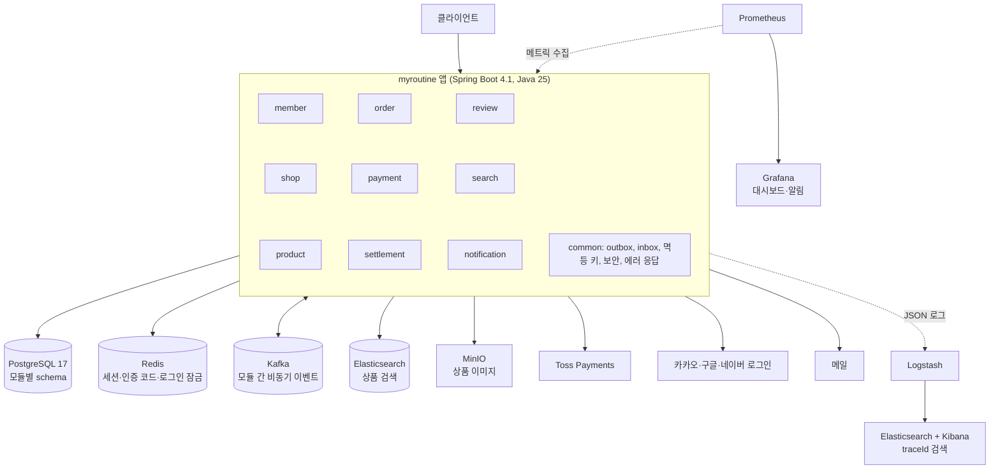
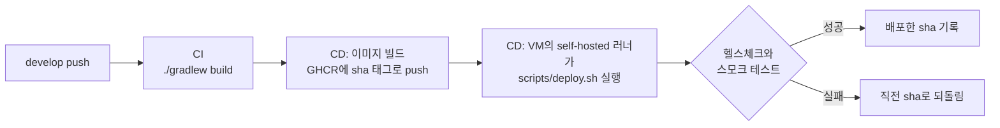

# MyRoutine v2

판매자가 가게를 열어 상품을 팔고, 구매자는 여러 가게의 상품을 **Toss 카드 결제**로 한 번에 구매하는 오픈마켓의 백엔드다.

팀 프로젝트(MSA 8개 서비스)의 [결함 54건을 분석](docs/00-as-is/README.md)해 **모듈러 모놀리스로 처음부터 재설계**한 개인 프로젝트다. 진화 경로는 Stage 1 모듈러 모놀리스 → Stage 2 측정 기반 성능 개선 → Stage 3 MSA 전환이고, 지금은 **Stage 1을 마쳤다**. 정기 구독, 취향 추천, 월간 리뷰 요약, k3s 전환은 Stage 1에 넣지 않고 [서브](docs/04-sub/README.md)로 뒀다.

**스택**: Java 25 · Spring Boot 4.1 · Spring Data JPA · Spring Security(JWT, OAuth) · Spring Modulith · PostgreSQL 17 · Flyway · Redis · Kafka · Elasticsearch · MinIO · Toss Payments · ELK · Prometheus · Grafana · Testcontainers · GitHub Actions

## 아키텍처

앱 하나 안에 도메인 모듈 9개와 공통 모듈을 둔다. 모듈 사이의 동기 호출은 `api` 패키지만 거치고, 스키마를 넘는 조인은 하지 않으며, 후속 처리는 Outbox와 Kafka로 전달한다. 위반은 [`ModularityTest`](src/test/java/com/myroutine/ModularityTest.java)가 잡는다.



## 실행 방법

**필요한 것**: Docker, JDK 25 (Gradle toolchain이 찾는다)

```bash
git clone https://github.com/95twan/myroutine-v2.git
cd myroutine-v2
```

**1. 환경변수**: `.env.local`을 로컬 전용 값으로 만든다. 이 파일은 커밋되지 않는다.

```bash
sed -E \
  -e 's/^SPRING_DATASOURCE_(USERNAME|PASSWORD)=.*/SPRING_DATASOURCE_\1=myroutine/' \
  -e 's/^MINIO_ROOT_USER=.*/MINIO_ROOT_USER=myroutine/' \
  -e 's/^MINIO_ROOT_PASSWORD=.*/MINIO_ROOT_PASSWORD=myroutine-local/' \
  -e 's/^(TOSS_(SECRET|CLIENT)_KEY|(KAKAO|GOOGLE|NAVER)_CLIENT_(ID|SECRET))=.*/\1=dummy/' \
  -e "s|^JWT_SECRET=.*|JWT_SECRET=$(openssl rand -base64 32)|" \
  .env.example > .env.local
```

`dummy` 값으로도 앱은 뜨지만 결제와 소셜 로그인은 실패한다. 결제까지 보려면 `TOSS_SECRET_KEY`·`TOSS_CLIENT_KEY`를 Toss 개발자센터의 테스트 키로 바꾼다.

**2. 인프라**: Postgres, MinIO, Kafka, Redis, Elasticsearch를 띄운다. 처음에는 이미지 내려받기와 Elasticsearch 이미지 빌드로 시간이 걸린다.

```bash
docker compose --env-file .env.local -f docker/docker-compose.yml up -d
```

**3. 앱**: 시작할 때 Flyway가 마이그레이션을 적용한다. 다른 터미널에서 헬스체크를 본다(관리 포트 8081).

```bash
./gradlew bootRun --args='--spring.profiles.active=local'
```

```bash
curl -s localhost:8081/actuator/health      # {"groups":["liveness","readiness"],"status":"UP"}
```

**4. 관측 스택**: Logstash, Kibana, Prometheus, Grafana를 더 띄운다.

```bash
docker compose --env-file .env.local -f docker/docker-compose.yml --profile observability up -d
```

| 화면 | 주소 | 볼 것 |
|---|---|---|
| Grafana | http://localhost:3000 (admin / admin) | 대시보드 3개(서비스 개요, 결제·정합성, Kafka·Outbox), 알림 규칙 |
| Prometheus | http://localhost:9090 | 앱 수집 대상 상태 |
| Kibana | http://localhost:5601 | traceId로 로그 검색 |

로그를 Kibana로 보내려면 앱을 `--spring.profiles.active=local,elk`로 띄우고, 저장 검색을 한 번 가져온다.

```bash
curl -s -XPOST "localhost:5601/api/saved_objects/_import?overwrite=true" \
  -H 'kbn-xsrf: true' -F file=@docker/kibana/saved-objects.ndjson
```

**테스트**: Docker가 켜져 있으면 Testcontainers가 필요한 인프라를 띄운다.

```bash
./gradlew test
```

**끌 때**: `down`만 하면 데이터가 남고, `-v`를 붙이면 지워진다.

```bash
docker compose --env-file .env.local -f docker/docker-compose.yml --profile observability down
```

API 목록은 [API 명세](docs/02-design/07-api-spec.md)에 있다.

## 운영 환경과 배포 흐름

집의 Proxmox 미니 PC에 Ubuntu VM 1대(RAM 16GB, vCPU 8)를 두고 Docker Compose로 앱, 인프라, 관측 스택을 함께 올린다. `develop`에 합치면 VM에 자동 배포된다.



- **릴리스와 배포는 별개다.** 배포는 `develop` push마다, 릴리스 태그는 `main`에 합칠 때다. 문서만 바뀐 push는 CI와 배포를 건너뛴다.
- **public 리포의 self-hosted 러너**: 포크 PR 코드가 VM에서 돌지 않도록 배포 job은 `push`로 시작한 CI가 성공했을 때와 수동 실행 때만 돈다. 시크릿은 리포에 두지 않고 VM의 파일(`/opt/myroutine/.env`)에 둔다.
- **롤백**은 이미지만 되돌린다. 그래서 파괴적 마이그레이션은 두 번 이상의 배포로 나눈다.
- **한계**: 단일 VM이라 배포 중 수 초의 단절이 있고 노드 장애에 무방비다. 무중단 배포는 [k3s 전환](docs/adr/ADR-012-kubernetes-zero-downtime.md)의 목표다.

결정의 이유는 [ADR-011](docs/adr/ADR-011-ops-practice-environment.md), VM 준비 절차는 [vm-setup](docs/ops/vm-setup.md), 알림이 울렸을 때의 대응은 [런북](docs/runbook.md)에 있다.

## 핵심 설계 요약

### 정합성

| 문제 | 설계 | 근거 |
|---|---|---|
| PG 응답이 끊겨 승인 여부를 모른다 | 결제를 `UNKNOWN`으로 두고 대사 잡이 PG 조회로 확정한다. 승인됐는데 주문 반영이 불가능하면 PG 승인을 취소한다 | [ADR-004](docs/adr/ADR-004-checkout-payment-consistency.md) |
| 같은 결제 요청이 두 번 온다 | API `Idempotency-Key`, `payment` unique 제약, PG 호출 `Idempotency-Key`로 세 번 막는다 | [ADR-004](docs/adr/ADR-004-checkout-payment-consistency.md) |
| DB 커밋과 이벤트 발행 사이에 이벤트가 사라진다 | 같은 트랜잭션에 Outbox로 저장하고 릴레이가 Kafka로 보낸다. 최소 1회 전달이라 consumer는 Inbox로 중복을 거르고, 계속 실패하면 DLT로 옮긴다 | [ADR-003](docs/adr/ADR-003-outbox-kafka.md) |
| 금액과 재고 규칙이 코드 실수로 깨진다 | 금액은 BIGINT와 `Money`로 다루고, 재고 등식과 누적 취소액 상한은 DB CHECK 제약이 마지막으로 막는다 | [ADR-007](docs/adr/ADR-007-data-layout.md) |
| 정산이 누락되거나 중복된다 | 구매확정 이벤트로 정산 대상을 적재하고, 배치가 품목을 정산에 할당해 품목당 1회만 정산한다 | [ADR-009](docs/adr/ADR-009-settlement.md) |

### 동시성

| 경합 | 설계 | 근거 |
|---|---|---|
| 인기 상품에 주문이 몰려 초과 판매된다 | 재고를 조건부 UPDATE로 차감하고 예약과 이동 이력을 남긴다. 상품 ID 순서로 차감해 데드락을 피한다 | [ADR-008](docs/adr/ADR-008-inventory-reservation.md) |
| 같은 주문의 취소, 반품, 발송이 겹친다 | 주문 행 잠금으로 직렬화하고, 엔티티 `@Version`으로 잠금 없는 경로의 충돌을 막는다 | [상태머신](docs/02-design/04-state-machines.md) |
| 앱이 여러 개일 때 잡과 릴레이가 중복 실행된다 | 스케줄 잡은 Postgres 세션 advisory lock, Outbox 릴레이는 `FOR UPDATE SKIP LOCKED`와 리스를 쓴다 | [Stage 1 구조](docs/02-design/02-architecture-stage1.md) |
| 유출된 refresh 토큰이 재사용된다 | 갱신마다 토큰을 회전하고, 이미 쓴 토큰이 다시 오면 세션을 폐기한다 | [ADR-006](docs/adr/ADR-006-auth.md) |

고치지 않고 안고 간 한계는 [상태 조합 문서 8절](docs/02-design/10-state-combinations.md)에 있다.

## 테스트로 증명한 것

통합 테스트는 Testcontainers의 실제 Postgres, Kafka, Redis, MinIO, Elasticsearch와 가짜 PG 서버로 돈다. E2E 시나리오는 끝날 때마다 [`InvariantChecker`](src/test/java/com/myroutine/support/InvariantChecker.java)로 금액 합계, 결제 반영, 재고 등식, 환불 상한, 정산 1회를 함께 점검한다.

| 증명한 것 | 테스트 |
|---|---|
| 재고 100개에 주문 1,000건이 동시에 몰려도 정확히 100건만 성공한다 | [`StockReservationConcurrencyTest`](src/test/java/com/myroutine/product/application/StockReservationConcurrencyTest.java) |
| 상품 순서가 반대인 두 주문이 동시에 예약해도 데드락 없이 둘 다 성공한다 | [`ReservationDeadlockTest`](src/test/java/com/myroutine/product/application/ReservationDeadlockTest.java) |
| 재고가 입고 이력이나 예약과 어긋나면 점검 잡이 불일치로 보고한다 | [`StockCheckJobTest`](src/test/java/com/myroutine/product/infrastructure/StockCheckJobTest.java) |
| 가게 2곳의 상품을 체크아웃부터 구매확정까지 진행하면 가게별로 정산·지급되고 알림이 모두 발송된다 | [`CheckoutPaymentE2ETest`](src/test/java/com/myroutine/e2e/CheckoutPaymentE2ETest.java) |
| 같은 `Idempotency-Key`로 동시에 10번 체크아웃해도 주문은 1건이다 | [`CheckoutIdempotencyConcurrencyTest`](src/test/java/com/myroutine/order/application/CheckoutIdempotencyConcurrencyTest.java) |
| 승인 응답이 늦어도 대사가 PG 기록으로 주문을 `PAID` 또는 `PAYMENT_FAILED`로 닫는다 | [`UncertainPaymentE2ETest`](src/test/java/com/myroutine/e2e/UncertainPaymentE2ETest.java) |
| PG 승인 뒤 주문 완료가 불가능하면 승인을 취소하고 재고 예약을 되돌린다 | [`OrderReconcileServiceTest`](src/test/java/com/myroutine/order/application/OrderReconcileServiceTest.java) |
| 체크아웃 후 결제하지 않은 주문은 만료되고 재고가 돌아온다 | [`AbandonedPaymentE2ETest`](src/test/java/com/myroutine/e2e/AbandonedPaymentE2ETest.java) |
| 같은 품목을 동시에 두 번 취소해도 환불은 1건이고, 취소와 발송이 겹쳐도 발송된 품목의 환불이 남지 않는다 | [`CancelLineConcurrencyTest`](src/test/java/com/myroutine/order/application/CancelLineConcurrencyTest.java) |
| 같은 반품을 승인과 거절로 동시에 처리하면 한쪽만 성공한다 | [`ReturnConcurrencyTest`](src/test/java/com/myroutine/order/application/ReturnConcurrencyTest.java) |
| 품목을 일부 취소해도 누적 취소액이 맞고 남은 품목은 정산까지 진행된다 | [`LineCancelE2ETest`](src/test/java/com/myroutine/e2e/LineCancelE2ETest.java) |
| 정산 잡을 두 번 돌려도 정산과 지급은 가게마다 1회다 | [`SettlementE2ETest`](src/test/java/com/myroutine/e2e/SettlementE2ETest.java) |
| Kafka가 멈춘 동안의 이벤트는 Outbox에 남고, 재개 후 모든 consumer가 처리한다 | [`KafkaOutageE2ETest`](src/test/java/com/myroutine/e2e/KafkaOutageE2ETest.java) |
| 같은 이벤트가 동시에 두 건 들어와도 consumer는 한 번만 처리한다 | [`InboxGuardTest`](src/test/java/com/myroutine/common/inbox/InboxGuardTest.java) |
| 일시적 오류는 재시도한 뒤 DLT로 옮기고, 깨진 JSON은 재시도 없이 옮긴다 | [`KafkaDltTest`](src/test/java/com/myroutine/common/config/KafkaDltTest.java) |
| 같은 refresh 토큰으로 동시에 두 번 갱신하면 하나만 성공하고 세션이 폐기된다 | [`RefreshConcurrencyTest`](src/test/java/com/myroutine/member/application/RefreshConcurrencyTest.java) |
| 틀린 비밀번호를 동시에 보내도 비밀번호 확인은 5번까지만 한다 | [`LoginLockConcurrencyTest`](src/test/java/com/myroutine/member/web/LoginLockConcurrencyTest.java) |
| 일반 회원과 비로그인 요청은 운영 API를 호출할 수 없다 | [`AdminAuthorizationTest`](src/test/java/com/myroutine/common/web/AdminAuthorizationTest.java) |
| 같은 잡을 동시에 실행하면 하나만 작업한다 | [`JobLockTest`](src/test/java/com/myroutine/common/job/JobLockTest.java) |
| 비밀번호, 인증 코드, 토큰, `paymentKey`가 로그에 남지 않는다 | [`LogSafetyTest`](src/test/java/com/myroutine/common/LogSafetyTest.java) |
| 불변식 점검기가 위반 데이터를 실제로 잡아낸다 | [`InvariantCheckerTest`](src/test/java/com/myroutine/e2e/InvariantCheckerTest.java) |
| 모듈 간 의존 규칙을 어기지 않는다 | [`ModularityTest`](src/test/java/com/myroutine/ModularityTest.java) |

## 문서 안내

| 문서 | 내용 |
|---|---|
| [00-as-is](docs/00-as-is/README.md) | 원 팀 프로젝트 분석과 결함 54건 (재설계의 근거) |
| [01-requirements](docs/01-requirements/README.md) | 요구사항, 정책, 정합성 불변식 |
| [02-design](docs/02-design/README.md) | 아키텍처 진화, 모듈 구조, ERD, 상태머신, 이벤트, 시퀀스, API |
| [adr](docs/adr/) | 설계 결정 기록 ADR-001~014 |
| [development-guide](docs/development-guide.md) | 코딩 규칙과 리뷰 기준 |
| [git-policy](docs/git-policy.md) | 브랜치, 커밋, PR, 릴리스 규칙 |
| [03-roadmap](docs/03-roadmap/README.md) | 단계별 구현 로드맵과 완료 확인 |
| [04-sub](docs/04-sub/README.md) | 서브: 구독, 취향 추천, 월간 리뷰 요약, 무중단 재색인, 로그 보강, k3s 전환 |
| [ops](docs/ops/vm-setup.md) | 운영 VM 준비와 자동 배포 절차, [MinIO를 NAS로 옮기는 절차](docs/ops/nas-minio.md) |
| [runbook](docs/runbook.md) | 알림별 대응과 운영 API 호출 |
| [retrospectives](docs/retrospectives/stage1.md) | Stage 1 회고 |
