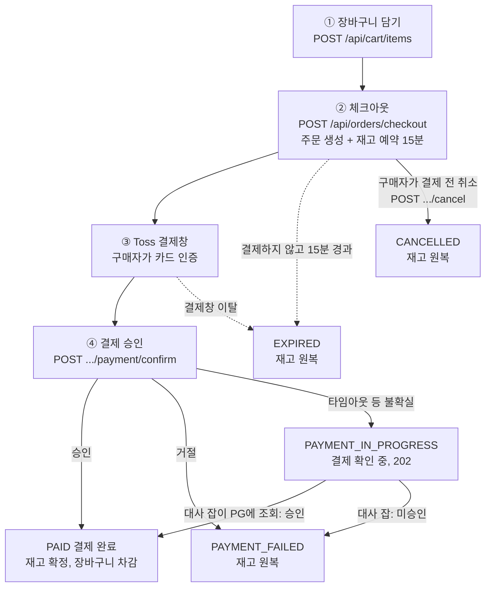
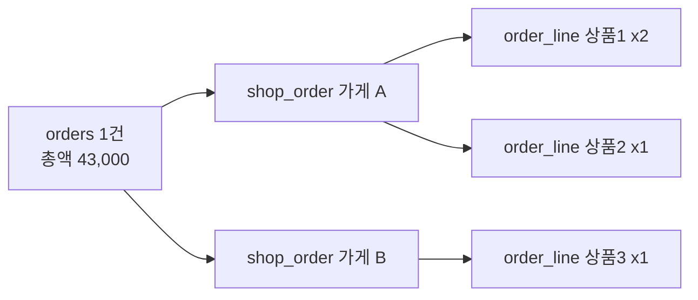
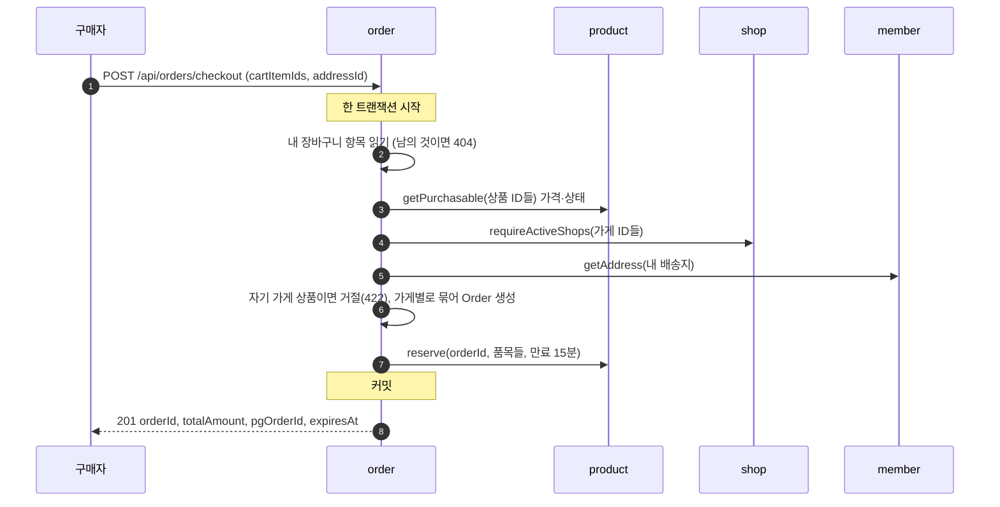
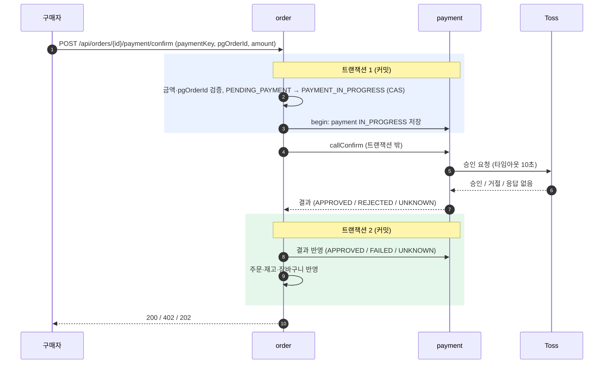
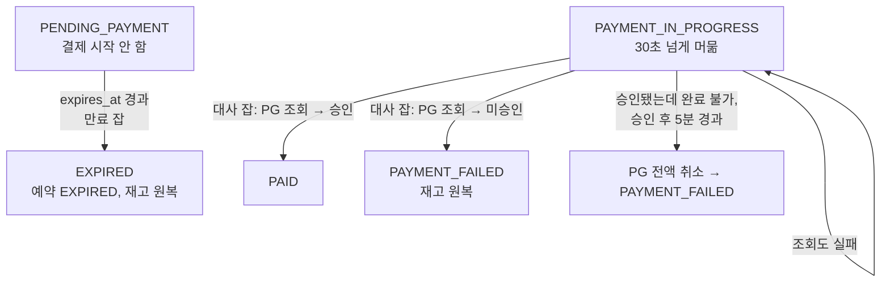

# 09. 주문 프로세스 — 장바구니 담기부터 결제까지 한눈에 보기

> 버전 0.3 · 2026-10-12 · 로드맵 용어 정리에 맞춰 "제안" 참조를 "추가 항목"·"채택하지 않은 선택지"로 바꿨다
> 0.2 · 2026-10-12 · 중복 체크아웃을 막지 않는 것으로 확정: 중복 주문이 생길 수 있음과 정리 경로를 §8에 명시
> 0.1 · 2026-10-12 · 사유: 2-1(장바구니)이 끝나고 2-2(체크아웃) 착수 시점에, 흩어진 로드맵 2-1~2-6을 "구매자가 한 번 주문할 때 무슨 일이 일어나는가" 순서로 한 번에 읽을 수 있게 정리

이 문서는 **새 결정을 내리지 않는다.** [로드맵 Part 2](../03-roadmap/part2-order-money.md)의 2-1~2-6, [06-sequences](06-sequences.md), [04-state-machines](04-state-machines.md), [07-api-spec](07-api-spec.md)에 있는 결정을 시간 순서로 다시 엮은 것이다. 어긋나면 위 문서가 기준이다. 결제 이후(발송·취소·환불·구매확정)는 범위 밖이다.

> 구현 상태(2026-10-12): 2-1 장바구니는 구현·병합됐다. 2-2 체크아웃은 착수했고(테스트 골격만), 2-3~2-6은 문서 기준이다.

## 0. 한눈에 보기

| 단계 | 구매자가 하는 일 | 서버가 하는 일 | 바뀌는 것 |
|---|---|---|---|
| ① 담기 | 상품·수량 선택 | 상품이 있는지만 확인, 같은 상품은 수량 합산 | `cart_item` |
| ② 체크아웃 | 항목·배송지 선택 | **가격 확정, 주문 생성(가게별 분리), 재고 예약** — 한 트랜잭션 | `orders`, `shop_order`, `order_line`, `stock`, `stock_reservation` |
| ③ 결제창 | Toss 결제창에서 인증 | (관여하지 않음) | - |
| ④ 승인 | (결제창이 돌려준 값을 서버로 전달) | **PG 승인 호출**, 결과에 따라 확정 또는 원복 | `payment`, `orders`, 재고, 장바구니 |
| 정리 | - | 만료 잡·대사 잡이 끝나지 않은 주문을 마무리 | 위와 같음 |

핵심 규칙 세 가지만 기억하면 나머지는 따라온다.

1. **가격은 서버가 정한다.** 요청에 가격을 받지 않는다(POL-17).
2. **재고는 결제 전에 "예약"으로 잡고, 결제가 끝나면 "확정", 실패·만료면 "원복"한다.**
3. **외부(Toss) 호출은 DB 트랜잭션 밖에서 한다.** 그래서 결과가 불확실한 경우가 생기고, 그것을 대사 잡이 정리한다.

## 1. 데이터가 어디에 있나

| 모듈 | 테이블 | 담는 것 |
|---|---|---|
| order | `cart`, `cart_item` | 구매자별 장바구니. 가격은 저장하지 않는다(조회 때 현재가) |
| order | `orders` | 주문 1건. 상태, 총액, 배송지 스냅샷, 만료 시각 |
| order | `shop_order` | 주문을 **가게별로 나눈 것**. 판매자가 처리하는 단위 |
| order | `order_line` | 품목. 상품명·단가·수량 **스냅샷** |
| product | `stock`, `stock_reservation` | 재고 수량(가용/예약중/판매확정)과 주문별 예약 기록 |
| payment | `payment` | PG 결제 1건. 주문당 하나(unique) |

주문 하나가 어떻게 쪼개지는지:

결제는 **주문 전체에 대해 한 번**이고, 배송·취소는 가게주문·품목 단위로 따로 움직인다.

## 2. ① 장바구니 담기·조회 (2-1)

| 동작 | API | 규칙 |
|---|---|---|
| 담기 | `POST /api/cart/items` | 수량 1~99. 같은 상품을 또 담으면 **한 행에 합산**(99 초과는 99). 담을 때는 상품이 존재하는지만 본다 |
| 수량 변경·삭제 | `PATCH`·`DELETE /api/cart/items/{id}` | 내 항목이 아니면 404 `CART_ITEM_NOT_FOUND` |
| 조회 | `GET /api/cart` | 항목마다 **현재** 가격·판매 상태·재고 여부를 붙여 준다 |

- 장바구니에 가격을 저장하지 않는다. 담은 뒤 가격이 바뀌면 조회에 바뀐 가격이 보인다.
- 판매 중이 아니거나 재고가 없는 상품도 담겨 있다. 조회 때 `purchasable=false`와 사유(`NOT_FOUND`·`NOT_ON_SALE`·`OUT_OF_STOCK`)로 표시하고, `totalAmount`에서 뺀다.
- 같은 상품을 동시에 담아도 행은 하나다(`INSERT ... ON CONFLICT DO UPDATE` 한 문장).

## 3. ② 체크아웃: 주문서 만들기 (2-2)

구매자가 장바구니 항목 일부와 배송지를 고르면 주문서가 만들어진다. 요청에는 가격이 없고 `Idempotency-Key` 헤더가 있다.

| 확인 | 걸리면 |
|---|---|
| 항목이 내 장바구니의 것이 아님 | 404 `CART_ITEM_NOT_FOUND` |
| 50개 초과 | 400 `INVALID_REQUEST` |
| 판매 중이 아닌 상품 | 422 `PRODUCT_NOT_ON_SALE` |
| 운영 중이 아닌 가게 | 422 `SHOP_NOT_ACTIVE` |
| 자기 가게 상품 | 422 `OWN_SHOP_PRODUCT` |
| 남의 배송지 | 404 `MEMBER_ADDRESS_NOT_FOUND` |
| 재고 부족 | 422 `OUT_OF_STOCK` |

**끝난 뒤 상태**

| 대상 | 상태 |
|---|---|
| `orders` | `PENDING_PAYMENT`, `expires_at = 지금 + 15분`, `total_amount = Σ(단가 × 수량)` |
| `shop_order`·`order_line` | 모두 `PENDING` (가게별로 나뉨, 단가·상품명은 스냅샷) |
| `stock` | `available` 감소, `reserved` 증가 |
| `stock_reservation` | `HELD`, 같은 `expires_at` |
| 장바구니 | **그대로** (건드리지 않는다) |
| 응답의 `pgOrderId` | `"ORD-" + orderId` — Toss에 넘길 주문번호 |

**한 트랜잭션이라서 얻는 것:** 위 순서 중 재고 예약에서 하나라도 실패하면 만들어진 주문까지 전부 롤백된다. "주문은 생겼는데 재고는 안 잡힌" 상태가 남지 않는다. 모놀리스이기 때문에 가능하고, MSA(Stage 3)에서는 Saga가 된다(ADR-002).

**멱등:** 같은 `Idempotency-Key`로 다시 보내면 새 주문을 만들지 않고 처음 응답을 그대로 돌려준다. 같은 키로 다른 내용을 보내면 422, 처리 중이면 409다. 2xx 응답만 저장하고, 실패한 요청의 키는 지워 같은 키로 다시 시도할 수 있다.

## 4. ③·④ 결제: 결제창과 승인 (2-3·2-4)

결제창은 Toss가 띄우고, 구매자가 카드 인증을 마치면 클라이언트가 `paymentKey`를 받아 **우리 서버의 confirm API**로 보낸다. **PG 승인은 이 요청으로만 일어난다.**

**왜 트랜잭션을 둘로 나누나**

| 만약 한 트랜잭션이면 | 나누면 |
|---|---|
| Toss 응답을 기다리는 동안 DB 커넥션·락을 쥔다. Toss가 느리면 서버 전체가 멈춘다 | 외부 호출 동안 DB를 쥐지 않는다 |
| 호출 중 앱이 죽으면 "결제됐는지" 기록이 없다 | 트랜잭션 1에서 `payment(IN_PROGRESS)`를 **먼저 커밋**해 두므로, 앱이 죽어도 "확인해야 할 결제"가 남는다 |

**트랜잭션 1에서 걸러지는 것**

| 상황 | 응답 |
|---|---|
| 금액·`pgOrderId`가 주문과 다름 | 422 `AMOUNT_MISMATCH` (PG 호출 없음) |
| 이미 만료됨 (`expires_at` 경과) | 409 `ORDER_EXPIRED` (PG 호출 없음) |
| 이미 결제됨 | 409 `ORDER_ALREADY_PAID` |
| 다른 요청이 이미 승인 중 | 202 `PAYMENT_IN_PROGRESS` |

승인 시작 CAS가 `WHERE status = 'PENDING_PAYMENT' AND expires_at > now`라서 **"만료된 주문에 승인된 결제"가 생기지 않는다.** 이 조건이 만료와 승인의 경쟁을 상태 한 줄로 가린다.

## 5. 승인 결과 세 갈래

| | 승인 | 거절 | 불확실 (타임아웃·5xx) |
|---|---|---|---|
| 응답 | 200 `PAID` | 402 `PAYMENT_FAILED` | 202 `PAYMENT_IN_PROGRESS` |
| `orders` | `PAID`, `paid_at` | `PAYMENT_FAILED`, 사유 저장 | `PAYMENT_IN_PROGRESS` 그대로 |
| `shop_order`·`order_line` | `PAID` | `CANCELLED` | `PENDING` 그대로 |
| `payment` | `APPROVED` | `FAILED`, 거절 코드 | `UNKNOWN` |
| 재고 | `reserved → sold` (확정) | `reserved → available` (원복) | 아직 `reserved` |
| 예약 | `COMMITTED` | `RELEASED` | `HELD` 그대로 |
| 장바구니 | **주문한 수량만큼 차감** (다 사면 삭제) | 그대로 | 그대로 |
| 다음 | 끝 | 구매자가 다시 주문 | 대사 잡이 확정 (6절) |

**장바구니 차감 규칙:** 장바구니는 체크아웃 때 건드리지 않고, 결제가 **확정될 때만** 비운다. 결제 중에 구매자가 수량을 늘렸다면 주문한 수량만 빠지고 나머지는 남는다.

| 결제 중 구매자가 | 결과 (주문 2개 기준) |
|---|---|
| 아무것도 안 함 | 비워짐 |
| 같은 상품을 3개 더 담음 (2→5) | 3개 남음 |
| 수량을 1개로 줄임 | 항목 삭제 |
| 항목을 직접 삭제 | 아무 일 없음 |

## 6. 끝나지 않은 주문은 누가 정리하나

구매자가 결제창을 닫거나, 승인 도중 응답이 끊기면 주문이 중간 상태로 남는다. 두 개의 잡이 1분마다 정리한다. 둘 다 여러 서버 중 한 곳에서만 돌고(advisory lock), 처리는 주문 한 건마다 별도 트랜잭션이다.

| 잡 | 대상 | 하는 일 |
|---|---|---|
| 만료 잡 (2-5) | `PENDING_PAYMENT`이고 `expires_at`이 지난 주문 | CAS로 `EXPIRED` 전이 → 예약 해제(재고 원복) → 가게주문·품목 `CANCELLED`. **`PAYMENT_IN_PROGRESS`는 만료시키지 않는다** (이미 PG가 처리 중일 수 있어서) |
| 대사 잡 (2-6) | `PAYMENT_IN_PROGRESS`로 30초 넘게 머문 주문 | Toss에 **조회**해서 승인이면 `PAID`, 미승인이면 `PAYMENT_FAILED`. 조회도 실패하면 다음 주기에 다시 |
| 보상 취소 (2-6) | 승인은 됐는데 주문을 완료하지 못하고 5분이 지난 주문 | PG 승인을 전액 취소하고 `PAYMENT_FAILED`. 취소는 같은 멱등키로 재시도해도 두 번 취소되지 않는다 |

"타임아웃이면 곧바로 취소하면 되지 않나?"는 안 된다. 타임아웃은 "실패"가 아니라 "모름"이라서, 이미 승인됐는데 취소하거나 승인 안 된 것을 놓칠 수 있다. 그래서 **먼저 조회해서 사실을 확인**하고 확정한다.

## 7. 숫자로 따라가기

상품 A(15,000원) 2개 + 상품 B(13,000원) 1개 = 43,000원, A 재고 10개, 구매자가 장바구니에 둘 다 담은 상태에서 시작한다. (A 재고만 표시)

| 시점 | `orders` | A 재고 `available / reserved / sold` | 예약 | `payment` | 장바구니 |
|---|---|---|---|---|---|
| 담기 직후 | - | 10 / 0 / 0 | - | - | A×2, B×1 |
| 체크아웃 후 | `PENDING_PAYMENT` | 8 / 2 / 0 | `HELD` | - | A×2, B×1 (그대로) |
| 승인 요청 시작 | `PAYMENT_IN_PROGRESS` | 8 / 2 / 0 | `HELD` | `IN_PROGRESS` | 그대로 |
| **승인됨** | `PAID` | 8 / 0 / 2 | `COMMITTED` | `APPROVED` | 비어 있음 |
| (거절됐다면) | `PAYMENT_FAILED` | 10 / 0 / 0 | `RELEASED` | `FAILED` | A×2, B×1 |
| (결제창 이탈, 15분) | `EXPIRED` | 10 / 0 / 0 | `EXPIRED` | - | A×2, B×1 |

재고 세 칸의 합(`available + reserved + sold`)은 어느 시점에도 입고 누계(10)와 같다. 재고 설계의 이유는 [08-stock-design-evolution](08-stock-design-evolution.md)에 있다.

## 8. 이런 상황이면?

| 상황 | 결과 | 막는 장치 |
|---|---|---|
| 체크아웃 버튼을 두 번 눌렀다 (같은 키) | 주문 1건, 같은 응답 | `Idempotency-Key`와 저장된 응답 |
| 결제창을 닫고 그냥 나갔다 | 15분 뒤 `EXPIRED`, 재고 원복, 장바구니는 그대로 | 만료 잡 |
| 결제창을 닫고 주문을 취소했다 (또는 마음이 바뀌었다) | 바로 `CANCELLED`, 재고 원복, 장바구니는 그대로 | 주문 취소 API(`POST /api/orders/{id}/cancel`). 승인이 이미 시작됐다면 409 |
| 클라이언트가 금액을 바꿔 보냈다 | 422 `AMOUNT_MISMATCH`, PG 호출 없음 | 서버가 가진 `total_amount`와 비교 |
| 한 회원이 체크아웃을 계속 반복한다 | 주문마다 재고를 15분씩 잡는다. 회원당 상한이 없어 인기 상품을 계속 붙잡을 수 있다 | 막지 않기로 한 한계. Part 4 이메일 인증, Part 7 모니터링, 로드맵 2-2 "추가 항목"(상한·속도 제한) |
| 두 명이 마지막 재고를 동시에 주문 | 한 명만 성공, 한 명은 422 `OUT_OF_STOCK` | 조건부 UPDATE |
| 같은 장바구니 항목으로 다른 키로 체크아웃을 두 번 했다 (결제창을 닫고 다시 주문하거나 탭 두 개) | 주문 2건이 만들어지고 각각 재고를 예약한다. 하나만 결제하면 나머지는 15분 뒤 만료된다. **둘 다 결제하면 별개의 주문 2건**이 된다. 의도하지 않았다면 결제 전에는 한쪽을 주문 취소로 바로 풀고, 결제됐다면 발송 전에 품목 취소해 환불받는다 | 막지 않기로 한 선택. **같은 주문의 이중 결제**는 막힌다(승인 시작 CAS, `payment.order_id` unique). 방어 선택지는 로드맵 2-2 "채택하지 않은 선택지" |

## 9. 불변식은 어디서 지켜지나

| 불변식 | 지키는 곳 |
|---|---|
| INV-01 금액: 결제액 = Σ(서버 가격 × 수량) = PG 승인 금액 | 서버가 가격 확정, `line_amount = unit_price × quantity` CHECK, 승인 때 `amount == total_amount` 검증 |
| INV-02 승인 1건은 주문에 1회만 반영, 반영 못 한 승인은 취소 | 주문 CAS, `payment.order_id` unique, `UNKNOWN` + 대사, 보상 취소 |
| INV-03 재고는 음수 불가, 합 불변 | 조건부 UPDATE, 수량 CHECK, 예약·확정·해제 CAS |

## 10. 구현 상태와 위치

| 단계 | 내용 | 상태 | 로드맵 |
|---|---|---|---|
| 2-1 | 장바구니 | 구현·병합 | [2-1](../03-roadmap/part2-order-money.md) |
| 2-2 | 체크아웃, 멱등 API, 주문 조회 | 착수 (테스트 골격) | 2-2 |
| 2-3 | Toss 클라이언트, 가짜 PG 서버 | 예정 | 2-3 |
| 2-4 | 결제 승인, 장바구니 차감 | 예정 | 2-4 |
| 2-5 | 주문 만료 잡 | 예정 | 2-5 |
| 2-6 | 결제 대사, PG 취소(보상) | 예정 | 2-6 |

상세 규격·API·에러 코드는 위 로드맵 단계와 [07-api-spec](07-api-spec.md), 상태 전이표는 [04-state-machines](04-state-machines.md), 시퀀스 원본은 [06-sequences](06-sequences.md)에 있다. 결정의 배경은 [ADR-004](../adr/ADR-004-checkout-payment-consistency.md), [ADR-008](../adr/ADR-008-inventory-reservation.md).

## 11. 스스로 답해 볼 것

1. 체크아웃 때 장바구니를 지우지 않고 결제 완료 때 차감하는 이유는? 반대로 지우면 무엇이 불편한가?
2. 승인 요청 전에 `payment`를 먼저 커밋하는 이유를, 앱이 승인 직후 죽는 상황으로 설명해 보라.
3. 만료 잡이 `PAYMENT_IN_PROGRESS`를 건드리지 않는 이유는?
4. 타임아웃이 났을 때 바로 PG에 취소를 보내지 않고 조회부터 하는 이유는?
5. 같은 장바구니로 주문이 둘 생겨 둘 다 결제되면 어떻게 되나? "같은 주문의 이중 결제"는 무엇이 막고, "서로 다른 두 주문"은 왜 막지 않기로 했나?
