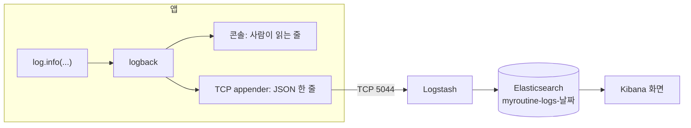
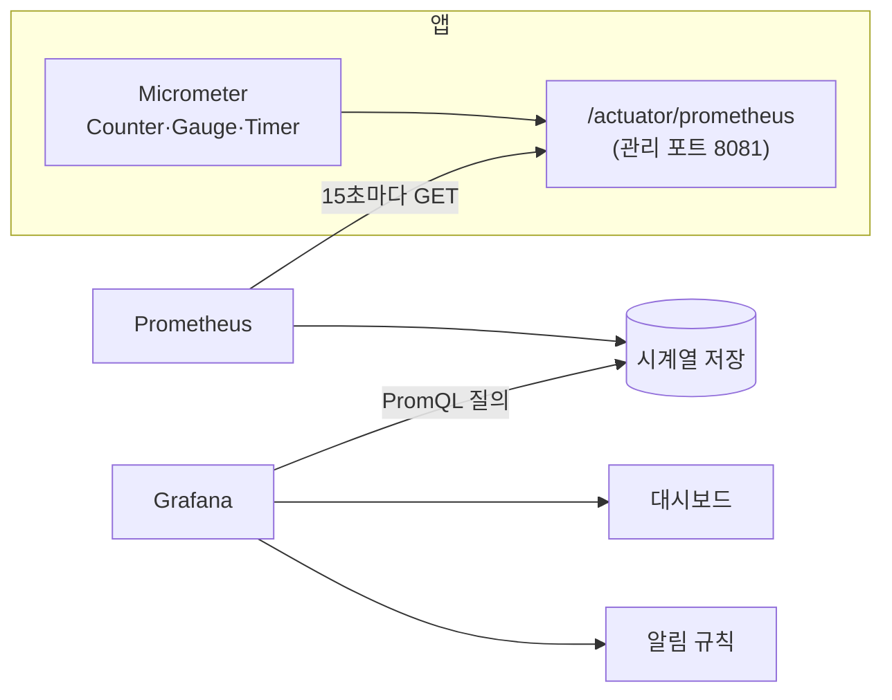

# Part 6. 관측 · 운영 · 마무리

> 버전 0.40 · 2026-11-05 · 6-3 즉시 대사는 주문이 30초 안에 바뀌었으면 PG를 조회하지 않고 현재 상태를 돌려준다(진행 중인 승인 요청을 실패로 확정하지 않게). 구매자 취소 환불을 종결해도 반품 요청은 막히지 않는다
> 0.39 · 2026-11-05 · 6-3 환불 종결 API `POST /admin/api/refunds/{id}/close`(`FAILED → REJECTED`)를 더하고, `FAILED` 환불을 활성 환불로 본다(발송 가드·`uk_refund_order_line_active`·구매자 재취소는 인덱스 위반 409)
> 0.38 · 2026-11-05 · 6-2에서 `mail_send_seconds` Timer를 뺐다(읽는 대시보드·알림이 없다). 운영 compose의 Grafana 비밀번호 키 `GRAFANA_ADMIN_PASSWORD`를 `.env.ops.example`에 더했다
> 0.37 · 2026-11-05 · `orderId` MDC는 서비스 본문 대신 `@LogOrderId` Aspect로 넣고 요청 2곳(`confirm`·`cancel`)에 적용한다. 운영 VM의 Kibana(5601)·Grafana(3000)는 SSH 터널 없이 LAN에서 바로 연다(Prometheus는 `127.0.0.1`)
> 0.36 · 2026-11-04 · 관측 스택(Logstash·Kibana·Prometheus·Grafana)을 운영 VM에도 올린다: 앱 프로필 `prod,elk`, 로그 인덱스는 ES ILM으로 7일 뒤 삭제한다
> 0.35 · 2026-11-04 · Part 6 앞에 6-0(문의 수정의 여러 줄 내용)을 더했다: 문의 수정의 `content`가 줄바꿈을 받는다
> 0.34 · 2026-11-04 · 6-3의 쓰기 API 응답과 목록 항목을 정하고 `GET /admin/api/dlt`, `GET /admin/api/settlements`를 더했다. 정산 수동 실행은 끝난 달만 받는다(이번 달로 실행하면 그달의 나머지 품목이 영구히 정산되지 않는다)
> 0.33 · 2026-11-04 · 6-1·6-2를 실제로 띄워 확인한 값으로 다시 썼다: 로그 인덱스 `myroutine-logs-*`, Logstash 포트 5044, INFO 필터와 로그 문장 추가, UNKNOWN 나이의 `created_at` 기준, DLT 알림의 `offset` 식. 6-3 목록 조회·`size`·실행 로그 `action`·`AdminDltService`를 확정했다
> 0.32 · 2026-10-31 · 구독·취향 추천·월간 리뷰 요약을 로드맵에서 빼서([서브](../04-sub/README.md)) Part 6에서 구독·OpenAI 의존을 걷어냈다: 6-1 `LogSafetyTest`의 빌링키 등록, 6-2 `openai_call_seconds`, 6-4 `subscriptionCycles()`(INV-08)·S5·S7의 구독 단계. 옮긴 내용은 서브 문서의 "Part 6에 더할 것"에 있다
> 0.31 · 2026-10-28 · 6-1 `LogSafetyTest`의 가입을 4-2의 가입 전 인증(발송 → 확인 → 인증 토큰으로 가입)으로 바꾸고 인증 토큰도 로그에 없어야 할 값에 더했다
> 0.30 · 2026-10-27
> 0.26 · 2026-10-23 · 6-3 구현물 2번 `reconcileOne`: 이미 있는 `private boolean reconcileOne`을 `public OrderStatus`로 열고 반환을 바꾼다
> 0.22 · 2026-10-22 · 6-1 MDC 표를 3-2 결정에 맞췄다: `InboxGuard`가 `EventContext.run` 안에서 실행되므로 `traceId`를 빼는 곳을 `EventContext`로 했다
> 0.11 · 2026-10-16 · 6-3 `reconcileOne`을 2-6 변경에 맞춰, 확정된 결제는 `applyPaymentState`로 바로 처리하는 지금의 `reconcileBatch` 처리와 같게 했다
> 0.9 · 2026-10-15 · 6-3 `reconcile`의 `{id}`는 `orderId`, `reconcileOne`은 `OrderStatus`를 반환한다. 6-4 `InvariantChecker`에 INV-08을 더하고 INV-09는 최종적 일관성이라 제외했다
> 0.8 · 2026-10-15 · 6-3 환불 재시도의 PG 멱등 키: `retry`가 `FAILED → APPROVED`와 함께 `pgAttempts`를 올려 `refundId-r{n}` 키로 PG까지 가게 했다(2-8 `Refund.pgIdempotencyKey()`)
> 0.5 · 2026-10-09 · logstash-logback-encoder `9.0`(Jackson 3·Logback 1.5 기반)과 ELK·Prometheus·Grafana 이미지 태그를 확인해 고정했다. Spring Boot가 Kafka 클라이언트 지표를 자동 등록한다. 1-11 운영 VM에서는 Prometheus가 `app:8081`을 긁는다
> 0.4 · 2026-10-02 · 예치금 제거: 원장 점검을 재고 대조 점검으로 바꾸고, E2E 시나리오에서 예치금을 삭제했다

> **끝나면**: 로그(Kibana)와 메트릭(Grafana)으로 시스템을 보고, 정합성 문제가 생기면 알림이 오고, 운영 API로 처리할 수 있다. 전체 시나리오가 E2E 테스트로 증명되고, Stage 1이 `v1.0.0`으로 릴리스된다.
> **인프라 추가**: **ELK**(Logstash, Kibana — ES는 Part 5 것을 같이 씀), **Prometheus, Grafana**

| 단계 | 제목 | 크기 |
|---|---|---|
| 6-0 | 문의 수정의 여러 줄 내용 | S |
| 6-1 | ELK: 로그 수집과 traceId 검색 | M |
| 6-2 | Prometheus · Grafana: 메트릭 · 대시보드 · 알림 | L |
| 6-3 | 운영 API | M |
| 6-4 | E2E 시나리오 · 불변식 점검 | L |
| 6-5 | README · 회고 · Stage 1 릴리스 | M |

---

## Part 6 공통 규칙

- 관측 스택(Logstash, Kibana, Prometheus, Grafana)은 docker-compose **`observability` 프로필**로 띄운다: `docker compose --env-file .env.local -f docker/docker-compose.yml --profile observability up -d`. 프로필을 주지 않으면 기존 5개 서비스만 뜬다. 평소 개발에는 띄우지 않는다(메모리). 이미지는 Logstash·Kibana·Prometheus·Grafana를 합쳐 약 6.5GB다. 운영 VM의 `docker-compose.ops.yml`에는 프로필 없이 항상 띄운다(6-1 "운영 VM", 6-2 7)).
- 설정 파일은 모두 리포에 둔다: `docker/logstash/`, `docker/kibana/`, `docker/prometheus/`, `docker/grafana/provisioning/`. 화면에서 만든 대시보드·검색은 **파일로 내보내 커밋**한다.
- 6-3의 운영 API는 모두 `/admin/api/**`(ADMIN)이다. 실행 로그 형식은 6-3 "모든 API에 공통"에 적었다.

---

## 6-0. 문의 수정의 여러 줄 내용 (S)

**목표**: 여러 줄로 쓴 문의를 여러 줄 내용 그대로 고칠 수 있다.

**왜 지금**: 5-3 규격의 결함이다. 문의를 쓸 때는 `@NotBlank`라 여러 줄이 되는데, 고칠 때만 400 `INVALID_REQUEST`(`details.content`: "공백만 입력할 수 없습니다.")가 된다. 프론트 리포 `myroutine-web`의 `e2e/inquiries.spec.ts`가 이 문제를 `test.fail`로 잡고 기다린다. 한 줄 수정이라 6-1의 로그 변경과 섞이기 전에 끝낸다.

**원인**: `@Pattern`은 값 전체가 식과 맞아야 통과한다. 정규식의 `.`은 기본으로 줄바꿈과 맞지 않아서, `.*\S.*`는 줄바꿈이 하나라도 있으면 거절한다. `(?s)`는 `.`이 줄바꿈과도 맞게 하는 옵션이다. 두 식을 실행한 결과는 다음과 같다.

| 값 | `.*\S.*` | `(?s).*\S.*` |
|---|---|---|
| `한 줄` | 통과 | 통과 |
| `첫 줄\n둘째 줄` | 거절 | 통과 |
| `\n앞에 줄바꿈`, `끝 줄바꿈\n` | 거절 | 통과 |
| ` \n `, `\n`, `   `, 빈 문자열 | 거절 | 거절 |

**정책 (이 단계에서 정함)**
- `EditInquiryRequest`의 `content`만 바꾼다. `title`은 한 줄 입력이라 줄바꿈을 계속 거절한다.
- 같은 식을 쓰는 다른 요청(가게·배송지·프로필·상품 이름)도 모두 한 줄 필드라 그대로 둔다. 상품 설명(`description`)은 이 식을 쓰지 않는다.
- API 경로와 응답 모양은 그대로다.

### 할 일

**구현 순서**: 1) `EditInquiryRequest` → 테스트.

`member.web.EditInquiryRequest`의 `content`에서 `regexp`만 `"(?s).*\\S.*"`로 바꾼다. `message`와 `@Size(max = 2000)`은 그대로다. `@NotBlank`로 바꾸면 안 된다. `@NotBlank`는 `null`도 막아서, 제목만 고치는 요청(`content` 생략)이 400이 된다.

### 완료 확인

#### `member/web/InquiryTest`

기존 클래스에 더한다. 준비는 5-3의 준비 A이고, `user1`이 `Q1`을 작성한 상태에서 `PATCH /api/inquiries/{Q1}`를 보낸다. 본문은 `objectMapper.writeValueAsString(new EditInquiryRequest(제목, 내용))`으로 만들면 줄바꿈이 JSON의 `\n`으로 들어간다.

**1. 여러 줄 내용으로 수정한다** — 동작: 내용 `"첫 줄\n둘째 줄"`(제목 `null`).
- 응답(andExpect): 상태 200, `$.content` = `"첫 줄\n둘째 줄"`.
- DB(inquiryOf(Q1)): `content()` = `"첫 줄\n둘째 줄"`.

**2. 공백과 줄바꿈만 있는 내용은 거절한다** — 동작: 내용 `" \n "`(제목 `null`).
- 응답(andExpect): 상태 400, `$.code` = `INVALID_REQUEST`, `$.details.content` = `공백만 입력할 수 없습니다.`.
- DB(inquiryOf(Q1)): `content()` = 작성 때 본문.

**3. 제목의 줄바꿈은 계속 거절한다** — 동작: 제목 `"첫 줄\n둘째 줄"`(내용 `null`).
- 응답(andExpect): 상태 400, `$.code` = `INVALID_REQUEST`, `$.details.title` = `공백만 입력할 수 없습니다.`.
- DB(inquiryOf(Q1)): `title()` = 작성 때 제목.

**리뷰 때 물어볼 것**: `.*\S.*`는 왜 여러 줄을 거절하나? 여기서 `@NotBlank`를 쓰면 무엇이 깨지나?

---

## 6-1. ELK: 로그 수집과 traceId 검색 (M)

**목표**: 앱 로그를 Kibana에서 검색한다. traceId 하나로 결제 승인 → Kafka 전송 → 이벤트 처리가 시간순으로 보이고, 회원·주문으로도 찾는다.

**왜 지금**: 기능이 다 모였고 흐름이 길어져서(결제 → 이벤트 → 정산 → 알림) 콘솔로는 따라가기 어렵다. 콘솔 로그는 앱을 재시작하면 사라지고, 스레드가 섞여 찍힌다. Stage 2 성능 분석도 이것이 전제다.

**전체 그림**



앱은 로그를 콘솔에 찍는 동시에 JSON으로 Logstash에 보낸다. Logstash는 받은 것을 ES에 넣고, Kibana는 ES를 검색하는 화면이다. ES는 5-2에서 띄운 것을 같이 쓰고 인덱스로만 나눈다.

**새로 등장**

| 개념 | 한 줄 설명 |
|---|---|
| logback | Boot의 기본 로깅 구현체. `log.info`를 받아 설정된 appender들에게 넘긴다 |
| appender | 로그를 내보내는 곳 하나. 콘솔 appender는 이미 있고, TCP로 보내는 appender를 더한다 |
| encoder | 로그 한 건을 바이트로 바꾸는 규칙. `LogstashEncoder`는 JSON 한 줄로 바꾼다 |
| 구조화 로그 | 문장 대신 필드(`level`, `traceId` 등)로 남긴 로그. "traceId가 X인 행만" 같은 검색이 된다 |
| Logstash | 로그를 받아 ES로 넘기는 중계 프로그램. 입력 → 출력을 적은 설정 파일 하나로 동작한다 |
| 인덱스 | ES에서 문서를 모아 두는 단위(5-2의 `products`와 같다). 로그는 날짜별로 하나씩 생긴다 |
| Kibana | ES를 검색하는 화면. 코드를 쓰지 않고 브라우저에서 쓴다 |
| 데이터 뷰 | Kibana가 어떤 인덱스들을 볼지 정의한 것. `myroutine-logs-*`로 날짜별 인덱스를 묶어 본다 |
| KQL | Kibana 검색창의 쿼리 문법. `traceId : "abc" and level : "ERROR"` |
| MDC | 스레드마다 들고 있는 `Map<String, String>`(`org.slf4j.MDC`). 값을 넣어 두면 그 스레드에서 찍는 모든 로그에 필드로 붙는다 |

**로그 한 건의 모양**

같은 로그가 콘솔에는 이렇게 찍힌다(`logging.pattern.level`이 대괄호 안에 traceId를 넣는다).

```text
2026-11-04T18:39:01.403+09:00  INFO [01a1a5ed-1857-7451-b4ac-017189e9c479] 95120 --- [myroutine] [io-28080-exec-1] c.m.payment.infrastructure.TossClient    : pg confirm paymentId=01a1a5ed-... result=Approved reason= latencyMs=6
```

Logstash로는 이렇게 간다. MDC 값이 최상위 필드가 되고, 이 모양 그대로 ES 문서가 된다.

```json
{
  "@timestamp": "2026-11-04T09:43:45.622Z",
  "@version": "1",
  "message": "pg confirm paymentId=01a1a5f1-... result=Approved reason= latencyMs=30",
  "logger_name": "com.myroutine.payment.infrastructure.TossClient",
  "thread_name": "http-nio-28080-exec-4",
  "level": "INFO",
  "level_value": 20000,
  "traceId": "01a1a5f1-6e7e-7872-a89b-02fd32abc230",
  "memberId": "01a1a5f1-6a37-70c8-ae60-26279c1763b0",
  "orderId": "01a1a5f1-6a75-76b4-9bd6-f03397b76910",
  "app": "myroutine"
}
```

| 필드 | 값 | 어디서 오나 |
|---|---|---|
| `@timestamp`, `@version`, `message`, `logger_name`, `thread_name`, `level`, `level_value` | 항상 있다 | `LogstashEncoder` 기본 필드 |
| `stack_trace` | 예외를 함께 남긴 로그에만 있다. 스택 전체가 문자열로 들어간다 | `LogstashEncoder` 기본 필드 |
| `traceId`, `memberId`, `orderId`, `job`, `eventId` | 그 시점 MDC에 있는 것만 있다 | MDC |
| `app` | `myroutine` | `customFields`(아래 1)) |
| `tags` | Spring 내부 로그에 `COMMONS-LOGGING`이 붙는다. 무시한다 | logback 마커 |

**정책 (이 단계에서 정함)**
- 콘솔은 지금처럼 사람이 읽는 형식, Logstash로 보내는 로그는 JSON이다. Logstash 전송은 Spring 프로필 `elk`일 때만이다(로컬에서 `local,elk`로 실행).
- Logstash로는 **INFO 이상만** 보낸다. `local` 프로필은 SQL(`DEBUG`)과 바인드 값(`TRACE`)을 콘솔에 찍는데, 이것까지 보내면 결제 승인 요청 하나의 145행 중 144행이 SQL과 바인드 값이고 해시된 값까지 ES에 쌓인다.
- 로그 인덱스는 `myroutine-logs-YYYY.MM.dd`이고 데이터 뷰는 `myroutine-logs-*`다. **이름을 `logs-`로 시작하면 안 된다.** ES에 기본으로 있는 인덱스 템플릿 `logs-*-*`와 맞아 data stream이 되는데, data stream은 `create` 쓰기만 받아서 Logstash의 쓰기가 전부 400으로 거절되고 로그가 한 건도 저장되지 않는다(`only write ops with an op_type of create are allowed in data streams`).
- Logstash 입력 포트는 `5044`다. macOS는 AirPlay 수신기가 5000번을 쓴다. `localhost:5000`은 컨테이너를 publish해도 AirPlay가 응답해(`403 AirTunes`) 연결은 성공하고 로그만 사라진다.
- 보관 기간은 로컬이라 정하지 않는다. 지울 때는 인덱스 이름을 그대로 적는다(`*`를 쓴 삭제는 ES가 거절한다, 아래 "직접 확인하는 명령").

**무엇을 로그로 남기나**

Kibana는 찍힌 로그만 보여 준다. 지금 코드의 `log.info`는 5곳뿐이라, INFO만 보내면 결제 승인 요청을 찾아도 `TossClient` 1행만 나오고 HTTP 요청과 consumer 처리는 보이지 않는다. 반대로 `JobRunner`는 할 일이 없어도 잡마다 INFO를 찍어서 아무 요청이 없어도 분당 수십 행이 쌓인다. 그래서 아래 다섯 곳을 고친다. 실행으로 확인한 결과, 평소 로그량은 **분당 103행 → 0행**(`local,elk`, 요청 없을 때)이 되고 결제 승인 하나의 검색 결과는 145행에서 아래 "traceId로 무엇이 보이나"의 4행이 된다.

| 위치 | 문장 | 왜 |
|---|---|---|
| `common.web.TraceIdFilter` `finally` | `log.info("http {} {} status={} {}ms", request.getMethod(), request.getRequestURI(), response.getStatus(), 경과ms)` | 요청 하나마다 시작점이 생긴다. `getRequestURI()`는 쿼리 문자열을 포함하지 않아 값이 새지 않는다. 이 필터는 관리 포트(8081)에 걸리지 않아서 Prometheus 수집과 헬스체크는 로그를 만들지 않는다 |
| `common.inbox.InboxGuard.runOnce` | `action.run()` 다음 줄에 `log.info("event handled consumer={} type={}", consumer, envelope.eventType())` | consumer가 무엇을 처리했는지 남긴다. `EventContext.run` 안이라 봉투의 `traceId`·`eventId`가 붙는다 |
| `common.outbox.OutboxRelay` 성공 | `count++` 앞에 `log.info("outbox sent eventId={} topic={} originTraceId={}", row.id, row.topic, row.traceId)` | 릴레이는 잡이라 자기 traceId를 쓴다. 메시지에 원래 traceId를 남겨 검색으로 잇는다. `@Slf4j`를 더한다 |
| `common.outbox.OutboxRelay` 실패 | `catch` 첫 줄에 `log.warn("Failed to send outbox event. eventId={} attempts={}", row.id, row.attempts + 1, e)` | 지금은 `last_error`에만 남고 로그가 없다. 마지막 인자가 예외면 `stack_trace` 필드로 들어간다 |
| `notification.application.NotificationDispatcher` 성공 | `count++` 앞에 `log.info("notification sent notificationId={} type={} memberId={}", notification.getId(), notification.getType(), notification.getMemberId())` | 메일이 실제로 나갔는지 찾는다. 잡이라 메시지의 `memberId`로 찾는다 |
| `common.job.JobRunner` | `if (ran)`을 `if (ran && count.get() > 0)`으로, `else`를 `else if (!ran)`로 바꾼다. 처리 건수 0이면 아무것도 찍지 않는다 | 릴레이는 1초마다 돈다. 하루 8만 6천 행이 "0건 처리"다 |

**traceId로 무엇이 보이나**

결제 승인 요청 하나를 실제로 돌린 결과다. `T`는 승인 응답 헤더 `X-Request-Id`, 쿼리는 `traceId : "T" or message : "T"`다.

| 시각 | `logger_name` 끝 | `message` | 다른 필드 |
|---|---|---|---|
| 33.758 | `TossClient` | `pg confirm paymentId=… result=Approved reason= latencyMs=6` | `memberId`, `orderId` |
| 33.777 | `TraceIdFilter` | `http POST /api/orders/{orderId}/payment/confirm status=200 111ms` | `memberId` |
| 34.208 | `OutboxRelay` | `outbox sent eventId=… topic=order.order-paid.v1 originTraceId=T` | `job` = `outbox-relay`, `traceId`는 잡의 값 |
| 34.215 | `InboxGuard` | `event handled consumer=notification.order-paid type=OrderPaidEvent` | `eventId` |

HTTP 행은 요청이 끝날 때 찍히므로 그 안에서 일어난 PG 호출보다 뒤에 나온다. 단계마다 traceId가 어떻게 이어지는지는 다음과 같다.

| 단계 | traceId | 찾는 법 |
|---|---|---|
| HTTP 요청, 그 안의 PG 호출 | `T` | `traceId : "T"` |
| 릴레이의 Kafka 전송 | 잡 실행마다 새 값(`JobRunner`) | `message : "T"`(`originTraceId`) |
| consumer | `T`(봉투에서 복원) | `traceId : "T"` |
| 알림 발송 잡 | 잡 실행마다 새 값 | `message : "회원ID"`. 체크아웃과 승인은 서로 다른 HTTP 요청이라 traceId도 다르다. 주문 하나를 끝까지 보려면 `orderId`로 찾는다 |

### 할 일

**구현 순서**: 1) 의존성·`logback-spring.xml` → 2) 로그 문장 → 3) MDC(`memberId` → `orderId`) → 4) `docker/logstash`·compose → 5) Kibana 저장 검색 → 6) 테스트(`LogFlowTest`, `LogSafetyTest`).

**1) 의존성·설정** — `build.gradle`, `src/main/resources/logback-spring.xml`

의존성은 `implementation 'net.logstash.logback:logstash-logback-encoder:9.0'` 한 줄이다. Boot BOM이 관리하지 않아 버전을 적는다(2026-11-04 Maven Central 최신, Boot 4.1.1에서 실행 확인). 이 라이브러리가 `LogstashTcpSocketAppender`와 `LogstashEncoder`를 준다.

```xml
<?xml version="1.0" encoding="UTF-8"?>
<configuration>
    <include resource="org/springframework/boot/logging/logback/defaults.xml"/>
    <include resource="org/springframework/boot/logging/logback/console-appender.xml"/>

    <root level="INFO">
        <appender-ref ref="CONSOLE"/>
    </root>

    <springProfile name="elk">
        <appender name="LOGSTASH" class="net.logstash.logback.appender.LogstashTcpSocketAppender">
            <filter class="ch.qos.logback.classic.filter.ThresholdFilter">
                <level>INFO</level>
            </filter>
            <destination>${LOGSTASH_HOST:-localhost}:5044</destination>
            <encoder class="net.logstash.logback.encoder.LogstashEncoder">
                <customFields>{"app":"myroutine"}</customFields>
            </encoder>
        </appender>
        <root level="INFO">
            <appender-ref ref="LOGSTASH"/>
        </root>
    </springProfile>
</configuration>
```

| 부분 | 이유 |
|---|---|
| 파일 이름 `logback-spring.xml` | `<springProfile>`은 Boot가 읽는 이 이름에서만 된다. `logback.xml`이면 Boot보다 먼저 읽혀서 프로필을 모른다 |
| `defaults.xml`, `console-appender.xml` | 이 파일을 두면 Boot의 기본 로깅 설정을 대신한다. 두 줄로 기본 콘솔 패턴과 `CONSOLE` appender를 다시 불러온다. 그래서 `application.yaml`의 `logging.pattern.level`과 `logging.level.*`은 그대로 동작한다 |
| `<root>` 두 번 | 같은 root에 appender가 더해진다. `elk` 프로필이 아니면 아래 블록이 없는 것과 같아 콘솔만 남는다 |
| `ThresholdFilter` | 이 appender로 들어오는 로그 중 INFO 미만을 버린다. 콘솔에는 그대로 찍힌다 |
| `${LOGSTASH_HOST:-localhost}` | logback의 기본값 문법이다. 환경변수가 없으면 `localhost`다 |
| `customFields` | 모든 로그에 붙일 고정 필드를 JSON으로 적는다 |

Logstash가 꺼졌을 때의 동작은 아래와 같다. 앱은 어느 경우에도 정상이고 콘솔 로그는 남는다.

| 상황 | 동작 |
|---|---|
| Logstash가 꺼진 채 앱 시작 | 앱은 그대로 뜬다. 콘솔에 `Log destination localhost/<unresolved>:5044: connection failed`가 찍힌다 |
| 앱이 도는 중 Logstash 중단 | 콘솔에 `Waiting 29999ms before attempting reconnection`이 찍히고 30초마다 다시 접속한다(`reconnectionDelay` 기본값) |
| 중단 중의 로그 | 유실될 수 있다. 중단 중 요청 5건을 보내고 Logstash를 다시 띄웠을 때 5건 모두 ES에 들어오지 않았고, 그 뒤의 3건은 들어왔다. 로그는 메모리 큐(`ringBufferSize` 기본 8192건)를 거치는 비동기 전송이라 요청은 느려지지 않는다 |

**2) 로그 문장** — 위 "무엇을 로그로 남기나" 표의 다섯 곳을 고친다. 메시지 안의 `{}`는 값으로 채워지고, `message` 필드에 그대로 들어가 KQL로 찾을 수 있다. `TraceIdFilter`는 `try` 앞에서 `long start = System.nanoTime()`을 재고, 경과는 `(System.nanoTime() - start) / 1_000_000`이다. `@Slf4j`를 더한다.

**3) MDC 보강** — `common.web`·`common.security`·`common.logging`·`order.application`

값은 문자열만 되고(UUID는 `.toString()`), **스레드를 넘어가지 않으며**(Kafka listener·스케줄러 스레드는 따로 넣어야 한다), 안 지우면 스레드 풀의 다음 작업에 남는다. 그래서 넣는 곳마다 빼는 곳이 짝으로 있다. `traceId`·`job`·`eventId`는 이미 있고, 이 단계에서 새로 넣는 것은 `memberId`와 `orderId`다.

| 키 | 넣는 곳 | 빼는 곳 |
|---|---|---|
| `traceId` | `TraceIdFilter`, `JobRunner`, `EventContext` (이미 있음) | 각자의 `finally` |
| `job` | `JobRunner` (이미 있음) | `JobRunner`의 `finally` |
| `eventId` | `EventContext` (이미 있음, `InboxGuard`가 안에서 부른다) | `EventContext`의 `finally` |
| `memberId` | `JwtAuthenticationFilter` 인증 성공 직후 | `TraceIdFilter`의 `finally` |
| `orderId` | `@LogOrderId`가 붙은 주문 요청 메서드 2곳(아래) | `LogOrderIdAspect`의 try-with-resources가 지운다 |

- **`memberId`**: `JwtAuthenticationFilter.doFilterInternal`의 `ifPresent` 람다 안, `SecurityContextHolder.getContext().setAuthentication(authenticatedToken)` 바로 다음 줄에 `MDC.put("memberId", claims.memberId().toString())`을 더한다. 토큰 버전이 맞을 때만 지나는 자리다(`AuthClaims`는 `record (UUID sessionId, UUID memberId, String role, int tokenVersion)`). 빼는 곳은 `TraceIdFilter`의 `finally`에 `MDC.remove("memberId")` 한 줄이다. `TraceIdFilter`가 `HIGHEST_PRECEDENCE`라 보안 필터 바깥에서 요청 전체를 감싸므로 거기서 지우면 된다. `http` 로그를 찍는 줄보다 뒤에 지워야 그 행에 `memberId`가 붙는다. 토큰이 없거나 틀린 요청은 비어 있다.
- **`orderId`**: 서비스 본문에 MDC 코드를 쓰지 않고, 메서드에 어노테이션을 붙이면 Aspect가 감싼다. 기존 `IdempotencyAspect`(`@Idempotent`)와 같은 방식이다. 새 패키지 `common.logging`에 어노테이션 `@LogOrderId`와 Aspect `LogOrderIdAspect`를 둔다.

  ```java
  @LogOrderId
  public ConfirmResult confirm(UUID memberId, UUID orderId, ConfirmPaymentCommand command) { ... }
  ```

  Aspect는 `@Around("@annotation(com.myroutine.common.logging.LogOrderId)")`로 걸고, `MethodSignature.getParameterNames()`에서 이름이 `orderId`인 파라미터의 위치를 찾아 `pjp.getArgs()`의 그 값을 쓴다(파라미터 이름은 컴파일 때 `-parameters`로 클래스에 남아 있다). 감싸는 방법은 아래다. `MDC.putCloseable`은 값을 넣고, try 블록이 끝나면(예외 포함) `close()`가 **그 키를 지운다**. `MDCCloseable`은 `close()`만 있는 타입이고 `ignored`는 쓰지 않는 변수라는 표시다.

  ```java
  try (MDC.MDCCloseable ignored = MDC.putCloseable("orderId", orderId.toString())) {
      return pjp.proceed();
  }
  ```

  `close()`는 이전 값을 복원하지 않고 지우기만 하므로, 같은 키를 안쪽에서 다시 열면 안쪽이 닫히는 순간 바깥 구간의 `orderId`도 사라진다. 그래서 어노테이션은 **가장 바깥 진입 메서드에만** 붙인다.

  | 붙이는 곳 | 범위 |
  |---|---|
  | `ConfirmPaymentService.confirm` | 메서드 전체 |
  | `CancelOrderLineService.cancel` | 메서드 전체 |

**4) docker** — `docker/logstash/pipeline/logstash.conf`, `docker/docker-compose.yml`

`docker/logstash/pipeline/logstash.conf`:

```text
input { tcp { port => 5044 codec => json_lines } }
output { elasticsearch { hosts => ["http://elasticsearch:9200"] index => "myroutine-logs-%{+YYYY.MM.dd}" } }
```

| 부분 | 뜻 |
|---|---|
| `tcp { port => 5044 }` | 이 포트로 들어오는 연결을 받는다 |
| `codec => json_lines` | 줄 단위로 JSON을 풀어 필드로 만든다. appender가 보내는 모양과 같다 |
| `hosts` | 컨테이너끼리는 compose 서비스 이름으로 접속한다. 5-2가 ES 보안을 껐기 때문에 인증이 없다 |
| `%{+YYYY.MM.dd}` | 이벤트의 `@timestamp`(UTC)로 날짜를 채운다. 그래서 한국 시간 새벽 로그는 전날 날짜 인덱스에 들어간다 |

`docker/docker-compose.yml`에 서비스 둘을 더한다. 경로 `./logstash/...`는 compose 파일 기준이다.

```yaml
  logstash:
    image: docker.elastic.co/logstash/logstash:9.4.8
    profiles: [observability]
    restart: unless-stopped
    environment:
      LS_JAVA_OPTS: -Xms256m -Xmx256m
      XPACK_MONITORING_ENABLED: "false"
    volumes:
      - ./logstash/pipeline:/usr/share/logstash/pipeline:ro
    ports:
      - "127.0.0.1:5044:5044"
    depends_on:
      - elasticsearch

  kibana:
    image: docker.elastic.co/kibana/kibana:9.4.8
    profiles: [observability]
    restart: unless-stopped
    environment:
      ELASTICSEARCH_HOSTS: http://elasticsearch:9200
      TELEMETRY_OPTIN: "false"
    ports:
      - "127.0.0.1:5601:5601"
    depends_on:
      - elasticsearch
```

| 부분 | 뜻 |
|---|---|
| 이미지 태그 `9.4.8` | ES(5-2)와 같은 버전이어야 한다 |
| `profiles: [observability]` | `--profile observability`를 줄 때만 뜬다. 주지 않으면 기존 5개 서비스만 뜬다 |
| `/usr/share/logstash/pipeline` | 이미지가 파이프라인을 읽는 폴더다. 마운트하면 이미지의 기본 파이프라인을 대신한다 |
| `LS_JAVA_OPTS` | Logstash 기본 힙은 1GB다. 이 정도 로그량에는 256MB로 충분했다 |
| `XPACK_MONITORING_ENABLED` | 쓰지 않는 자체 모니터링 수집을 끈다 |
| `TELEMETRY_OPTIN` | Kibana의 사용 통계 전송을 끈다. 기본은 켜져 있다 |

실행과 메모리는 다음과 같다. 앱은 `elk` 프로필을 더해 띄운다.

```bash
docker compose --env-file .env.local -f docker/docker-compose.yml --profile observability up -d
./gradlew bootRun --args='--spring.profiles.active=local,elk'
docker compose --env-file .env.local -f docker/docker-compose.yml --profile observability stop   # 끌 때
```

| 서비스 | 메모리(실측) | 이미지 크기 |
|---|---|---|
| Logstash | 약 600MiB | 1.53GB |
| Kibana | 약 1.0GiB(뜰 때 1.8GiB) | 2.76GB |

6-2의 Prometheus·Grafana까지 모두 띄워도 Docker Desktop 메모리 8GB 안에 들어간다.

**운영 VM** — `docker/docker-compose.ops.yml`

운영 VM(RAM 16GB, [ADR-011](../adr/ADR-011-ops-practice-environment.md))에도 같은 스택을 올린다. 메모리 실측 합계가 Logstash·Kibana·Prometheus·Grafana를 합쳐 약 2.2~2.7GiB라 들어간다. 운영 compose에는 `profiles`가 없으므로 배포 때마다 같이 뜬다. 로컬 compose와 다른 점은 아래와 같다.

```yaml
  app:
    environment:
      SPRING_PROFILES_ACTIVE: prod,elk
      LOGSTASH_HOST: logstash

  logstash:
    image: docker.elastic.co/logstash/logstash:9.4.8
    restart: unless-stopped
    environment:
      LS_JAVA_OPTS: -Xms256m -Xmx256m
      XPACK_MONITORING_ENABLED: "false"
    volumes:
      - ./logstash/pipeline:/usr/share/logstash/pipeline:ro
    depends_on:
      elasticsearch:
        condition: service_healthy

  kibana:
    image: docker.elastic.co/kibana/kibana:9.4.8
    restart: unless-stopped
    environment:
      ELASTICSEARCH_HOSTS: http://elasticsearch:9200
      TELEMETRY_OPTIN: "false"
    ports:
      - "5601:5601"
    depends_on:
      elasticsearch:
        condition: service_healthy
```

| 부분 | 이유 |
|---|---|
| `SPRING_PROFILES_ACTIVE: prod,elk` | `prod`만 있던 값에 `elk`를 더한다. `elk`가 있어야 `logback-spring.xml`이 Logstash로 보낸다 |
| `LOGSTASH_HOST: logstash` | 같은 compose 네트워크 안의 서비스 이름이다. 기본값 `localhost`는 앱 컨테이너 자신이라 닿지 않는다 |
| logstash에 `ports` 없음 | 앱이 `logstash:5044`로 직접 보내므로 호스트에 열 이유가 없다([ADR-011](../adr/ADR-011-ops-practice-environment.md) 5항: 앱 포트 외에는 publish하지 않는다) |
| `app.depends_on`에 logstash 없음 | Logstash가 없어도 앱은 떠야 한다(위 "Logstash가 꺼졌을 때의 동작") |
| kibana `5601:5601` | LAN에 연다. 집 LAN 안에서만 쓰는 VM이라 터널 없이 `http://VM주소:5601`로 본다. Kibana에는 로그인이 없어서(5-2가 ES 보안을 껐다) LAN의 모든 기기가 접속할 수 있다. 외부 접속 경로(Cloudflare Tunnel의 프록시)에는 이 포트를 연결하지 않는다 |
| 파이프라인 마운트 | 로컬과 같은 `docker/logstash/pipeline`을 쓴다. 배포 job이 러너의 작업 폴더에 체크아웃한 파일을 읽는다. 운영 VM에서 `docker logs myroutine-ops-logstash-1`에 `Pipelines running`이 나오는 것을 확인했다 |

**화면 열기**: 개발 PC 브라우저에서 `http://VM주소:5601`을 연다. 저장 검색은 한 번 가져온다: `curl -s -XPOST "VM주소:5601/api/saved_objects/_import?overwrite=true" -H 'kbn-xsrf: true' -F file=@docker/kibana/saved-objects.ndjson`. Kibana의 설정은 ES에 저장되므로 ES 볼륨이 남아 있는 한 다시 가져올 필요가 없다.

**로그 보관 기간**: 운영은 **7일**이다. ES의 ILM(인덱스 생명주기 관리)으로 인덱스를 자동 삭제한다. 로컬은 정하지 않는다.

| 개념 | 한 줄 설명 |
|---|---|
| ILM 정책 | "인덱스가 만들어진 지 N일이 지나면 지운다" 같은 규칙. 이 정책은 `delete` 단계 하나뿐이다 |
| 인덱스 템플릿 | 이름이 패턴에 맞는 인덱스가 새로 만들어질 때 설정을 자동으로 붙인다. `myroutine-logs-*`에 위 정책을 붙인다 |

VM 최초 배포 **전에** 한 번 만든다. 정책과 템플릿은 ES 볼륨에 저장되므로 다시 하지 않아도 된다. 템플릿은 그 뒤에 새로 만들어지는 인덱스에만 적용된다. ES는 호스트에 열려 있지 않으므로 컨테이너 안의 curl을 쓴다. 두 명령 모두 `{"acknowledged":true}`가 나와야 한다.

```bash
docker exec myroutine-ops-elasticsearch-1 curl -s -XPUT localhost:9200/_ilm/policy/myroutine-logs-retention \
  -H 'Content-Type: application/json' \
  -d '{"policy":{"phases":{"delete":{"min_age":"7d","actions":{"delete":{}}}}}}'

docker exec myroutine-ops-elasticsearch-1 curl -s -XPUT localhost:9200/_index_template/myroutine-logs \
  -H 'Content-Type: application/json' \
  -d '{"index_patterns":["myroutine-logs-*"],"template":{"settings":{"index.lifecycle.name":"myroutine-logs-retention"}}}'
```

날짜별 인덱스에 쓴 로그가 실제로 지워지는지는 임시 ES에서 `min_age`를 10초, 확인 주기(`indices.lifecycle.poll_interval`)를 1초로 줄여 실행해 확인했다(인덱스가 `managed: true`로 잡히고 약 10초 뒤 사라졌다). `7d` 정책은 운영 VM에서 첫 인덱스가 `managed: true`로 잡히는 것까지 확인했고, 7일 뒤의 실제 삭제는 확인하지 못했다. `min_age`는 인덱스가 **만들어진 시각**부터 세므로, 하루 한 개씩 생기는 인덱스는 만든 지 7일이 지난 뒤 통째로 지워진다. 그 인덱스에는 만든 시각부터 최대 하루치 로그가 들어 있으므로 로그 한 건은 6~7일 남는다. ES가 기본 10분마다 확인하므로 삭제는 몇 분 늦을 수 있다.

**5) Kibana 저장 검색** — `docker/kibana/saved-objects.ndjson`

처음에는 화면에서 만들고, 만든 결과를 파일로 내보내 커밋한다. 파일이 있으면 Kibana를 새로 띄워도 가져오기 한 번으로 복구된다.

1. **데이터 뷰**: `http://localhost:5601` → 왼쪽 위 메뉴 → Stack Management → Kibana → Data Views → Create data view. Name `myroutine-logs`, Index pattern `myroutine-logs-*`, Timestamp field `@timestamp`.
2. **검색**: 메뉴 → Discover. 데이터 뷰를 `myroutine-logs`로 고르고, 오른쪽 위 시간 범위를 넓히고(기본 15분), 검색창에 KQL을 넣는다. 왼쪽 필드 목록의 `+`로 열을 고르고, 표의 `@timestamp` 머리글로 오름차순 정렬한 뒤 오른쪽 위 Save로 저장한다.
3. **내보내기**: Stack Management → Kibana → Saved Objects → 위 검색들을 체크 → Export(`Include related objects`를 켜면 데이터 뷰도 같이 나간다) → 받은 `.ndjson`(줄마다 JSON 한 개)을 `docker/kibana/saved-objects.ndjson`로 옮긴다.
4. **가져오기**: 같은 화면의 Import, 또는 아래 명령이다.

   ```bash
   curl -s -XPOST "localhost:5601/api/saved_objects/_import?overwrite=true" -H 'kbn-xsrf: true' -F file=@docker/kibana/saved-objects.ndjson
   ```

| 저장 검색 이름 | KQL | 열 |
|---|---|---|
| traceId로 흐름 보기 | `traceId : "T" or message : "T"` (쓸 때 `T`를 바꾼다) | `level`, `logger_name`, `message`, `job` |
| 회원으로 찾기 | `memberId : "M" or message : "M"` | 위와 같음 |
| 주문으로 찾기 | `orderId : "O" or message : "O"` | 위와 같음 |
| ERROR만 | `level : "ERROR"` | `level`, `logger_name`, `message`, `traceId` |
| 결제 UNKNOWN | `message : "Unknown" and logger_name : *payment*` | `level`, `logger_name`, `message`, `traceId`, `orderId` |

KQL 읽는 법은 다음과 같다. 문자열 필드는 소문자로 잘려 색인되므로 대소문자를 가리지 않고, 큰따옴표는 단어들이 그 순서로 붙어 있는 것을 찾는다.

| 쿼리 | 뜻 |
|---|---|
| `traceId : "01a1a5f1-6e7e-…"` | 그 값이 들어 있는 행 |
| `message : "http POST"` | 메시지에 이 구절이 있는 행 |
| `logger_name : *myroutine*` | 앱 코드의 로그만. Kafka가 멈추면 `NetworkClient`의 WARN이 쌓이므로(8분에 약 2만 행) 이걸로 거른다 |
| `level : "ERROR" and logger_name : *payment*` | 둘 다 맞는 행. `or`, `not`도 쓴다 |
| `stack_trace : *` | 예외가 있는 행 |

화면의 `Your data is not secure` 창은 5-2가 ES 보안을 꺼서 뜨는 것이고 Dismiss로 닫는다. 로컬은 `127.0.0.1`에만 열려 있다.

**직접 확인하는 명령**

구현 중 ES 상태는 터미널에서 본다. zsh는 `?`를 특수문자로 읽으므로 주소를 큰따옴표로 감싼다.

```bash
E=http://localhost:9200

curl -s "$E/_cat/indices/myroutine-logs-*?v&h=index,docs.count,store.size"   # 날짜별 인덱스와 건수
curl -s "$E/myroutine-logs-*/_search?size=1&sort=@timestamp:desc&pretty"     # 가장 최근 로그 1건

# 앱 없이 Logstash → ES 경로만 확인한다. 몇 초 뒤 검색된다
printf '{"message":"hello","level":"INFO","app":"manual"}\n' | nc -w 1 localhost 5044
curl -s "$E/myroutine-logs-*/_search?q=app:manual&pretty"

curl -s -XDELETE "$E/myroutine-logs-2026.11.04"    # 인덱스 삭제. myroutine-logs-* 처럼 *를 쓰면 ES가 거절한다
```

**문제가 생겼을 때**

| 증상 | 원인 | 확인 |
|---|---|---|
| 콘솔에 `Log destination … connection failed` | Logstash가 꺼져 있거나 아직 뜨는 중이다(뜨는 데 수십 초 걸린다) | `docker compose ... logs logstash`에 `Pipelines running`이 있는지 |
| 인덱스가 안 생기거나 건수가 0 | 인덱스 이름이 `logs-`로 시작한다. Logstash 로그에 `Could not index event … data streams`가 나온다 | `docker compose ... logs logstash \| grep "Could not index"` |
| Discover가 비어 있다 | 시간 범위가 좁다(기본 15분) | 오른쪽 위 시간 범위를 넓힌다 |
| 앱 로그가 안 들어오는데 수동 `nc`는 들어온다 | 앱을 `elk` 프로필 없이 띄웠다 | 시작 로그의 `profiles are active` 줄 |
| 앱은 정상인데 Kibana에 인덱스가 없다 | 파이프라인 마운트가 안 붙어 Logstash가 이미지의 기본 설정(Beats 입력, 콘솔 출력)으로 떴다. 연결은 되고 로그만 사라진다 | `docker logs <logstash 컨테이너>`에 `beats` 입력이 보이는지 |
| SQL이 Kibana에 보인다 | `ThresholdFilter`가 빠졌다 | `logger_name : "org.hibernate.SQL" or logger_name : "org.hibernate.orm.jdbc.bind"` |

**6) 테스트** — 완료 확인 `common/LogFlowTest`, `common/LogSafetyTest`

민감정보 점검 대상은 **로그 문장(`log.info("...", 값)`의 인자와 예외 메시지)**이다. 토큰·비밀번호·인증코드·`authKey`·`paymentKey`가 인자로 들어간 곳, 요청·응답 바디를 통째로 찍는 곳이 후보이고, 고치는 방법은 값을 빼거나 앞 몇 글자만 남기는 것이다. `@ExtendWith(OutputCaptureExtension.class)`를 달면 메서드 파라미터로 `CapturedOutput output`을 받는다. 콘솔 출력을 보므로 JSON 인코더와 무관하게 같은 로그 문장을 검사한다.

`LogMailSender`(`@Profile("!prod")`)는 메일 본문 앞 100자를 찍으므로 로컬에서는 인증코드가 콘솔과 Kibana에 남는다(`send mail to …, body: 인증코드: 370394`). 로컬에서 메일 없이 코드를 읽는 수단이라 그대로 둔다. 운영의 `SmtpMailSender`는 본문을 로그에 남기지 않는다. 테스트에서는 `FakeMailSender`가 대신 주입되고, 이 구현도 본문 앞 100자를 찍는다. 그래서 `LogSafetyTest`는 `FakeMailSender`가 찍은 줄을 빼고 검사한다.

### 완료 확인

**확인 값을 읽는 방법**
- 테스트의 로그: `CapturedOutput output`의 `output.getAll()`(그때까지 콘솔에 찍힌 전체 문자열).
- 응답: MockMvc `jsonPath`. 요청의 traceId는 응답 헤더 `X-Request-Id`(`TraceIds.HEADER`).
- DB: JDBC. 가짜 PG가 받은 요청: `pg.requests(경로 접두어)`.
- Kibana(수동): Discover의 데이터 뷰 `myroutine-logs`. 한 행의 필드 이름은 위 "로그 한 건의 모양"과 같다.

#### `common/LogFlowTest` (`@ExtendWith(OutputCaptureExtension.class)` + `@AutoConfigureMockMvc` + `IntegrationTestSupport`)

**1. HTTP 요청 로그** — 동작: `GET /api/products?size=1`.
- 로그(output.getAll()): `http GET /api/products status=200`을 포함한다. `size=1`을 포함하지 않는다.

**2. 이벤트 처리 로그** — 준비: 임의 `eventId`의 봉투(`TestEvent`). 동작: `inboxGuard.runOnce("test.log-flow", 봉투, () -> {})`.
- 로그(output.getAll()): `event handled consumer=test.log-flow type=TestEvent`를 포함한다.

**3. 중복 이벤트는 처리 로그를 남기지 않는다** — 준비: 2번을 마친 상태. 동작: 같은 봉투로 `runOnce` 한 번 더.
- 로그(output.getAll()): `event handled consumer=test.log-flow`가 정확히 1번 나온다(두 번째 실행은 `duplicate event skipped`).

**4. 릴레이 전송 로그** — 준비: `outboxAssert.publishReady("test.outbox-relay.v1", 임의 UUID)`로 READY 행 X를 만들고 그 행의 `trace_id`를 JDBC `UPDATE`로 `t-log`로 바꾼다. 동작: `outboxRelay.relayOnce()`.
- 로그(output.getAll()): `"outbox sent eventId=" + X`와 `originTraceId=t-log`를 포함한다.

**5. 릴레이 실패 로그** — 준비: 4번과 같은 READY 행 X, `kafka.getDockerClient().pauseContainerCmd(kafka.getContainerId()).exec()`(3-1 `OutboxRelayTest`와 같다). 동작: `relayOnce()` 뒤 `unpauseContainerCmd`.
- 로그(output.getAll()): `"Failed to send outbox event. eventId=" + X`를 포함한다.

**6. 알림 발송 로그** — 준비: `notification.notification`에 PENDING 행 N을 JDBC로 넣는다(6-3 `AdminNotificationTest` 준비의 컬럼, `status` `PENDING`). 동작: `notificationDispatcher.dispatchBatch()`.
- 로그(output.getAll()): `"notification sent notificationId=" + N`을 포함한다.

**7. 잡은 처리 건수가 있을 때만 로그를 남긴다** — 동작: `jobRunner.run("test-log-zero", () -> 0)`, `jobRunner.run("test-log-three", () -> 3)`.
- 로그(output.getAll()): `job test-log-zero processed`를 포함하지 않는다. `job test-log-three processed 3`을 포함한다.

#### `common/LogSafetyTest` (`@ExtendWith(OutputCaptureExtension.class)` + `@AutoConfigureMockMvc` + `IntegrationTestSupport`)

**준비**: 판매자 1명, 가게 1개, 상품 1개(`registerProduct(sellerId, shopId, 10000, 10)`). 구매자는 아래 1단계 API로 가입한다. 아래 순서로 요청을 보내면서 **비밀값을 변수에 모은다**(응답에서 읽은 값은 요청 결과를 `.andReturn()`으로 받아 본문 문자열에서 `JsonPath.read(본문, "$.accessToken")`처럼 경로로 꺼낸다).

| 순서 | 요청 | 모아 둘 값 |
|---|---|---|
| 1 | `POST /api/auth/signup/email-verifications` 본문 `{"email":"logsafe@test.com"}` → 202 | `fakeMailSender.sent()` 중 `to`가 `logsafe@test.com`인 마지막 메일의 `body`(`"인증코드: " + 6자리`)에서 `body.split("인증코드: ")[1].substring(0, 6)`으로 뽑은 6자리 인증코드 |
| 2 | `POST /api/auth/signup/email-verifications/confirm` 본문 `{"email":"logsafe@test.com","code": 인증코드}` → 200 | `$.verificationToken` |
| 3 | `POST /api/auth/signup` 본문 `{"email":"logsafe@test.com","password":"LogSafe9183x","nickname":"logsafe","name":"테스터","verificationToken": 2번 값}` → 201 | 비밀번호 `LogSafe9183x`, `$.accessToken`, `$.refreshToken`, `$.memberId`(구매자 ID) |
| 4 | `POST /api/auth/login` 본문 `{"email":"logsafe@test.com","password":"LogSafe9183x"}` → 200 | `$.accessToken`, `$.refreshToken` |
| 5 | `POST /api/auth/refresh` 본문 `{"refreshToken": 4번의 refresh}` → 200 | `$.accessToken`(이후 요청에 쓴다), `$.refreshToken` |
| 6 | `createPendingOrder(구매자 ID, 상품 ID)`로 주문을 만든다(체크아웃 응답에 쓸 값은 `CheckoutResult`의 `orderId`·`pgOrderId`·`totalAmount`) | |
| 7 | `POST /api/orders/{orderId}/payment/confirm`(5번 access 토큰, `Idempotency-Key` = orderId) 본문 `{"paymentKey":"pk_logsafe_{orderId}","pgOrderId": 6번 값,"amount": 6번 totalAmount}` → 200, `$.status` = `PAID` | `paymentKey` = `pk_logsafe_{orderId}` |

**확인할 것**
- 로그(output.getAll()): 캡처가 비어 있지 않다. `"pg confirm paymentId=" + paymentId + " result=Approved"`를 포함한다(`paymentId`는 `jdbcTemplate.queryForObject("SELECT id FROM payment.payment WHERE order_id = ?", UUID.class, orderId)`).
- 로그(output.getAll()): 아래 값이 하나도 들어 있지 않다: 비밀번호, 인증코드, 인증 토큰, 3·4·5번의 access 토큰 3개와 refresh 토큰 3개, `paymentKey`. 값마다 단언을 따로 두고 실패 메시지에 값 이름이 나오게 해서 어느 값이 걸렸는지 알 수 있게 한다.

#### Kibana에서 흐름 보기 (수동)

**준비**: 관측 스택을 띄우고(위 4)) 앱을 프로필 `local,elk`로 실행 → 판매자·가게·상품(10,000원)과 구매자를 만든다. Kibana는 `http://localhost:5601`이다.

**동작**: 구매자가 `POST /api/orders/checkout`으로 주문을 만들고 `POST /api/orders/{id}/payment/confirm`으로 승인한다. 승인 응답의 `X-Request-Id` 값을 `T`로, 구매자 ID를 `M`으로, 주문 ID를 `O`로 적어 둔다. 릴레이(1초 주기)와 알림 발송(10초 주기)이 돌 때까지 30초 기다린다.

**확인할 것**
- "traceId로 흐름 보기"에 `T`를 넣으면 시간 오름차순으로 위 "traceId로 무엇이 보이나"의 4행이 나온다(`TossClient`, `TraceIdFilter`, `OutboxRelay`, `InboxGuard`). 행마다 `app` = `myroutine`이다. consumer가 더 있으면 `InboxGuard` 행이 더 나올 수 있다.
- "회원으로 찾기"에 `M`을 넣으면 위 행들과 함께 `notification sent … type=ORDER_PAID memberId=M` 행이 나온다.
- "주문으로 찾기"에 `O`를 넣으면 `TossClient` 행(`orderId` 필드)과 `http POST /api/orders/O/payment/confirm` 행(`message`)이 나온다.
- SQL이 보이지 않는다: `logger_name : "org.hibernate.SQL" or logger_name : "org.hibernate.orm.jdbc.bind"`가 0건이다. `*hibernate*`로 넓게 찾으면 시작할 때 찍는 INFO 로그(`HHH000…`)가 걸리므로 SQL 로거 이름으로 찾는다.
- "ERROR만"과 "결제 UNKNOWN"이 쿼리 오류 없이 실행된다(0건이어도 된다).
- 저장 검색 5개가 `docker/kibana/saved-objects.ndjson`에 있고, Kibana를 새로 띄워 그 파일을 가져오면 5개 이름이 Saved Objects 목록에 보인다.
- PR에 "traceId로 흐름 보기" 결과 스크린샷 1장을 붙인다.

#### 운영 VM에서 확인 (수동)

**준비**: 위 "운영 VM"의 ILM 정책·템플릿 명령을 최초 배포 전에 실행하고, 이 단계를 `develop`에 머지해 자동 배포가 끝난 상태.

**동작**: `http://VM주소:5601`의 Kibana에서 저장 검색을 가져온 뒤, 운영 앱에 요청을 보낸다(예: `GET /api/products`).

**확인할 것**
- "traceId로 흐름 보기"에 그 요청의 `X-Request-Id`를 넣으면 `app` = `myroutine`인 `http GET /api/products` 행이 나온다.
- `docker exec myroutine-ops-elasticsearch-1 curl -s "localhost:9200/myroutine-logs-*/_ilm/explain"`의 인덱스마다 `"managed":true`, `"policy":"myroutine-logs-retention"`이다.
- VM의 `free -h`로 잰 사용 메모리는 used 5.5GiB, available 9.6GiB, swap 사용 0이다(앱·인프라·Logstash·Kibana). 6-2에서 Prometheus·Grafana를 올린 뒤의 값은 6-2의 "운영 VM"에 있다.

**리뷰 때 물어볼 것**
- 분산 트레이싱(Tempo 등) 없이 로그로만 추적하면 무엇이 부족한가? (ADR-010)
- 왜 Logstash로 INFO 이상만 보내는가? 잡이 0건을 처리할 때 로그를 남기지 않는 이유는?

---

## 6-2. Prometheus · Grafana: 메트릭 · 대시보드 · 알림 (L)

**목표**: 서비스 상태와 **정합성 지표**를 대시보드로 보고, 문제가 생기면 알림이 온다.

**전체 그림**



앱은 지금 값을 숫자로 내놓기만 한다. Prometheus가 15초마다 그 값을 가져가(pull) 시간과 함께 저장하고, Grafana는 Prometheus에 물어 그래프를 그리고 조건을 넘으면 알림을 띄운다.

로그와 메트릭은 답하는 질문이 다르다.

| | 로그(6-1) | 메트릭(이 단계) |
|---|---|---|
| 답하는 질문 | 이 요청에 무슨 일이 있었나 | 지금 얼마나 느리고 얼마나 실패하나, 쌓이고 있나 |
| 단위 | 사건 한 건의 문장 | 시간별 숫자 |
| 비용 | 건수에 비례해 쌓인다 | 지표 개수에 비례한다. 요청이 늘어도 크기가 거의 같다 |
| 알림 | 맞지 않는다 | 맞다. "60초 넘게 쌓였다" 같은 조건을 건다 |

**새로 등장**

| 개념 | 한 줄 설명 |
|---|---|
| Micrometer | 앱 코드에서 지표를 만드는 라이브러리(로깅의 SLF4J에 해당). actuator에 이미 들어 있다 |
| `MeterRegistry` | 지표를 등록하는 곳. 빈으로 주입받는다 |
| 시계열 | 이름과 라벨 조합 하나의 (시각, 값) 목록. `saga_stuck_count{type="refund"}`가 시계열 하나다 |
| 라벨 | 지표를 나누는 축. 값 종류가 곧 시계열 수라 회원 ID처럼 값이 많은 것은 쓰지 않는다 |
| Prometheus | 대상 주소를 주기적으로 긁어(scrape) 시계열로 저장하는 서버 |
| PromQL | Prometheus 쿼리 언어. 아래 "PromQL 읽는 법" |
| Grafana | 대시보드와 알림 화면. 데이터는 저장하지 않고 Prometheus에 묻는다 |
| 프로비저닝 | Grafana가 기동할 때 폴더의 파일을 읽어 데이터소스·대시보드·알림 규칙을 만드는 기능 |

**`/actuator/prometheus` 읽는 법**

Prometheus가 가져가는 것은 아래 같은 텍스트다. 한 줄이 시계열 하나의 지금 값이고, 실제 출력에서 옮겼다.

```text
# TYPE outbox_ready_count gauge
outbox_ready_count{application="myroutine"} 0.0
saga_stuck_count{application="myroutine",type="order_payment"} 0.0
saga_stuck_count{application="myroutine",type="refund"} 0.0
kafka_dlt_records_total{application="myroutine",topic="order.order-paid.v1"} 1.0
pg_call_seconds_count{application="myroutine",operation="confirm",result="unknown"} 1
pg_call_seconds_sum{application="myroutine",operation="confirm",result="unknown"} 0.016410375
hikaricp_connections_active{application="myroutine",pool="HikariPool-1"} 0.0
```

| 접미사 | 뜻 |
|---|---|
| `_total` | Counter. 누적 횟수 |
| `_count`, `_sum`, `_max` | Timer. 호출 횟수, 걸린 시간 합(초), 최근 최댓값 |
| `_bucket` | Timer의 구간별 누적 횟수. `le="0.1"`은 0.1초 이하인 호출 수다. 분위수(p95)를 구하는 재료이고, 시계열 하나당 69줄이 된다 |

**정책 (이 단계에서 정함)**
- DB를 조회해서 만드는 지표(대기 건수 등)는 **스크랩할 때마다 쿼리하지 않는다**. 각 모듈의 수집기가 30초마다 계산해 `AtomicLong`에 넣고, Gauge는 그 값을 읽는다. 스크랩은 15초마다 오고, Gauge에서 직접 쿼리하면 DB가 느릴 때 스크랩까지 함께 느려진다.
- 지표 이름·라벨은 아래 표가 기준이다(ADR-010 목록과 같게, 바뀌면 ADR도 고친다).

### 할 일

**구현 순서**: 1) 노출(의존성·`application.yaml`·`SecurityConfig`) → 2) 메트릭 이름과 Micrometer 사용법 → 3)~5) 모듈별(조회 메서드 → 수집기 → Counter·Timer 연결) → 6) `StockCheckJob` → 7) Prometheus·Grafana 파일·compose → 테스트(완료 확인) → 8) 장애 주입(수동).

아래 코드와 설정은 실험용 복사본에서 앱·Prometheus 3.15.1·Grafana 13.2.5로 실행해 확인했다. 출력과 시간은 그때 나온 값이다.

**1) 노출** — `build.gradle`, `application.yaml`, `common.security.SecurityConfig`

의존성은 `implementation 'io.micrometer:micrometer-registry-prometheus'`다(Boot BOM이 관리해 버전을 적지 않는다). 넣으면 `MeterRegistry` 빈이 Prometheus용으로 자동 등록되고 `/actuator/prometheus`를 쓸 수 있다.

```yaml
management:
  server:
    port: 8081            # 이미 있다
  endpoints:
    web:
      exposure:
        include: health,prometheus     # 노출할 actuator 목록
  metrics:
    tags:
      application: myroutine           # 모든 지표에 application="myroutine" 라벨을 붙인다
    distribution:
      percentiles-histogram:
        http.server.requests: true     # HTTP 요청의 _bucket을 만든다. 없으면 p95를 구할 수 없다
```

`SecurityConfig`의 `.requestMatchers("/actuator/health/**").permitAll()` 옆에 `.requestMatchers("/actuator/prometheus").permitAll()`을 더한다. 이 체인은 관리 포트에도 적용되어서, 빠지면 `curl localhost:8081/actuator/prometheus`가 `401`이고 Prometheus 대상이 `down`이 된다. 관리 포트는 외부에 노출하지 않으므로 허용해도 된다.

이것만으로 HTTP 요청, JVM, HikariCP, Kafka 클라이언트 지표가 나온다. 전체는 약 4,200줄이고 그중 절반이 Kafka 클라이언트 지표다.

**2) 비즈니스 메트릭**

이 절에는 직접 만드는 코드가 없다. 3)~6)에서 지표를 만들 때 쓰는 도구(타입 3종, 등록하는 모양)와 만들 지표의 목록이다. 지표는 표의 "구현 절" 순서대로 해당 절에서 구현하고, 모르는 것이 나오면 여기로 돌아온다.

- Gauge(지금 값): 수집기 `@Component`가 30초마다 DB를 조회해 `AtomicLong`에 넣고, Gauge는 그 값을 읽는다.
- Counter(누적 횟수): 사건이 일어난 자리에서 `registry.counter(...).increment()`를 부른다.
- Timer(걸린 시간): 외부 호출 한 번이 끝날 때 걸린 시간을 `record`한다.

| 타입 | 패키지 | 뜻 |
|---|---|---|
| `MeterRegistry` | `io.micrometer.core.instrument` | 지표 등록소. 생성자로 주입받는다 |
| `Gauge` | 〃 | 지금 값(올라갔다 내려감): 대기 건수, 나이(초) |
| `Counter` | 〃 | 누적 횟수(증가만) |
| `Timer` | 〃 | 호출 한 번의 걸린 시간 |

```java
// Gauge: 값을 담은 객체와 읽는 함수를 등록한다. 값을 바꾸는 쪽은 ready.set(n)만 한다
private final AtomicLong ready = new AtomicLong();
Gauge.builder("outbox_ready_count", ready, AtomicLong::doubleValue).register(registry);
Gauge.builder("saga_stuck_count", order, AtomicLong::doubleValue).tag("type", "order_payment").register(registry);

// Counter: 같은 이름·라벨로 다시 부르면 기존 것을 돌려준다
registry.counter("kafka_dlt_records_total", "topic", record.topic()).increment();

// Timer: _bucket까지 만들려면 builder로 publishPercentileHistogram()을 켠다
Timer.builder("pg_call_seconds")
        .tag("operation", pgMethod)
        .tag("result", result.getClass().getSimpleName().toLowerCase())
        .publishPercentileHistogram()
        .register(registry)
        .record(System.nanoTime() - start, TimeUnit.NANOSECONDS);
```

- **Gauge 함정**: Gauge는 `AtomicLong`을 약한 참조로만 잡는다. 지역 변수나 곧 버려질 객체에 두면 GC 뒤에 값이 `NaN`이 된다. 수집기 `@Component`의 **필드**에 둔다.
- 코드에 적는 이름이 Prometheus에 나오는 이름이다. 이미 `_total`·`_seconds`로 끝나는 이름에는 접미사를 다시 붙이지 않는다(`kafka_dlt_records_total`, `pg_call_seconds_count`로 나오는 것을 확인했다).
- Counter와 Timer는 처음 올라갈 때 나타난다. 그 전에는 `/actuator/prometheus`에 줄이 없다.

| 이름 | 라벨(`.tag(키, 값)`) | 종류 | 계산(뜻만 적은 줄임말. 실제 SQL은 구현 절에 있다) | 만드는 곳 | 구현 절 |
| --- | --- | --- | --- | --- | --- |
| `outbox_ready_count` | - | Gauge | `count(*) WHERE status='READY'` | common `OutboxMetrics` (30초) | 3) |
| `outbox_oldest_age_seconds` | - | Gauge | READY 행 중 가장 오래된 `created_at`부터 지금까지 몇 초 (없으면 0) | 같음 | 3) |
| `outbox_dead_count` | - | Gauge | `count(*) WHERE status='DEAD'` | 같음 | 3) |
| `kafka_dlt_records_total` | `topic` | Counter | DLT로 보낼 때마다 +1 | `KafkaConfig`의 recoverer를 감싸서 | 3) |
| `payment_unknown_count` | - | Gauge | `status='UNKNOWN'` 결제 수 | payment `PaymentMetrics` (30초) | 4) |
| `payment_unknown_oldest_age_seconds` | - | Gauge | 가장 오래된 UNKNOWN 결제의 `created_at`부터 지금까지 몇 초 (없으면 0) | 같음 | 4) |
| `saga_stuck_count` | `type` = `order_payment` | Gauge | `PAYMENT_IN_PROGRESS`로 5분 넘은 주문 수 | order `OrderMetrics` (30초) | 5) |
| `saga_stuck_count` | `type` = `refund` | Gauge | `APPROVED`·`PG_CANCELLED`로 10분 넘은 환불 수 | 같음 | 5) |
| `stock_reservation_expired_total` | - | Counter | 만료 잡이 주문 하나를 만료시킬 때 +1 | `OrderExpirationService` | 5) |
| `stock_balance_mismatch_count` | - | Gauge | 아래 점검 잡의 불일치 상품 수 | product `StockCheckJob` | 6) |
| `pg_call_seconds` | `operation`, `result` | Timer | Toss 호출마다 | `TossClient` | 4) |

수집기(`OutboxMetrics`, `PaymentMetrics`, `OrderMetrics`)의 공통 모양 — 위 정책의 "30초마다 계산해 `AtomicLong`에 넣는" 일을 하는 `@Component`다. 모양은 셋이 같다

1. 필드: 지표마다 `AtomicLong` 하나(초기값 0). `saga_stuck_count`는 같은 이름에 `type` 라벨만 다른 Gauge 둘이라 `AtomicLong`도 둘
2. 생성자(주입: `MeterRegistry`와 아래 조회 수단): 필드마다 `Gauge.builder(이름, 필드, AtomicLong::doubleValue)[.tag(...)].register(registry)`
3. `@Scheduled(fixedDelay = 30_000)` 메서드 하나(이름은 권장안 `refresh()`, **`public`** — `MetricsTest`가 직접 부른다): 쿼리 실행 → 각 필드 `set`. 쿼리 예외는 스케줄러가 로그를 남기고 다음 주기에 다시 하므로 Gauge는 직전 값을 유지한다
4. `JobRunner`·잡 락은 쓰지 않는다. 락은 "한 인스턴스만 실행"인데, Prometheus는 인스턴스마다 긁으므로 각 인스턴스가 자기 Gauge를 계산해야 한다

**3) common.outbox · common.config**

| 클래스 | 규격 |
|---|---|
| `OutboxMetrics` (`@Component`, 패키지 `common.outbox`) | 수집기(공통 모양은 위 2)). 조회 수단: `JdbcTemplate` — `common.outbox_event`는 같은 모듈 테이블. 쿼리 3개는 아래 SQL이고 모두 `jdbcTemplate.queryForObject(sql, Long.class)`로 읽는다. `@RequiredArgsConstructor`로는 Gauge 등록 코드를 넣을 수 없어 생성자를 직접 쓴다(`JdbcTemplate`, `MeterRegistry`를 받는다) |
| `KafkaConfig` (기존 수정, 3-2) | `kafka_dlt_records_total{topic}` Counter를 건다. 방법은 아래 |

```sql
-- outbox_ready_count
SELECT count(*) FROM common.outbox_event WHERE status = 'READY'
-- outbox_dead_count
SELECT count(*) FROM common.outbox_event WHERE status = 'DEAD'
-- outbox_oldest_age_seconds
SELECT COALESCE(EXTRACT(EPOCH FROM now() - min(created_at)), 0)::bigint
FROM common.outbox_event WHERE status = 'READY'
```

나이 SQL은 안쪽부터 읽는다.

| 부분 | 뜻 |
|---|---|
| `WHERE status = 'READY'` | 아직 보내지 않은 행만 |
| `min(created_at)` | 그중 가장 오래전에 만들어진 행의 생성 시각 |
| `now()` | PostgreSQL이 돌려주는 지금 시각(자바의 `Instant.now()`에 해당) |
| `now() - min(created_at)` | 그 행이 쌓인 시간. `interval` 타입이다(예: `00:02:00`) |
| `EXTRACT(EPOCH FROM ...)` | 그 시간 길이를 초 단위 숫자로 바꾼다(`00:02:00` → `120`) |
| `COALESCE(..., 0)` | READY 행이 없으면 `min`이 `NULL`이라 결과도 `NULL`이다. 그때 0으로 바꾼다 |
| `::bigint` | 결과를 정수로 바꾼다. 자바에서 `Long.class`로 읽기 위해서다 |

알림 "Outbox 지연"(`> 60`)은 이 값, 곧 "가장 오래된 미발행 이벤트가 몇 초째 밀려 있나"를 본다.

`DeadLetterPublishingRecoverer`는 `ConsumerRecordRecoverer`(`org.springframework.kafka.listener`, `BiConsumer<ConsumerRecord<?,?>, Exception>`와 같은 모양)다. `DefaultErrorHandler`에 넘기기 전에 감싼다(spring-kafka 4.1.1에서 실행 확인). 메서드 파라미터에 `MeterRegistry registry`를 더한다.

```java
ConsumerRecordRecoverer counting = (record, ex) -> {
    recoverer.accept(record, ex);
    registry.counter("kafka_dlt_records_total", "topic", record.topic()).increment();
};
DefaultErrorHandler errorHandler = new DefaultErrorHandler(counting, backOff);
```

`record.topic()`은 **원본 토픽**이라(`.dlt`가 붙지 않은 `order.order-paid.v1`) 6-3 DLT API의 `{topic}`과 같은 값이다.

**4) payment.domain · payment.infrastructure · payment.application**

| 클래스 | 규격 |
|---|---|
| `PaymentRepository` (domain 순수 인터페이스, 기존 수정) | `long countByStatus(PaymentStatus status)`와 `Optional<Instant> findOldestCreatedAtByStatus(PaymentStatus status)`를 더한다. 대상은 `UNKNOWN` |
| `JpaPaymentRepository` (infrastructure, 기존 수정) | `countByStatus`는 파생 쿼리다. 둘째는 `@Query("select min(p.createdAt) from Payment p where p.status = :status")` |
| `PaymentMetrics` (`@Component`, application) | 수집기(공통 모양은 위 2)). 계산: `payment_unknown_count` = `countByStatus(UNKNOWN)`, `payment_unknown_oldest_age_seconds` = `Duration.between(가장 오래된 created_at, clock.instant()).toSeconds()`, 없으면 0 |
| `TossClient` (infrastructure, 기존 수정, 2-3) | `pg_call_seconds{operation,result}` Timer를 건다. `confirm`·`cancel`·`queryByOrderId`가 이미 `start`를 재고 마지막에 `logResult(pgMethod, paymentId, result, start)`를 부르므로, `logResult` 안에서 위 2)의 `Timer.builder`를 호출한다. `MeterRegistry` 필드를 더한다 |

- 나이 계산의 모양(비어 있으면 UNKNOWN이 없는 것이라 0): `findOldestCreatedAtByStatus(UNKNOWN).map(t -> Duration.between(t, clock.instant()).toSeconds()).orElse(0L)`. 값이 있으면 `map`이 초로 바꾸고, 비었으면 `orElse`가 0을 준다. `Clock`은 `PaymentApiImpl`처럼 주입받는다.
- `TossClient`의 `start`는 `System.nanoTime()` 값이다. `logResult`의 `log.info` 옆에서 2)의 `Timer.builder(...)…record(System.nanoTime() - start, TimeUnit.NANOSECONDS)`를 그대로 호출하고, `result`에는 `result.getClass().getSimpleName().toLowerCase()`(`approved` 등)를 넣는다.

나이의 기준이 `updated_at`이 아니라 `created_at`인 이유: 대사 잡이 UNKNOWN 결제를 1분마다 다시 조회하면서 `increaseReconcileAttempts`가 `updated_at`을 갱신한다. 실제로 재 보면 `updated_at` 기준 나이는 0과 30초를 오가서 "600초 넘음" 알림이 영원히 뜨지 않고, `created_at` 기준 나이는 계속 늘어난다.

라벨 값은 로그와 같은 말을 쓴다. `operation`은 `pgMethod`(`confirm`·`cancel`·`query`), `result`는 `PgResult` 종류의 소문자(`approved`·`rejected`·`unknown`)다.

**5) order.domain · order.infrastructure · order.application**

| 클래스 | 규격 |
|---|---|
| `OrderRepository` (domain 순수 인터페이스, 기존 수정) | `long countByStatusAndUpdatedAtBefore(OrderStatus status, Instant before)`를 더한다 |
| `RefundRepository` (domain 순수 인터페이스, 기존 수정) | `long countByStatusInAndUpdatedAtBefore(Collection<RefundStatus> statuses, Instant before)`를 더한다 |
| `JpaOrderRepository`·`JpaRefundRepository` (infrastructure, 기존 수정) | 위 두 메서드는 파생 쿼리다 |
| `OrderMetrics` (`@Component`, application) | 수집기(공통 모양은 위 2)). 계산: 아래 표대로 센다. 기준 컬럼이 `updated_at`인 것은 `findStuckIds`(2-6, 2-8b)와 같고, 대사는 주문의 `updated_at`을 바꾸지 않아 PG가 멈추면 이 값이 그대로 오른다 |
| `OrderExpirationService` (application, 기존 수정) | `stock_reservation_expired_total` Counter를 건다. 방법은 아래 |

`OrderMetrics.refresh()`의 호출

| Gauge | 호출 | 뜻 |
|---|---|---|
| `saga_stuck_count{type="order_payment"}` | `orderRepository.countByStatusAndUpdatedAtBefore(PAYMENT_IN_PROGRESS, clock.instant().minus(Duration.ofMinutes(5)))` | 5분 넘게 결제 중인 주문 수 |
| `saga_stuck_count{type="refund"}` | `refundRepository.countByStatusInAndUpdatedAtBefore(List.of(APPROVED, PG_CANCELLED), clock.instant().minus(Duration.ofMinutes(10)))` | 10분 넘게 끝나지 않은 환불 수 |

- `saga_stuck_count`는 `AtomicLong`이 둘(`order_payment`용, `refund`용)이다. 같은 이름에 `.tag("type", …)`만 다르게 Gauge를 두 번 등록한다(2)의 예시).
- `stock_reservation_expired_total`: `expireBatch`의 건별 루프에서 `tx.execute(s -> expireOne(orderId))`가 `true`를 반환한 **직후**(트랜잭션 밖)에 `increment()`. `expireOne` 안에서 올리면 롤백돼도 카운트가 남는다

**6) product.infrastructure — 재고 정합성 점검 잡** `StockCheckJob`
```sql
SELECT s.product_id FROM product.stock s
LEFT JOIN (SELECT product_id, SUM(quantity) q FROM product.stock_movement WHERE type IN ('RECEIVE','ADJUST') GROUP BY product_id) m ON m.product_id = s.product_id
LEFT JOIN (SELECT product_id, SUM(quantity) q FROM product.stock_reservation WHERE status = 'HELD' GROUP BY product_id) r ON r.product_id = s.product_id
WHERE s.received <> COALESCE(m.q, 0) OR s.reserved <> COALESCE(r.q, 0)
```

`StockCheckJob` (product.infrastructure, `@Component`) — **재고 행의 숫자가 기록(이력·예약)과 맞는지 하루에 한 번 대조하는 잡**. 다른 잡(`OrderExpirationJob` 등)과 같은 모양이다
- **왜 필요한가**: `ck_stock_balance`(`available + reserved + sold = received`)는 한 행 안의 등식만 지킨다. 코드 버그로 `received`와 `available`을 같이 틀리게 바꾸면 CHECK는 통과하지만 이력과는 어긋난다. 이 잡이 그 어긋남을 잡는다(INV-03·04)
- **Gauge 등록**: `StockCheckJob`도 `AtomicLong` 필드 하나를 두고 생성자에서 `Gauge.builder("stock_balance_mismatch_count", …).register(registry)`로 등록한다(`OutboxMetrics`와 같은 방식, `MeterRegistry`를 주입받는다). 다른 점은 값이 30초마다가 아니라 `check()`가 실행될 때만 바뀐다는 것이다.
- **구성**: `@Scheduled(cron = "${myroutine.stock-check.cron:0 0 5 * * *}", zone = "Asia/Seoul")` 메서드 → `jobRunner.run("stock-check", this::check)`. `JobRunner.run`은 `Supplier<Integer>`를 받으므로 `check()`는 `int`(불일치 상품 수)를 반환한다. `check()`(`public`)가 하는 일: ① 위 SQL을 `JdbcTemplate.queryForList(sql, UUID.class)`로 실행(`List<UUID>` = 어긋난 `product_id`) ② 상품마다 `log.error("stock mismatch productId={}", id)` ③ `AtomicLong`(`stock_balance_mismatch_count`)에 `set(개수)` ④ 개수 반환
- **수동 실행**: cron을 설정값으로 둬서 코드 변경 없이 주기를 바꾼다. 로컬에서 `MYROUTINE_STOCKCHECK_CRON='0 * * * * *' ./gradlew bootRun ...`이면 1분마다 돈다(환경변수 이름에서 `-`는 빠진다).
- **SQL 읽는 법**: `m.q`는 상품별 `stock_movement`의 **입고(RECEIVE)와 조정(ADJUST)** 수량 합(조정은 음수일 수 있다)이고, `s.received`와 같아야 한다. `r.q`는 상품별 `HELD`(보류 중) 예약 수량 합이고 `s.reserved`와 같아야 한다. 이력·예약이 한 건도 없는 상품은 LEFT JOIN 결과가 `NULL`이라 `COALESCE(..., 0)`로 0과 비교한다
- 이 Gauge는 실행 때만 바뀐다. 앱을 재시작하면 다음 실행까지 0으로 보인다.

**7) Prometheus·Grafana** — `docker/docker-compose.yml`, `docker/prometheus/prometheus.yml`, `docker/grafana/provisioning/`

```yaml
  prometheus:
    image: prom/prometheus:v3.15.1
    profiles: [observability]
    restart: unless-stopped
    volumes:
      - ./prometheus/prometheus.yml:/etc/prometheus/prometheus.yml:ro
    ports:
      - "127.0.0.1:9090:9090"

  grafana:
    image: grafana/grafana:13.2.5
    profiles: [observability]
    restart: unless-stopped
    environment:
      GF_SECURITY_ADMIN_USER: admin
      GF_SECURITY_ADMIN_PASSWORD: admin
      GF_ANALYTICS_REPORTING_ENABLED: "false"
      GF_ANALYTICS_CHECK_FOR_UPDATES: "false"
      GF_ANALYTICS_CHECK_FOR_PLUGIN_UPDATES: "false"
    volumes:
      - ./grafana/provisioning:/etc/grafana/provisioning:ro
    ports:
      - "127.0.0.1:3000:3000"
    depends_on:
      - prometheus
```

`GF_`로 시작하는 환경변수는 Grafana 설정이다. `GF_ANALYTICS_*`는 사용 통계 전송과 업데이트 확인을 끈다. 메모리는 Prometheus 약 110MiB, Grafana 약 460MiB~950MiB(실측)이고, 데이터는 컨테이너 안에 저장되어 `down`하면 사라진다(로컬이라 볼륨을 두지 않는다).

`docker/prometheus/prometheus.yml`:

```yaml
global:
  scrape_interval: 15s
scrape_configs:
  - job_name: myroutine
    metrics_path: /actuator/prometheus
    static_configs:
      - targets: ["host.docker.internal:8081"]
```

컨테이너 안에서 호스트의 앱에 닿는 주소가 `host.docker.internal`이다(Docker Desktop은 그대로 된다). Linux에서 호스트의 앱을 긁으려면 prometheus 서비스에 `extra_hosts: ["host.docker.internal:host-gateway"]`가 필요하다. 앱도 컨테이너인 운영 compose에서는 대상이 `app:8081`이다. Prometheus가 지표마다 `job="myroutine"`, `instance="host.docker.internal:8081"` 라벨을 더한다.

**운영 VM** — `docker/docker-compose.ops.yml`, `docker/prometheus/prometheus.ops.yml`

운영 VM에도 올린다. 6-1의 "운영 VM"과 같은 방식(`profiles` 없음, 화면은 LAN에 직접 연다)이고 로컬과 다른 점은 아래와 같다.

| 부분 | 운영 VM |
|---|---|
| Prometheus 설정 | `prometheus.yml`의 대상만 `app:8081`로 바꾼 별도 파일 `prometheus.ops.yml`을 마운트한다. 앱이 같은 compose 네트워크의 서비스라 `host.docker.internal`이 필요 없다. 이 포트는 호스트에 열지 않았으므로(ADR-011 5항) 컨테이너끼리만 닿는다 |
| 포트 | Grafana `3000:3000`은 LAN에 열고(로그인이 있다) `http://VM주소:3000`으로 본다. Prometheus `127.0.0.1:9090`은 VM 안에서만 열고, 쿼리 실험은 Grafana의 Explore로 한다 |
| Grafana 비밀번호 | `GF_SECURITY_ADMIN_PASSWORD: ${GRAFANA_ADMIN_PASSWORD:?GRAFANA_ADMIN_PASSWORD를 지정하세요}`로 받고, 값은 VM의 `/opt/myroutine/.env`에 둔다(로컬의 `admin`을 그대로 쓰지 않는다). 키 이름은 `.env.ops.example`에 있다 |
| Prometheus 데이터 | named volume `prometheus_data`를 `/prometheus`에 마운트한다. 재배포로 컨테이너가 바뀌어도 지표 이력이 남아야 Stage 2 부하 테스트의 전후를 비교할 수 있다. 보관은 Prometheus 기본(15일)을 쓴다 |
| Grafana 데이터 | 볼륨을 두지 않는다. 데이터소스·대시보드·알림 규칙이 모두 `provisioning` 파일이라 컨테이너를 새로 만들어도 같은 상태로 뜬다 |

VM에 올린 뒤 `free -h`는 전체 15GiB 중 used 6.5GiB, available 8.6GiB, swap 사용 240KiB다. 6-1까지(used 5.5GiB, available 9.6GiB)보다 Prometheus·Grafana만큼 약 1GiB 늘었고, 16GB VM에 충분히 들어간다.

`docker/grafana/provisioning/datasources/prometheus.yml`. `uid`를 고정해야 대시보드·알림 파일에서 가리킬 수 있다.

```yaml
apiVersion: 1
datasources:
  - name: Prometheus
    uid: prometheus
    type: prometheus
    access: proxy
    url: http://prometheus:9090
    isDefault: true
```

`docker/grafana/provisioning/dashboards/provider.yml`. JSON 파일만 두면 읽지 않는다. 이 파일이 "이 폴더의 JSON을 대시보드로 올려라"는 설정이다.

```yaml
apiVersion: 1
providers:
  - name: myroutine
    type: file
    folder: MyRoutine
    allowUiUpdates: true
    options:
      path: /etc/grafana/provisioning/dashboards
```

대시보드 하나가 JSON 파일 하나다. `overview.json`, `payment.json`, `kafka.json` 세 파일이 `provider.yml`과 같은 폴더에 있고, 패널 위치는 `gridPos` 규칙(`w:12, h:8`, `x`는 0과 12를 번갈아, 두 패널마다 `y`를 8씩)으로 정했다. 아래는 패널이 하나인 `kafka.json`의 형식이다.

```json
{
  "uid": "myroutine-kafka",
  "title": "Kafka·Outbox",
  "schemaVersion": 39,
  "version": 1,
  "refresh": "30s",
  "time": { "from": "now-30m", "to": "now" },
  "panels": [
    {
      "id": 1,
      "title": "Outbox READY",
      "type": "timeseries",
      "datasource": { "type": "prometheus", "uid": "prometheus" },
      "gridPos": { "x": 0, "y": 0, "w": 12, "h": 8 },
      "fieldConfig": { "defaults": { "unit": "short" }, "overrides": [] },
      "targets": [
        { "refId": "A", "expr": "outbox_ready_count", "legendFormat": "ready",
          "datasource": { "type": "prometheus", "uid": "prometheus" } }
      ]
    }
  ]
}
```

JSON 필드는 다음과 같다.

| 필드 | 뜻 |
|---|---|
| `uid` | 대시보드의 고정 ID. 바꾸면 다른 대시보드가 된다 |
| `refresh` | 화면이 자동으로 새로고침되는 주기 |
| `time` | 처음 보여 줄 시간 범위(`now-30m`은 최근 30분) |
| `panels[].type` | 그래프 종류. 값이 시간에 따라 변하는 지표는 `timeseries`(선 그래프) |
| `panels[].gridPos` | 패널 위치와 크기. 화면 가로를 24칸으로 본다. `x`는 왼쪽에서 몇 칸째, `y`는 위에서 몇 줄째, `w`는 가로 칸 수, `h`는 세로 줄 수다. 예시의 `x: 0, w: 12`는 왼쪽 절반이다 |
| `panels[].fieldConfig.defaults.unit` | 값의 단위. 아래 표의 `단위` 열(`s`는 초, `percentunit`은 0~1을 %로 표시 등) |
| `targets[].expr` | Prometheus에 묻는 PromQL. 아래 표의 `expr` 열 |
| `targets[].legendFormat` | 그래프 선의 이름표. `{{topic}}`처럼 쓰면 시계열의 `topic` 라벨 값으로 채워진다. 선이 여러 개일 때 구분하려고 쓴다 |
| `targets[].refId` | 한 패널 안에서 쿼리를 구분하는 이름(`A`, `B`, …). 쿼리가 둘이면 `B`를 더한다 |

세 파일의 패널과 쿼리는 다음과 같다(표의 한 행이 `panels`의 객체 하나). 쿼리는 모두 실제 데이터로 실행해 확인했다. `단위`는 `fieldConfig.defaults.unit` 값이다.

| 대시보드 | 패널 | `expr` | 범례 | 단위 |
|---|---|---|---|---|
| 서비스 개요 | 요청률 | `sum(rate(http_server_requests_seconds_count[1m]))` | `req/s` | `reqps` |
| | 에러율 | `sum(rate(http_server_requests_seconds_count{outcome="SERVER_ERROR"}[5m])) / sum(rate(http_server_requests_seconds_count[5m])) or vector(0)` | `5xx` | `percentunit` |
| | p95 응답 시간 | `histogram_quantile(0.95, sum by (le) (rate(http_server_requests_seconds_bucket[5m])))` | `p95` | `s` |
| | JVM 힙 | `sum(jvm_memory_used_bytes{area="heap"})`, `sum(jvm_memory_max_bytes{area="heap"})` | `used`, `max` | `bytes` |
| | HikariCP | `hikaricp_connections_active`, `hikaricp_connections_max` | `active`, `max` | `short` |
| | Kafka consumer lag | `sum by (topic) (kafka_consumer_fetch_manager_records_lag{topic=~".+\\..+"})` | `{{topic}}` | `short` |
| 결제·정합성 | UNKNOWN 결제 수 | `payment_unknown_count` | `unknown` | `short` |
| | 가장 오래된 UNKNOWN | `payment_unknown_oldest_age_seconds` | `age` | `s` |
| | 정체 Saga | `saga_stuck_count` | `{{type}}` | `short` |
| | 재고 불일치 | `stock_balance_mismatch_count` | `mismatch` | `short` |
| | PG 호출 p95 | `histogram_quantile(0.95, sum by (le, operation) (rate(pg_call_seconds_bucket[5m])))` | `{{operation}}` | `s` |
| | PG 결과별 비율 | `sum by (result) (rate(pg_call_seconds_count[5m])) / ignoring(result) group_left sum(rate(pg_call_seconds_count[5m]))` | `{{result}}` | `percentunit` |
| | 재고 예약 만료 | `increase(stock_reservation_expired_total[5m])` | `expired` | `short` |
| Kafka·Outbox | Outbox READY | `outbox_ready_count` | `ready` | `short` |
| | Outbox 가장 오래된 행 | `outbox_oldest_age_seconds` | `age` | `s` |
| | Outbox DEAD | `outbox_dead_count` | `dead` | `short` |
| | DLT 적재(5분) | `kafka_dlt_records_total - (kafka_dlt_records_total offset 5m or kafka_dlt_records_total * 0)` | `{{topic}}` | `short` |

**PromQL 읽는 법**

Prometheus 화면(`http://localhost:9090`)이나 Grafana의 Explore에서 쿼리를 바로 돌려 볼 수 있다. 터미널에서는 `curl -s -G "localhost:9090/api/v1/query" --data-urlencode 'query=outbox_ready_count'`다.

| 쿼리 | 뜻 |
|---|---|
| `outbox_ready_count` | 시계열의 지금 값 |
| `saga_stuck_count{type="refund"}` | 라벨로 거른다 |
| `kafka_consumer_fetch_manager_records_lag{topic=~".+\\..+"}` | `=~`는 정규식. 여기서는 토픽 이름에 `.`이 있는 것만 |
| `rate(x_total[5m])` | 최근 5분간 초당 증가량. Counter는 누적값이라 그대로 그리면 계속 오르기만 해서 항상 `rate`로 본다 |
| `increase(x_total[5m])` | 최근 5분간 증가량(`rate` × 300) |
| `sum by (topic) (...)` | 라벨 `topic`별로 합친다. `by`에 없는 라벨은 사라진다 |
| `histogram_quantile(0.95, sum by (le) (rate(x_bucket[5m])))` | 최근 5분간 p95. `le`는 `_bucket`의 구간 라벨이라 `by`에 꼭 남긴다 |
| `A or vector(0)` | `A`에 값이 없으면 0 |
| `x offset 5m` | 5분 전 값 |

실제로 부딪히는 함정은 다음과 같다.

| 함정 | 무슨 일이 일어나나 | 대응 |
|---|---|---|
| 처음 나타난 Counter | Counter는 처음 올라갈 때 값 1로 등장한다. `increase`·`rate`는 이전 값이 없어 그 증가를 세지 못한다. DLT에 메시지가 들어가 지표가 1인데 `increase(kafka_dlt_records_total[5m])`는 0이고 알림이 뜨지 않았다 | 놓치면 안 되는 지표는 `x - (x offset 5m or x * 0)`로 쓴다. 5분 전 값이 없으면 0으로 쳐서 등장 자체를 증가로 센다. 같은 실행에 새 라벨 조합이 처음 나타날 때도 같다 |
| 값이 없는 쿼리 | 5xx가 한 번도 없으면 에러율 시계열이 없어 패널이 `No data`다 | `or vector(0)`을 붙인다 |
| Kafka 지표의 토픽 이름 | 같은 토픽이 `shop.shop-opened.v1`과 `shop_shop-opened_v1` 두 벌로 나와 합치면 두 배가 된다 | `{topic=~".+\\..+"}`로 `.`이 있는 쪽만 남긴다 |
| `_lag_max` | fetch가 없는 토픽은 `NaN`이다 | 파티션별 `records_lag`를 합친다 |
| 호출이 없는 구간의 비율·분위수 | 분모가 0이라 `NaN`이고 패널이 비어 보인다 | 정상이다. 호출이 있으면 그려진다 |

**알림 규칙** — `docker/grafana/provisioning/alerting/rules.yml`

알림 규칙은 "이 숫자가 이 값을 넘으면 알려라"를 Grafana에 적어 둔 조건이다. Grafana가 30초마다 Prometheus에 숫자를 물어 조건을 확인한다. 규칙은 6개이고, 각각 앱이 내놓는 지표 하나를 본다. 알림은 Grafana 화면에 표시되며 메일이나 메신저로 보내지 않는다.

| 화면 표기 | 쉬운 말 |
|---|---|
| `Normal` | 조건에 걸리지 않은 평소 상태 |
| `Pending` | 조건에 걸렸지만 정해 둔 시간(`for`)만큼 더 지켜보는 중 |
| `Firing` | 그 시간 동안 계속 걸려서 알림이 울린 상태. 조건이 풀리면 다시 `Normal`이다 |

규칙 하나는 "Prometheus에 PromQL을 묻고(`A`) → 결과가 임계값을 넘으면(`C`) → 그 상태가 `for`만큼 이어지면 Firing"이다. 아래는 그대로 동작하는 파일의 머리와 규칙 하나다. 나머지 규칙은 `uid`, `title`, `expr`, `params`, `for`만 다르다.

```yaml
apiVersion: 1
groups:
  - orgId: 1
    name: myroutine
    folder: MyRoutine
    interval: 30s
    rules:
      - uid: outbox-lag
        title: Outbox 지연
        condition: C
        for: 2m
        noDataState: OK
        execErrState: Error
        data:
          - refId: A
            relativeTimeRange: {from: 600, to: 0}
            datasourceUid: prometheus
            model:
              refId: A
              expr: outbox_oldest_age_seconds
              instant: true
          - refId: C
            datasourceUid: __expr__
            model:
              refId: C
              type: threshold
              expression: A
              conditions:
                - evaluator: {type: gt, params: [60]}
```

| 부분 | 뜻 |
|---|---|
| `interval: 30s` | 그룹의 규칙을 30초마다 평가한다 |
| `datasourceUid: prometheus` | 위 데이터소스의 `uid`다 |
| `instant: true` | 범위가 아니라 지금 값 하나를 묻는다 |
| `__expr__`, `type: threshold` | Grafana 내장 계산. `A`가 `gt`(초과) `60`인지 본다 |
| `noDataState: OK` | **꼭 둔다.** Counter는 처음 올라가기 전에는 시계열이 없어서, 기본값이면 평소에 경보 상태가 된다. `OK`면 `Normal (NoData)`로 조용하다 |
| `for` | 조건이 이만큼 이어져야 Firing이다. 그동안 `Pending`이다. 즉시는 `0s`다 |

| 알림 | 언제 울리나 | 조건(`expr` / 임계값) | `for` |
|---|---|---|---|
| DLT 적재 | 이벤트 처리가 계속 실패해 실패 보관 토픽(DLT)에 최근 5분 사이 메시지가 쌓였다 | `kafka_dlt_records_total - (kafka_dlt_records_total offset 5m or kafka_dlt_records_total * 0)` / `gt 0` | `0s` |
| Outbox 지연 | 보내야 할 이벤트가 60초 넘게 밀려 있는 상태가 2분 이어졌다 | `outbox_oldest_age_seconds` / `gt 60` | `2m` |
| Outbox DEAD | 이벤트 전송을 여러 번 실패해 포기한(DEAD) 행이 하나라도 있다 | `outbox_dead_count` / `gt 0` | `0s` |
| 결제 확인 지연 | PG 결과를 모르는(UNKNOWN) 결제가 600초 넘게 남아 있다 | `payment_unknown_oldest_age_seconds` / `gt 600` | `0s` |
| 정체 Saga | 결제 중 주문이 5분, 끝나지 않은 환불이 10분 넘게 멈춘 건이 5분 이어졌다 | `saga_stuck_count` / `gt 0` | `5m` |
| 재고 불일치 | 재고 숫자가 입고 이력·예약과 맞지 않는 상품이 하나라도 있다 | `stock_balance_mismatch_count` / `gt 0` | `0s` |

- 상태는 `Normal` → `Pending` → `Firing` → 조건이 풀리면 `Normal`이다. `for`가 `0s`인 규칙은 `Pending` 없이 바로 `Firing`이 된다. API의 `state`는 `Firing`을 `firing`, `Normal`을 `inactive`로 돌려준다.
- 라벨이 다른 시계열은 알림도 따로 뜬다(`saga_stuck_count`는 `type`별로 두 인스턴스).
- 문제가 생기고 알림이 뜨기까지 수집기 30초 + 스크랩 15초 + 평가 30초, 최대 약 75초가 더 걸린다.
- 파일로 올린 규칙은 화면에서 고칠 수 없다. 파일을 고치고 `docker compose ... --profile observability restart grafana`로 다시 읽는다. 현재 규칙을 YAML로 보려면 `curl -s -u admin:admin "localhost:3000/api/v1/provisioning/alert-rules/export?format=yaml"`이다.
- 시작 직후 로그의 `Failed to evaluate rule … plugin not registered`는 플러그인이 뜨기 전의 일시적 재시도다.
- 알림 전달 채널은 로컬이라 두지 않는다(Grafana 화면에서 Firing 상태로 확인).

**직접 확인하는 명령**

```bash
curl -s -o /dev/null -w '%{http_code}\n' localhost:8081/actuator/prometheus    # 200이어야 한다
curl -s localhost:8081/actuator/prometheus | grep -E '^(outbox_|saga_stuck_count)'
curl -s "localhost:9090/api/v1/targets" | python3 -c "import json,sys;[print(t['scrapeUrl'],t['health'],t.get('lastError')) for t in json.load(sys.stdin)['data']['activeTargets']]"
curl -s -u admin:admin "localhost:3000/api/search?type=dash-db"                # 대시보드 목록
curl -s -u admin:admin "localhost:3000/api/prometheus/grafana/api/v1/rules"    # 규칙과 상태
```

화면은 다음과 같다. Grafana는 `http://localhost:3000`(admin/admin)이다.

| 보려는 것 | 위치 |
|---|---|
| 수집 대상이 살아 있는지 | Prometheus → Status → Target health |
| 쿼리 실험 | Grafana → Explore |
| 대시보드 | Grafana → Dashboards → MyRoutine |
| 알림 규칙과 상태 | Grafana → Alerting → Alert rules → Grafana-managed → MyRoutine → myroutine |

**문제가 생겼을 때**

| 증상 | 원인 | 확인 |
|---|---|---|
| Target이 `down`, `401` | `SecurityConfig`에 허용이 없다 | `curl -i localhost:8081/actuator/prometheus` |
| Target이 `down`, `connection refused` | 앱이 꺼져 있거나 주소가 틀렸다 | `prometheus.yml`의 `targets` |
| 지표가 안 보인다 | Counter·Timer는 처음 올라갈 때 나타난다 | 해당 동작을 한 번 한다 |
| 대시보드가 안 보인다 | `provider.yml`이 없거나 JSON이 깨졌다 | `docker compose ... logs grafana \| grep -i provisioning` |
| `DLT 적재`가 평소에 경보 상태 | `noDataState: OK`가 빠졌다 | 규칙 파일 |
| DLT에 들어갔는데 알림이 없다 | `increase`를 썼다(위 "함정") | Prometheus에서 지표 값과 `increase` 값을 비교한다 |

**8) 장애 주입으로 확인 (수동)** — Kafka 중단, 결제 불확실, 재고 불일치, DLT의 주입·기대·복구는 완료 확인 "수동 확인: 장애 주입"에 있다

### 완료 확인

**확인 값을 읽는 방법**
- 테스트의 메트릭: 주입받은 `MeterRegistry registry`에서 Gauge는 `registry.get("이름").gauge().value()`, 라벨이 있으면 `registry.get("이름").tag("키", "값").gauge()`, Counter는 `.counter().count()`. `/actuator/prometheus`는 MockMvc로 부를 수 없다(관리 포트 8081).
- 수집기 실행: `OutboxMetrics`·`PaymentMetrics`·`OrderMetrics`의 `refresh()`를 테스트가 직접 부른다(테스트 프로필은 `myroutine.scheduling.enabled=false`(2-5)라 `@Scheduled`가 돌지 않는다).
- Counter는 같은 Spring 컨텍스트의 다른 테스트가 올려 둔 값이 남아 있을 수 있다. 동작 전에 `count()`를 읽어 두고 증가분으로 비교한다. Counter는 처음 올라갈 때 등록되므로 그 전에는 `registry.get(...)`이 예외를 던진다. 동작 전 값은 `registry.find("이름").tag("키", "값").counter()`가 null이면 0, 아니면 `count()`로 읽는다. Gauge는 `refresh()`가 값을 덮어쓰므로 절댓값으로 비교한다.
- 수동 확인의 화면과 명령: 위 "직접 확인하는 명령".

#### `common/MetricsTest` (`IntegrationTestSupport`)

Gauge·Counter 값은 모두 주입받은 `registry`에서 읽는다(위 "확인 값을 읽는 방법").

**1. outbox 수집기 Gauge 값** — 준비: `common.outbox_event`에 JDBC `INSERT`로 4행을 넣는다. 공통 값은 `aggregate_type` `TEST`, `event_type` `TestEvent`, `topic` `test.metrics.v1`, `payload` `'{}'::jsonb`, `attempts` 0, `next_attempt_at` 지금, `updated_at` 지금. 행별로 다른 값: READY 행 A(`created_at` = 지금 - 120초), READY 행 B·C(`created_at` = 지금), DEAD 행 D(`status` `DEAD`, `attempts` 10, `created_at` = 지금).
- 동작: `outboxMetrics.refresh()`.
- 메트릭(registry): Gauge `outbox_ready_count` 값 = 3.0 / `outbox_oldest_age_seconds` 값은 120.0 이상 130.0 미만 / `outbox_dead_count` 값 = 1.0.
- 동작: 행 A를 JDBC `UPDATE`로 `SENT`로 바꾸고 다시 `refresh()`.
- 메트릭(registry): `outbox_ready_count` 값 = 2.0이고 `outbox_oldest_age_seconds` 값은 0 이상 10.0 미만이다.

**2. DLT Counter** — 동작: 3-2 `KafkaDltTest`의 항상 실패하는 테스트 리스너 토픽 `test.always-fail.v1`에 메시지 1건을 보낸다. 보내기 전 `registry.find("kafka_dlt_records_total").tag("topic", "test.always-fail.v1").counter()`가 null이면 0, 아니면 `count()`를 `before`로 읽는다.
- 메트릭(registry): `Eventually.await(Duration.ofSeconds(20), ...)` 안에서 `registry.get("kafka_dlt_records_total").tag("topic", "test.always-fail.v1").counter().count()` - `before` = 1.0.

**3. 주문의 `saga_stuck_count` 기준 시간** — 준비: 판매자·가게·상품(`registerProduct(sellerId, shopId, 1000, 10)`)과 구매자 1명. `pg.on("/v1/payments/confirm", Behavior.delay(1000))` + `createPendingOrder` + `confirmPayment`로 `PAYMENT_IN_PROGRESS` 주문 1개.
- 동작: `setOrderUpdatedAt(orderId, 지금 - 4분)` → `orderMetrics.refresh()`.
- 메트릭(registry): Gauge `saga_stuck_count`(라벨 `type` = `order_payment`) 값 = 0.0.
- 동작: `setOrderUpdatedAt(orderId, 지금 - 6분)` → `refresh()`.
- 메트릭(registry): 같은 Gauge 값 = 1.0.

**4. 환불의 `saga_stuck_count` 기준 시간** — 준비: 판매자·가게·상품(`registerProduct(sellerId, shopId, 1000, 10)`)과 구매자 1명. `createPaidOrder` 주문의 품목 1개를 `pg.on("/v1/payments/" + paymentKey, Behavior.delay(1000))` 후 취소 요청(응답 202)으로 `APPROVED`에 멈춘 환불 1건. 환불 ID는 취소 응답 본문의 `$.refundId`.
- 동작: `setRefundUpdatedAt(refundId, 지금 - 9분)` → `orderMetrics.refresh()`.
- 메트릭(registry): Gauge `saga_stuck_count`(라벨 `type` = `refund`) 값 = 0.0.
- 동작: `setRefundUpdatedAt(refundId, 지금 - 11분)` → `refresh()`.
- 메트릭(registry): 같은 Gauge 값 = 1.0.

**5. `stock_reservation_expired_total`** — 준비: 판매자·가게, 상품 3개(`registerProduct(sellerId, shopId, 1000, 10)`)와 구매자 1명. 서로 다른 상품 `p1`·`p2`·`p3`로 `createPendingOrder` 주문 3개를 만들고 셋 모두 `setOrderExpired(orderId, 지금 - 1분)`. `p3`에는 `breakReservedStock(p3)`(`UPDATE product.stock SET available = available + reserved, reserved = 0`)를 건다. 동작: `registry.find("stock_reservation_expired_total").counter()`가 null이면 0, 아니면 `count()`를 `before`로 읽은 뒤 `orderExpirationService.expireBatch()`.
- 반환값: `expireBatch()` = 2.
- 메트릭(registry): `registry.get("stock_reservation_expired_total").counter().count()` - `before` = 2.0.

**6. 결제 수집기 Gauge 값** — 준비: 판매자·가게·상품(`registerProduct(sellerId, shopId, 1000, 10)`)과 구매자 1명. `pg.on("/v1/payments/confirm", Behavior.delay(1000))` + `createPendingOrder(구매자 ID, 상품 ID)` → `confirmPayment(구매자 ID, orderId)`(응답 202). 다른 주문 하나는 `pg.on("/v1/payments/confirm", Behavior.approve())`로 되돌린 뒤 `createPaidOrder`로 만들어 `APPROVED` 결제를 하나 더 둔다. JDBC로 UNKNOWN 결제(첫 주문의 `orderId`)의 `created_at`을 지금 - 90초로 바꾼다(`UPDATE payment.payment SET created_at = ? WHERE order_id = ?`). `updated_at`은 그대로 지금 근처라, `updated_at`을 기준으로 잘못 구현하면 나이가 0 근처로 나온다.
- 동작: `paymentMetrics.refresh()`.
- 메트릭(registry): Gauge `payment_unknown_count` 값 = 1.0 / `payment_unknown_oldest_age_seconds` 값은 90.0 이상 100.0 미만.

#### `product/infrastructure/StockCheckJobTest` (`OutputCaptureExtension` + `IntegrationTestSupport`)

`check()`를 직접 부른다. 준비: 판매자·가게·상품(`registerProduct(sellerId, shopId, 1000, 10)` → `product.stock` `received` 10·`available` 10·`reserved` 0·`sold` 0, `stock_movement`에 `RECEIVE` 10 1행).

**1. 정상 재고** — 동작: `check()`.
- 반환값: `check()` = 0.
- 메트릭(registry): Gauge `stock_balance_mismatch_count` 값 = 0.0.

**2. 입고 합 불일치** — 동작: JDBC `UPDATE product.stock SET received = received + 5, available = available + 5 WHERE product_id = ?` → `check()`.
- 반환값(첫 `check()` 직후): `check()` = 1.
- 메트릭(registry, 첫 `check()` 직후): Gauge `stock_balance_mismatch_count` 값 = 1.0.
- 로그(output.getAll(), 첫 `check()` 직후): `"stock mismatch productId=" + productId` 한 줄.
- 동작: `UPDATE`를 되돌리고(`received - 5`, `available - 5`) `check()`.
- 반환값(둘째 `check()` 직후): 0. 메트릭(registry, 둘째 `check()` 직후): Gauge 값 = 0.0.

**3. 예약 합 불일치** — 준비: `createPendingOrder(구매자 ID, productId)`(`reserved` 1, `stock_reservation` `HELD` 1건). 동작: `breakReservedStock(productId)`(`available`에 `reserved`를 더하고 `reserved` 0) → `check()`.
- 반환값: `check()` = 1.
- 메트릭(registry): Gauge `stock_balance_mismatch_count` 값 = 1.0.
- 로그(output.getAll()): `"stock mismatch productId=" + productId`.

#### 수동 확인: 노출과 대시보드

**준비**: 관측 스택을 띄우고 앱을 프로필 `local`로 실행 → 가입·결제 승인·품목 취소로 요청을 몇 건 보낸다 → 1분 기다린다.

- 노출: `curl -s -o /dev/null -w '%{http_code}' localhost:8081/actuator/prometheus` = `200`. `curl -s localhost:8081/actuator/prometheus | grep -E '^(outbox_|payment_unknown|saga_stuck_count|stock_balance_mismatch_count|stock_reservation_expired_total|kafka_dlt_records_total|pg_call_seconds)'` 출력에 위 지표표의 이름이 나오고 `_total_total`·`_seconds_seconds` 같은 중복 접미사가 없다. `kafka_dlt_records_total`·`stock_reservation_expired_total`·`pg_call_seconds_*`는 처음 한 번 올라간 뒤부터 나온다. 그 줄들에 `application="myroutine"` 라벨이 있다.
- 분위수: 같은 출력에 `http_server_requests_seconds_bucket`과 `pg_call_seconds_bucket`이 있다.
- Prometheus: Status → Target health에서 대상 `myroutine`(주소는 로컬 `host.docker.internal:8081`)이 `UP`. 쿼리 `outbox_ready_count`가 값 1개를 돌려준다.
- Grafana: `curl -s -u admin:admin "localhost:3000/api/datasources/uid/prometheus/health"`의 `message`가 `Successfully queried`로 시작한다. Dashboards의 MyRoutine 폴더에 3개(서비스 개요, 결제·정합성, Kafka·Outbox)가 파일에서 자동으로 보이고, 각 패널이 쿼리 오류(빨간 표시) 없이 열린다. Alerting → Alert rules에 6개(DLT 적재, Outbox 지연, Outbox DEAD, 결제 확인 지연, 정체 Saga, 재고 불일치)가 있고 평시 상태가 `Normal`이다(`DLT 적재`는 첫 DLT 전까지 `Normal (NoData)`).

#### 수동 확인: 장애 주입

공통: 앱·관측 스택이 떠 있고 위 6개 알림이 `Normal`인 상태에서 시작한다. Firing은 아래 시간만큼 기다린 뒤 본다. 각 시나리오는 Grafana Alerting 화면의 해당 규칙이 `Firing`이 되는 것을 확인하고, 복구한 뒤 `Normal`로 돌아오는 것을 확인한다. PR에 `Firing` 화면과 복구 후 화면 스크린샷을 시나리오마다 붙인다. 시간은 Kafka·결제·재고를 함께 주입해 30초 간격으로 기록한 값이다.

| # | 주입 | 기대(실측 시간) | 복구와 해제 확인 |
|---|---|---|---|
| 1 | `docker compose --env-file .env.local -f docker/docker-compose.yml stop kafka` 후 outbox 행이 생기는 요청 2건(가입 2건) | 약 2분에 "Outbox 지연" `Pending`. 약 2분 30초에 행이 `DEAD`가 되어 `outbox_ready_count` 0, `outbox_dead_count` 2(실패마다 `send`가 최대 5초 막히고 10초 뒤 재시도, 10번째에 `DEAD`, 3-1). 약 3분에 **"Outbox DEAD" Firing**, "Outbox 지연"은 조건이 풀려 `Normal`로 돌아간다 | `docker compose ... start kafka`만으로는 `DEAD`가 풀리지 않는다. 6-3 `POST /admin/api/outbox/{id}/retry`(이 단계에서는 `UPDATE common.outbox_event SET status='READY', attempts=0, next_attempt_at=now(), updated_at=now() WHERE status='DEAD'`) → 행이 `SENT`, 규칙 `Normal` |
| 2 | 로컬 실행 설정 `myroutine.toss.base-url`을 `http://10.255.255.1`로 바꿔(환경변수 `MYROUTINE_TOSS_BASEURL`, `-`는 빠진다) 앱을 다시 띄우고 결제 승인 1건 | 승인 응답 202, `payment_unknown_count` = 1. `payment_unknown_oldest_age_seconds`가 재시도와 상관없이 계속 오른다. 약 11분에 "결제 확인 지연" Firing. "정체 Saga"(`order_payment`)도 함께 약 6분에 `Pending`, 약 11분에 Firing | `base-url`을 되돌려 앱 재기동 → 대사 잡(1분 주기)이 결제를 끝낸다 → `payment_unknown_count` 0, 규칙 `Normal` |
| 3 | 로컬 DB에서 `UPDATE product.stock SET received = received + 5, available = available + 5 WHERE product_id = ?`, 앱은 `MYROUTINE_STOCKCHECK_CRON='0 * * * * *'`로 실행 | 약 1분에 `stock_balance_mismatch_count` = 1, 약 1분 30초에 "재고 불일치" Firing. 콘솔에 `stock mismatch productId=` | UPDATE를 되돌린다(`- 5`) → 다음 점검 뒤 `stock_balance_mismatch_count` 0, 규칙 `Normal` |
| 4 | outbox에 내용이 빈 행을 넣는다: `INSERT INTO common.outbox_event (id, aggregate_type, aggregate_id, event_type, topic, payload, status, attempts, next_attempt_at, created_at, updated_at) VALUES (gen_random_uuid(), 'TEST', gen_random_uuid(), 'OrderPaidEvent', 'order.order-paid.v1', '{}'::jsonb, 'READY', 0, now(), now(), now())` | consumer가 실패해 DLT로 간다. 약 30초에 `kafka_dlt_records_total{topic="order.order-paid.v1"}` = 1, 평가 뒤 "DLT 적재" Firing | 5분 뒤 `offset`이 따라잡아 조건이 풀리고 규칙 `Normal` |

앞의 표 밖에서 실측한 시간은 다음과 같다(결제 승인 요청과 이벤트 주입 시각부터).
- "결제 확인 지연": 약 11분에 Firing. `created_at` 기준 나이가 600초를 넘긴 다음 평가에서 울린다.
- "정체 Saga"(`order_payment`): 약 5~6분에 Pending, 약 11분에 Firing(`for` 5분).
- "DLT 적재": 약 30초에 Firing, 약 5분 40초에 `Normal`로 돌아온다.
- 복구: 결제 시나리오(2)에서 `base-url`을 되돌려 재기동하면 약 1분 안에 `payment_unknown_count`가 0이 되고 두 규칙이 `Normal`이 된다. 로컬은 Toss 샌드박스에 없는 `paymentKey`라 결제는 `FAILED`로 끝난다.

**리뷰 때 물어볼 것**
- 정합성이 깨지면 어떻게 알 수 있나? 알림 임계값은 어떻게 정했나?
- Gauge에서 매번 DB를 조회하면 무엇이 문제인가?
- `increase`로 쓴 알림은 어떤 경우에 놓치나?

---

## 6-3. 운영 API (M)

**목표**: 알림을 받았을 때 처리할 수단. 모두 ADMIN만, 실행 이력을 로그로 남긴다.

**정책 (이 단계에서 정함)**
- FAILED 환불 재시도를 위해 환불 상태 전이에 `FAILED → APPROVED`(관리자 재시도)를 추가한다([상태머신 §4](../02-design/04-state-machines.md) 갱신).
- 재시도해도 PG가 계속 거절하는 환불(예: 이미 PG에서 취소된 결제)은 종결 API로 닫는다. `FAILED → REJECTED`(관리자 종결)이고 사유를 `reject_reason`에 남긴다. 반품 환불이면 품목을 `RETURN_REQUESTED → DELIVERED`로 되돌리고(판매자 거절과 같은 경로), 구매자 취소 환불이면 환불 행만 닫는다. 돈은 PG 밖에서 운영자가 처리하며 시스템은 환불 완료로 기록하지 않는다(`payment.cancelled_amount`가 PG의 실제 취소액과 어긋나지 않게).
- `FAILED` 환불은 활성 환불이다. 품목당 하나만 두고(`uk_refund_order_line_active`에 `FAILED`를 더한다), 가게주문 발송을 막고(`REFUND_IN_PROGRESS`), 같은 품목의 구매자 재취소는 인덱스 위반이 막는다(409 `DUPLICATE_RESOURCE`). 풀리는 길은 재시도(`COMPLETED`)와 종결(`REJECTED`)뿐이다. 이렇게 하지 않으면 `FAILED` 환불이 있는 품목이 발송되거나 구매자가 새 환불을 만들어, 재시도할 때 `SHIPPED` 품목의 PG 취소가 성공하거나 활성 환불 둘이 인덱스에 걸린다.
- DLT 재처리는 같은 메시지를 **원래 토픽으로 다시 보내는 것**이다. consumer가 `InboxGuard`로 멱등이라 두 번 재처리해도 결과는 한 번이다.
- 지급에 실패한 정산은 `GET /admin/api/settlements?status=PAYOUT_FAILED`로 보고, 끝난 달로 `POST /admin/api/settlements/run`을 다시 불러 재지급한다. `run`의 `payoutAll`이 기간과 상관없이 `PAYOUT_FAILED`를 모두 다시 지급하고, 이미 정산한 달이면 새 정산은 만들지 않는다. 별도 재지급 API는 두지 않는다.
- 정산 수동 실행은 **끝난 달만** 받는다. 이번 달로 실행하면 그 시점까지의 품목으로 가게의 정산 행이 생기고, 그달에 나중에 확정된 품목은 다음 실행에서 `insertIfAbsent`가 0행(`uk_settlement_shop_period`)이라 건너뛰어 영구히 정산되지 않는다.

### 할 일

**구현 순서**: 1) `RefundStatus`·`Refund.retryPgCancel()`·`Refund.close(reason)`, `FAILED`를 활성으로 보는 Part 2 수정(마이그레이션·`ShipmentService`) → 2) → 3) → 4) → 5) → 6) → 7)(각 절에서 목록 조회 쿼리 → 서비스 → 컨트롤러 순. 7)은 `ShopApi.getShopNames` 먼저) → 8) 테스트 보조 → 테스트(완료 확인). 9) `docs/runbook.md`는 Claude가 쓴다.

이름·시그니처는 권장안이다. API별 처리 순서는 각 절에 있다.

**모든 API에 공통**
- **인가**: 컨트롤러에서 따로 검사하지 않는다. 3-4가 `SecurityConfig`에 넣은 `.requestMatchers("/admin/**").hasRole("ADMIN")` 한 줄이 맡는다. 일반 회원은 403(`FORBIDDEN`)
- **실행 로그**: 쓰기 API(retry·replay·reconcile·close·run)는 메서드 첫 부분에서 `log.info("admin action={} target={} by={}", action, target, memberId)`를 남긴다. `memberId`는 컨트롤러 파라미터 `@CurrentMember UUID memberId`, `target`은 대상 식별자(outbox id, `topic/partition/offset`, orderId, refundId, notificationId, period)다. `action`은 API별 고정 문자열로 `outbox-retry`, `dlt-replay`, `payment-reconcile`, `refund-retry`, `refund-close`, `notification-retry`, `settlement-run`이다
- **`Idempotency-Key`**: 쓰기 API는 요구하지 않는다. 두 번 눌러도 상태 전이 조건과 `InboxGuard`가 막는다.
- **목록 API**(outbox·payments·refunds·notifications·settlements): `status`는 필수이고 enum으로 받는다. 없거나 틀린 값이면 400 `INVALID_REQUEST`다(1-3 `GlobalExceptionHandler` 변환표). `cursor`가 없으면(`null`·빈 값은 `decode`에 넘기지 않는다) 첫 페이지, 있으면 `Cursor.decode(cursor)`로 `Cursor(Instant createdAt, UUID id)`를 얻어 그 뒤부터 읽는다. `size + 1`건을 읽어 `size`건만 `CursorPage<T>(items, nextCursor)`로 돌려주고, 다음 커서는 `size`번째 항목의 `new Cursor(createdAt, id).encode()`다(마지막 페이지면 `nextCursor = null`). `size`는 다른 목록 API와 같이 기본 20·`@Min(1) @Max(50)`이고, 정렬은 `created_at, id` 오름차순(오래된 것부터 처리한다)이다. 서비스(application)는 `~Result` record를 담은 `CursorPage<~Result>`를 돌려주고, 컨트롤러가 항목을 `~Response`로 바꿔 `CursorPage<~Response>`를 응답한다(5-3 `InquiryService.getForAdmin`·`AdminInquiryResult`와 같다). `Result`의 필드를 서비스 절에 적고, `Response`는 그 필드와 같다.
- **쓰기 API의 응답**은 아래 표와 같다. outbox·알림 재시도는 조건부 `UPDATE`가 없는 ID와 상태 불일치 모두 0행을 돌려주므로, 0행이면 존재 여부를 한 번 더 읽어 404와 409를 나눈다.

| API | 성공 | 없는 대상 | 상태가 맞지 않음 |
|---|---|---|---|
| `POST /admin/api/outbox/{id}/retry` | 204 | 404 `NOT_FOUND` | 409 `INVALID_STATE_TRANSITION`(`DEAD`가 아님) |
| `POST /admin/api/dlt/{topic}/{partition}/{offset}/replay` | 204(브로커가 받은 뒤) | 404 `NOT_FOUND`(없는 토픽·offset) | 없다. 다시 보내도 안전하다 |
| `POST /admin/api/payments/{orderId}/reconcile` | 200 `{orderId, status}` | 404 `ORDER_NOT_FOUND` | 없다. 처리된 주문과 결제가 없는 주문은 현재 상태를 200으로 준다 |
| `POST /admin/api/refunds/{id}/retry` | 200 `RefundResponse`(`COMPLETED`), 202 `RefundResponse`(`APPROVED`, PG 결과가 불확실해 복구 잡이 마무리한다), 다시 실패하면 502 `PG_ERROR` | 404 `REFUND_NOT_FOUND` | 409 `INVALID_STATE_TRANSITION`(`FAILED`가 아님), 동시 요청은 409 `CONFLICT_RETRY` |
| `POST /admin/api/refunds/{id}/close` | 200 `RefundResponse`(`REJECTED`) | 404 `REFUND_NOT_FOUND` | 409 `INVALID_STATE_TRANSITION`(`FAILED`가 아님) |
| `POST /admin/api/notifications/{id}/retry` | 204 | 404 `NOT_FOUND` | 409 `INVALID_STATE_TRANSITION`(`FAILED`가 아님) |
| `POST /admin/api/settlements/run?period=` | 200 `SettlementRunResult` | 해당 없음 | 400 `INVALID_REQUEST`(`details.period`, 끝나지 않은 달) |

환불 재시도의 200·202·502는 구매자 품목 취소(`POST /api/orders/{id}/lines/{lineId}/cancel`)와 같은 약속이다. 재시도가 다시 실패하는 것은 정상 흐름이라 500이 아니다.

**1) order.domain · order.infrastructure**

| 클래스 | 규격 |
|---|---|
| `RefundStatus` (기존 수정, 2-8) | 전이표에 `FAILED → {APPROVED, REJECTED}`(관리자 재시도, 관리자 종결)를 더한다 |
| `Refund` (기존 수정, 2-8) | `retryPgCancel()`을 더한다 — `status != FAILED`이면 `BusinessException(CommonErrorCode.INVALID_STATE_TRANSITION)`을 던지고(409), 아니면 `FAILED → APPROVED`로 바꾸면서 `pgAttempts`를 1 올리는 메서드다. `transitTo(APPROVED)`만으로는 `REQUESTED → APPROVED`가 허용돼 판매자 승인 전 반품 환불이 통과하므로 `FAILED` 검사를 먼저 직접 한다. `pg_attempts` 칸과 `Refund.pgIdempotencyKey()`(키 형식은 아래 "PG 멱등 키")는 2-8에서 만든다. `refunds` `retry`가 부른다 |
| `Refund` (기존 수정, 2-8) | `close(String reason)`를 더한다 — `status != FAILED`이면 `BusinessException(CommonErrorCode.INVALID_STATE_TRANSITION)`을 던지고(409), 아니면 `FAILED → REJECTED`로 바꾸고 `rejectReason = reason`을 남긴다. `REQUESTED → REJECTED`도 전이표에서 허용되므로 `retryPgCancel()`처럼 `FAILED` 검사를 먼저 직접 한다. `refunds` `close`가 부른다 |
| 마이그레이션 (새 파일) | `uk_refund_order_line_active`를 지우고 `WHERE status IN ('REQUESTED','APPROVED','PG_CANCELLED','FAILED')`로 다시 만든다. 운영 VM에 같은 품목의 `FAILED` 환불과 활성 환불이 함께 있으면 인덱스 생성이 실패하므로 적용 전에 그런 품목이 없는지 확인한다 |
| `ShipmentService.ship` (기존 수정, 2-8a) | 발송 가드의 상태 목록에 `FAILED`를 더한다(`REQUESTED`·`APPROVED`·`PG_CANCELLED`·`FAILED`) |
| `OrderRepository` (domain 순수 인터페이스, 기존 수정) | `List<OrderLine> findLinesByIdIn(Collection<UUID> lineIds)`를 더한다. 환불 목록이 품목 이름을 한 번에 읽는다 |
| `RefundRepository` (domain 순수 인터페이스, 기존 수정) | `findByStatusFirstPage(RefundStatus status, Limit limit)`, `findByStatusNextPage(RefundStatus status, Instant cursorCreatedAt, UUID cursorId, Limit limit)`을 더한다. 5-3 `InquiryRepository`의 관리자 목록과 같은 모양이다. 커서·`size + 1`은 위 "모든 API에 공통"의 목록 규칙. `refunds` 목록 API가 쓴다 |
| `JpaOrderRepository`·`JpaRefundRepository` (infrastructure, 기존 수정) | 위 조회를 구현한다 |

**2) payment.domain · payment.infrastructure · payment.web** — 컨트롤러 이름은 문서에 없다(권장: `AdminPaymentController`)

| 클래스 | 규격 |
|---|---|
| `PaymentRepository` (domain 순수 인터페이스, 기존 수정) | `findByStatusFirstPage(PaymentStatus status, Limit limit)`, `findByStatusNextPage(PaymentStatus status, Instant cursorCreatedAt, UUID cursorId, Limit limit)`을 더한다. 커서·`size + 1`은 위 "모든 API에 공통"의 목록 규칙 |
| `JpaPaymentRepository` (infrastructure, 기존 수정) | 위 조회를 구현한다 |
| `PaymentCancelRepository` (domain, 기존 수정) | `List<PaymentCancel> findByIdempotencyKeyIn(Collection<String> keys)`를 더한다 |
| `PaymentApi`·`PaymentApiImpl` (기존 수정) | `Map<String, String> findCancelFailureCodes(Collection<String> idempotencyKeys)`를 더한다. 키는 멱등 키, 값은 `failure_code`이고 코드가 없는 행은 뺀다. 환불 목록(order)이 쓴다 |
| `AdminPaymentService` (`payment.application`, 새로 만든다) | `@Transactional(readOnly = true) CursorPage<AdminPaymentResult> getPayments(PaymentStatus status, String cursor, int size)`. `AdminPaymentResult(UUID id, UUID orderId, String pgOrderId, long amount, int reconcileAttempts, Instant createdAt, Instant updatedAt)`. 읽은 `Payment`를 변환하고 다른 조회는 없다 |
| `AdminPaymentController` | `GET /admin/api/payments?status=UNKNOWN&cursor=&size=` → `CursorPage<AdminPaymentResponse>` |

`AdminPaymentResponse`는 `AdminPaymentResult`와 같은 필드다. `createdAt`은 얼마나 밀렸는지 보는 값이고(`updatedAt`은 대사마다 바뀐다), `pgOrderId`는 대사로도 결과를 모를 때 Toss 상점 관리자에서 찾는 주문번호다. `paymentKey`는 로그에도 남기지 않는 값이라 내려주지 않는다.

**3) order.application**

| 클래스 | 메서드 |
|---|---|
| `OrderReconcileService` (기존 수정) | `public OrderStatus reconcileOne(UUID orderId)` — 기존 `private boolean reconcileOne(UUID)`를 열고 반환을 바꾼다. `payments reconcile`(4)) API와 `reconcileBatch`가 쓴다 |
| `AdminRefundService` (새로 만든다) | `@Transactional(readOnly = true) CursorPage<AdminRefundResult> getRefunds(RefundStatus status, String cursor, int size)`(목록), `RefundResult retry(UUID refundId)`, `RefundResult close(UUID refundId, String reason)`. `AdminRefundResult`의 필드는 아래 목록에 있다. 내용은 아래 **refunds** |

- **주문은 맨 앞에서 한 번만 읽는다**: `OrderStatus current = orderRepository.findById(orderId).orElseThrow(() -> new BusinessException(OrderErrorCode.ORDER_NOT_FOUND)).getStatus()`. `current`는 "이 호출이 아무것도 바꾸지 않았을 때 돌려줄 값"이다.
- **`current`가 `PAYMENT_IN_PROGRESS`가 아니거나 주문의 `updated_at`이 30초 안이면 결제를 보지 않고 바로 `current`를 돌려준다.** 대사는 `PAYMENT_IN_PROGRESS`로 30초 넘게 머문 주문만 대상이다(2-6 정책, 잡의 `findStuckIds`와 같은 기준). 30초 안의 주문은 승인 요청이 아직 진행 중일 수 있어서, 이때 PG를 조회하면 PG가 아직 요청을 받지 못해 "없음"으로 답하고 결제와 주문을 실패로 확정한 뒤 PG가 승인하는 일이 생긴다. 이 가드가 없으면 관리자가 이미 끝난 주문을 누를 때 결제 상태 분기가 잘못 탄다: 전액 환불로 payment가 `CANCELLED`가 된 `PAID` 주문, 보상 취소로 끝난 `PAYMENT_FAILED` 주문은 `CANCELLED` 분기의 `failOrder`가 `markPaymentFailed`에서 `INVALID_STATE_TRANSITION`(409)을 던지고, 일부 환불로 `PARTIAL_CANCELLED`인 `PAID` 주문은 정상인데 `log.error`가 남는다. 대사 잡의 대상(`PAYMENT_IN_PROGRESS`)은 `current`가 항상 이 값이라 영향이 없다.
- 위 가드를 지난 주문(`PAYMENT_IN_PROGRESS`)에서 `paymentApi.find`가 비어 있으면 `log.error`를 남기고 `current`를 돌려준다. 그 상태에 결제가 없는 것이 비정상이다.
- 처리 내용(`APPROVED`·`FAILED`는 `closeConfirmed`, `IN_PROGRESS`·`UNKNOWN`은 `closeByQuery`(`queryPgOutcome` → `applyOutcome`), `CANCELLED`는 `failOrder`, 완료 실패 시 보상)은 그대로이고, `closeConfirmed`·`closeByQuery`·`closeOrder`의 반환 타입을 `boolean`에서 `OrderStatus`로 바꾸고 `current`를 인자로 받는다. 경로별 반환값:

| 경로 | 반환 |
|---|---|
| `current`가 `PAYMENT_IN_PROGRESS`가 아니거나 주문이 30초 안에 바뀜 | `current` |
| `closeOrder`에서 `applyPaymentState`가 성공 | `applyPaymentState`가 돌려준 `OrderStatus`를 그대로. 다른 흐름이 이미 처리했으면 그 가드가 현재 상태를 돌려준다 |
| 보상 취소가 `DONE`이라 `failOrder` 실행 | `PAYMENT_FAILED` |
| `CANCELLED` 분기의 `failOrder` | `PAYMENT_FAILED` |
| 보상 취소가 `DONE`이 아님, `closeByQuery`의 조회 결과가 `UNKNOWN`, `PARTIAL_CANCELLED` | 바꾼 것이 없으므로 `current` |
| `applyPaymentState`가 던진 예외(보상 조건이 아닌 경우) | 그대로 던진다. `reconcileBatch`는 로그만 남기고 관리자 API는 500 |

- `reconcileBatch`는 반환된 `OrderStatus`가 `PAID`·`PAYMENT_FAILED`일 때 처리 건수에 센다.
- `reconcileOne`은 트랜잭션 없이 호출한다. `OrderReconcileService`는 클래스에 `@Transactional`이 없고 `TransactionTemplate`을 쓴다. `queryPgOutcome`·`cancel`이 트랜잭션 밖 전용이라 컨트롤러와 `reconcileOne`에 `@Transactional`을 붙이지 않는다.
- `POST /admin/api/payments/{orderId}/reconcile`의 경로 값은 `orderId`다. `PaymentApi.find(UUID orderId)`와 `reconcileOne(UUID orderId)`가 모두 `orderId`를 받는다. 목록 응답 항목에 `orderId`가 있어 운영자는 그 값을 쓴다.

**refunds** (order 모듈, `AdminRefundService`)
- 목록: 반환은 `CursorPage<AdminRefundResult>`다. 항목은 `AdminRefundResult(UUID id, UUID orderId, UUID orderLineId, String productName, long amount, String reasonType, String reason, String failureCode, int pgAttempts, Instant createdAt, Instant updatedAt)`이고 `AdminRefundResponse`는 같은 필드다. 순서: ① 커서가 없으면 `findByStatusFirstPage`, 있으면 `Cursor.decode`로 `findByStatusNextPage`(둘 다 `Limit.of(size + 1)`) ② `size`건만 남기고 `nextCursor` 만들기(목록 규칙) ③ 아래 두 `Map`을 읽어 항목마다 붙이기. `amount`는 `refund.getAmount().amount()`, `reasonType`은 `getReasonType().name()`이다. 한 쪽을 읽은 뒤 `findLinesByIdIn`(`Map<UUID, OrderLine>`으로 만들어 `productName`을)으로 품목 이름을, `paymentApi.findCancelFailureCodes`(위 2))로 실패 코드(`Map<String, String>`, 키 `refund.pgIdempotencyKey()`)를 한 번에 읽어 붙인다. `failureCode`는 그 환불의 마지막 PG 취소 코드다. 키가 `refund.pgIdempotencyKey()`이고 재시도마다 `-r{n}`이 붙으므로 현재 키가 마지막 시도다. 없으면 `null`이다. `Refund`에 실패 사유 칸이 없어서, `NOT_CANCELABLE_AMOUNT`처럼 다시 해도 안 되는 실패인지 이 값으로 판단한다
- `retry`: ① 트랜잭션(`tx.execute`)에서 환불을 읽어(없으면 `BusinessException(REFUND_NOT_FOUND)`) `retryPgCancel()`(1)에서 더한 메서드)을 부르고 그 `Refund`를 `return`한다(`Refund refund = tx.execute(...)`. `ReturnService.approve`와 같다). 같은 환불에 재시도를 두 번 눌러도 두 번째는 이미 `APPROVED`라 거부된다 ② 트랜잭션 밖에서 `refundProcessor.process(refundId)`(2-8, `RefundStatus` 반환) — APPROVED이므로 `needsPgCancel()`이 참이라 PG 취소부터 다시 한다 ③ `CancelOrderLineService.cancel`의 `switch`와 같게 `COMPLETED`·`APPROVED`는 `new RefundResult(refund.getId(), status, refund.getAmount().amount())`, `FAILED`는 `BusinessException(PG_ERROR)`. ①은 이미 커밋됐고 `FAILED`로 돌아간 것도 커밋되므로 502여도 `pgAttempts`는 남는다
- `close`: 트랜잭션 하나(`@Transactional`, `ReturnService.reject`와 같이 주문 행 잠금 없이 `Refund`의 `@Version`이 경합을 막는다)에서 ① 환불을 읽는다(없으면 `BusinessException(REFUND_NOT_FOUND)`) ② `refund.close(reason)`(`FAILED`가 아니면 409) ③ `reasonType`이 `RETURN`이면 주문을 읽어 `order.rejectReturn(refund.getOrderLineId())`(품목 `RETURN_REQUESTED → DELIVERED`). `BUYER_CANCEL`이면 품목이 `PAID` 그대로라 환불 행만 닫는다. 응답은 `RefundResult`(`REJECTED`)다. 반품 환불을 닫은 뒤 그 품목의 반품은 다시 요청할 수 없다(`RETURN_NOT_ALLOWED`, `RETURN`의 `REJECTED` 이력). 구매자 취소 환불을 닫은 뒤에는 구매자가 다시 취소할 수 있고, 발송·배송 완료 뒤의 반품 요청도 막히지 않는다
- **PG 멱등 키**: 재시도는 새 키로 Toss까지 간다. 2-6 `PaymentApi.cancel`은 같은 키의 `payment_cancel` 행이 이미 `FAILED`면 PG를 부르지 않고 `FAILED`를 재생하므로, `process`가 쓰는 `refund.pgIdempotencyKey()`(2-8)가 `pgAttempts`가 1 이상이면 `refundId-r{pgAttempts}`로 달라진다. 그래서 `AdminRefundRetryTest`("가짜 PG를 정상으로 → retry → COMPLETED")가 통과한다. Toss 멱등 키 문서([Idempotency-Key](https://docs.tosspayments.com/reference/using-api/idempotency-key))는 같은 키의 재요청에 첫 응답을 그대로 돌려준다고 하면서 실패 응답도 재생하는지는 적지 않았다. 그래서 같은 키를 재사용하지 않고 새 키를 쓴다. 문서는 에러 뒤 키를 바꿔 재시도하는 것이 위험하니 원인을 먼저 확인하라고도 안내한다. 이 API에서 새 키가 안전한 이유는 `FAILED`가 Toss의 명확한 거절이라 이미 취소됐을 가능성이 없기 때문이고(결과가 불확실하면 `UNKNOWN`으로 남고 `FAILED`가 되지 않는다), 운영자가 목록의 `failureCode`를 먼저 보고 다시 해도 되는 실패인지 판단한다.

**4) order.web** — 컨트롤러 이름은 문서에 없다(권장: `AdminReconcileController`, `AdminRefundController`)

| 클래스 | 규격 |
|---|---|
| `AdminReconcileController` | `POST /admin/api/payments/{orderId}/reconcile` — 그 주문만 바로 대사(2-6 로직) → 200 `ReconcileResponse(UUID orderId, OrderStatus status)`(처리 뒤 주문 상태, 이름은 권장안). `payment` → `order` 호출은 허용 방향이 아니므로 대사 API는 order 모듈에 둔다 |
| `AdminRefundController` | `GET /admin/api/refunds?status=FAILED&cursor=&size=` → `CursorPage<AdminRefundResponse>` · `POST /admin/api/refunds/{id}/retry` → 200·202 `RefundResponse`(`OrderController`의 품목 취소와 같이 `COMPLETED`면 200, 아니면 202) · `POST /admin/api/refunds/{id}/close` → 200 `RefundResponse`, 본문 `CloseRefundRequest(@NotBlank @Size(max = 200) String reason)`(길이 한도는 `reject_reason varchar(200)`) |

**5) notification.domain · notification.infrastructure · notification.web** — 컨트롤러 이름은 문서에 없다(권장: `AdminNotificationController`)

| 클래스 | 규격 |
|---|---|
| `NotificationRepository` (domain 순수 인터페이스, 기존 수정, 3-5) | `findByStatusFirstPage(NotificationStatus status, Limit limit)`, `findByStatusNextPage(NotificationStatus status, Instant cursorCreatedAt, UUID cursorId, Limit limit)`과 `boolean existsById(UUID id)`, `int retryFailed(UUID id, Instant now)`를 더한다. 커서·`size + 1`은 위 "모든 API에 공통"의 목록 규칙이고, `retryFailed`는 `UPDATE`가 바꾼 행 수(`int`)를 돌려준다. 구현은 `JpaNotificationRepository`에 있다 |
| `JpaNotificationRepository` (infrastructure, 기존 수정) | 위 조회를 구현한다. `retryFailed`는 `@Modifying @Query(nativeQuery = true)`로 아래 `retry`의 `UPDATE`를 실행한다(`insertIfAbsent`와 같은 방식). 1행이면 성공, 0행이면 id가 없거나 `FAILED`가 아니다 |
| `NotificationService` (기존 수정) | `@Transactional(readOnly = true) CursorPage<AdminNotificationResult> getForAdmin(NotificationStatus status, String cursor, int size)`(`AdminNotificationResult(UUID id, UUID memberId, String type, String recipient, String title, int attempts, String lastError, Instant createdAt, Instant updatedAt)`), `@Transactional void retry(UUID id)`(`retryFailed`가 0행이면 `existsById`로 404 `NOT_FOUND`와 409 `INVALID_STATE_TRANSITION`을 나눈다) |
| `AdminNotificationController` | `GET /admin/api/notifications?status=FAILED&cursor=&size=` → `CursorPage<AdminNotificationResponse>` · `POST /admin/api/notifications/{id}/retry` → 204 — FAILED → PENDING, `attempts = 0` |

- 목록: `AdminNotificationResponse`는 `AdminNotificationResult`와 같은 필드다. 본문은 판단에 필요 없어 뺀다
- `retry`: `UPDATE notification.notification SET status = 'PENDING', attempts = 0, updated_at = :now, version = version + 1 WHERE id = :id AND status = 'FAILED'`(`:now`는 메서드 인자 `Instant now`). FAILED의 `next_attempt_at`은 마지막 실패 때의 과거 값이라 다음 `dispatchBatch`(10초 주기)가 바로 집어 간다. 0행이면 `NotificationRepository.existsById`(더한다)로 404와 409를 나눈다

**6) common.outbox · common.dlt · common.web** — 패키지는 문서에 없어 권장안을 적는다: 서비스는 기능 패키지(`common.outbox`, 새 패키지 `common.dlt`), 컨트롤러와 Response DTO는 `common.web`이다(테스트 `AdminOutboxTest`·`AdminDltTest`는 `common/web`에 둔다). 클래스 이름은 문서에 없다(권장: `AdminOutboxController`, `AdminDltController`)

| 클래스 | 규격 |
|---|---|
| `OutboxStatus` (`common.outbox`, 새로 만든다) | `READY`, `PROCESSING`, `SENT`, `DEAD`. `outbox_event`는 `JdbcTemplate`이라 enum이 없어서, 목록 파라미터를 검증하려고 만든다 |
| `AdminOutboxService` (`common.outbox`) | `CursorPage<AdminOutboxResult> getEvents(OutboxStatus status, String cursor, int size)`, `void retry(UUID id)`. 아래 **outbox**의 `JdbcTemplate` 쿼리를 실행한다. `AdminOutboxResult(UUID id, String topic, UUID aggregateId, int attempts, String lastError, Instant createdAt)` |
| `AdminOutboxController` | `GET /admin/api/outbox?status=DEAD&cursor=&size=` — 행 목록 / `POST /admin/api/outbox/{id}/retry` → 204 — DEAD → READY, `attempts = 0`, `next_attempt_at = now` |
| `AdminDltController` | `GET /admin/api/dlt` → `DltTopicResponse[]` / `GET /admin/api/dlt/{topic}?limit=50` → `DltRecordResponse[]`(각각 아래 `DltTopicResult`·`DltRecordResult`와 같은 필드) / `POST /admin/api/dlt/{topic}/{partition}/{offset}/replay` → 204 |
| `AdminDltService` (`common.dlt`) | 요청마다 `KafkaConsumer`를 만들어 쓰는 코드를 컨트롤러에서 분리한다. 순서는 아래 `DLT` |

**outbox** (common)
- 목록: `common.outbox_event`에서 `status = :status`인 행을 `created_at, id` 기준으로 읽는다(`JdbcTemplate`). 컨트롤러는 `AdminOutboxResult`를 같은 필드의 `AdminOutboxResponse`로 바꿔 응답한다
- `retry`: `UPDATE common.outbox_event SET status = 'READY', attempts = 0, next_attempt_at = now(), updated_at = now() WHERE id = :id AND status = 'DEAD'`. 1행이면 성공이고 다음 `relayOnce()`(1초 주기)가 집어 간다. 0행이면 `SELECT EXISTS(...)`로 id가 없으면 404, 있으면 409다. `WHERE status = 'DEAD'`가 같은 요청을 두 번 보내도(두 번째는 이미 READY/SENT라 0행) 안전하게 하는 장치다

**DLT** (common) — Kafka의 DLT 토픽(3-2가 `{원본토픽}.dlt`로 보낸 실패 메시지)을 읽고 되돌려 보낸다. 경로의 `{topic}`은 **원본 토픽 이름**(예: `shop.shop-opened.v1`)이고 실제로 읽는 토픽이 `{topic}.dlt`다. 토픽 존재 확인은 `consumer.listTopics()`(`Map<String, List<PartitionInfo>>`, 토픽 이름 → 파티션 목록)로 한다. `partitionsFor`는 쓰지 않는다. 기본 설정(`allow.auto.create.topics=true`)에서 없는 토픽을 물으면 브로커가 그 토픽을 만들 수 있다. 두 API 모두 요청마다 `KafkaConsumer<String, String>`을 새로 만들어 `try-with-resources`로 닫는다. 속성은 `bootstrap.servers`(앱과 같은 주소), key·value `StringDeserializer`, `enable.auto.commit=false`이고 **`group.id`는 주지 않는다**(그룹에 속하지 않고 `assign`으로 파티션을 직접 지정하므로 오프셋을 저장하지 않고 운영 consumer에 영향이 없다). `bootstrap.servers`는 `KafkaProperties`(`org.springframework.boot.kafka.autoconfigure`)를 주입받아 `getBootstrapServers()`로 얻는다
- 토픽 목록 `GET /admin/api/dlt` — 어느 토픽에 쌓였는지 알아야 아래 목록을 부를 수 있어서 둔다
  1. `consumer.listTopics()`에서 `.dlt`로 끝나는 토픽만 고른다 → 파티션마다 `TopicPartition`을 만들어 `consumer.beginningOffsets(tps)`, `consumer.endOffsets(tps)`
  2. 토픽마다 `end - begin`의 합이 `recordCount`다. 0인 토픽은 빼고, `DltTopicResult(String topic, long recordCount)`를 이름순으로 돌려준다. `topic`은 `.dlt`를 뺀 원본 이름이다. 재처리해도 기록을 지우지 않으므로 이 값은 줄지 않는다
- 기록 목록 `GET /admin/api/dlt/{topic}?limit=50` — `limit`은 **파티션마다**이고 기본 50, `@Min(1) @Max(100)`이다
  1. `consumer.listTopics().get(dltTopic)`이 `null`이면 404 `NOT_FOUND`다. 파티션마다 `new TopicPartition(dltTopic, info.partition())` → `consumer.assign(그 목록)`
  2. `consumer.beginningOffsets(tps)`, `consumer.endOffsets(tps)`(둘 다 `Map<TopicPartition, Long>`) → 파티션마다 `start = Math.max(begin, end - limit)`로 `consumer.seek(tp, start)`
  3. `consumer.poll(Duration.ofSeconds(1))`을 반복해 `ConsumerRecord<String, String>`을 모은다. 파티션마다 `end` 직전 offset까지 읽으면 그 파티션은 끝난 것이다(`start == end`인 빈 파티션은 건너뛴다)
  4. 레코드마다 `DltRecordResult(int partition, long offset, String key, String value, Instant timestamp, String exception)`로 바꾸고 `timestamp` 내림차순(최신순)으로 돌려준다. `value`는 앞 500자다. `timestamp`는 `Instant.ofEpochMilli(record.timestamp())`로, `DeadLetterPublishingRecoverer`가 원본 시각을 물려주지 않아 DLT에 들어간 시각이다(spring-kafka 4.1.1 소스 확인). 재처리가 또 실패했는지는 같은 `key`의 새 기록이 생겼는지로 안다. `exception`은 `record.headers().lastHeader(KafkaHeaders.DLT_EXCEPTION_MESSAGE)`의 `value()`(`byte[]`)를 `new String(bytes, UTF_8)`로 바꾼 앞 500자이고, 헤더가 없으면 `null`이다
- 재처리 `POST /admin/api/dlt/{topic}/{partition}/{offset}/replay` — 입력은 위 목록에서 본 `(partition, offset)`이다
  1. 위와 같이 `listTopics()`로 토픽을 확인한다(없으면 404). `consumer.assign(List.of(new TopicPartition(topic + ".dlt", partition)))` → `consumer.seek(tp, offset)` → `poll`해서 `record.offset() == offset`인 레코드를 찾는다. 없으면(범위 밖·삭제됨) 404 `NOT_FOUND`
  2. `kafkaTemplate.send(topic, record.key(), record.value()).get(5, TimeUnit.SECONDS)` — 3-1 릴레이가 쓰는 `KafkaTemplate<String, String>`이다. `.get()`으로 브로커 확인까지 기다린다(실패하면 예외). `record.value()`는 이벤트 봉투 JSON 그대로라 `eventId`가 같고, key는 `aggregateId`라 원래 파티션으로 간다
  3. 원본 consumer가 다시 받아 `InboxGuard`로 처리한다. 이미 처리된 이벤트면 건너뛰고, 처리에 실패했던 이벤트(그때 `processed_message` INSERT도 롤백됨)면 이번에 처리된다. **DLT의 레코드는 지우지 않으므로** 같은 레코드를 두 번 replay해도 처리 결과는 한 번이다(`AdminDltTest`가 이 경우를 본다)

**7) settlement.web**

| API | 처리 |
|---|---|
| `POST /admin/api/settlements/run?period=yyyy-MM` | 아래 `SettlementService.runManually(YearMonth)`를 실행 → 200 `SettlementRunResult(int settledShops, int paid, int payoutFailed)`. 컨트롤러는 3-4가 만들었고, 이 단계는 `@CurrentMember UUID memberId` 파라미터와 실행 로그 한 줄(`action` = `settlement-run`, `target` = period)을 더한다 |
| `GET /admin/api/settlements?status=PAYOUT_FAILED&cursor=&size=`(같은 `SettlementController`) | 200 `CursorPage<AdminSettlementResponse>`(필드는 `SettlementQueryService`의 `AdminSettlementResult`와 같다). 지금의 정산 조회 API는 가게 주인만 부를 수 있어 관리자가 어느 가게의 어느 기간이 왜 실패했는지 볼 곳이 없다 |

| 클래스 | 규격 |
|---|---|
| `SettlementService` (기존 수정) | `public SettlementRunResult runManually(YearMonth month)`를 더한다. `month.isBefore(YearMonth.now(clock.withZone(businessProperties.businessZone())))`가 아니면 `BusinessException(CommonErrorCode.INVALID_REQUEST, Map.of("period", "끝난 달만 실행할 수 있습니다."))`, 맞으면 `run(month)`. `run` 자체에 넣지 않는다. `SettlementJob`은 전월만 부르고, 6-4 시나리오는 이번 달 품목으로 `run`을 직접 부른다 |
| `SettlementRepository`·`JpaSettlementRepository` (기존 수정) | `findByStatusFirstPage(SettlementStatus status, Limit limit)`, `findByStatusNextPage(SettlementStatus status, Instant cursorCreatedAt, UUID cursorId, Limit limit)`을 더한다 |
| `SettlementQueryService` (기존 수정) | `@Transactional(readOnly = true) CursorPage<AdminSettlementResult> getForAdmin(SettlementStatus status, String cursor, int size)`(`AdminSettlementResult(UUID id, UUID shopId, String shopName, LocalDate periodStart, LocalDate periodEnd, long netAmount, int payoutAttempts, String lastError, Instant updatedAt)`). 한 쪽의 `shopId`로 `shopApi.getShopNames`를 한 번 불러 이름을 붙인다 |
| `ShopApi`·`ShopApiImpl` (shop, 기존 수정) | `Map<UUID, String> getShopNames(Collection<UUID> shopIds)`를 더한다. `shopRepository.findAllByIdIn`으로 읽는다. `requireActiveShops`는 활성 가게만 받는데, 폐업한 가게에도 지급 실패 정산이 있을 수 있어서 상태로 거르지 않는다. settlement는 이미 `shop::api`에 의존한다 |

**8) 테스트 보조** — `src/test/`

- `AdminDltTest`가 쓰는 "플래그로 성공하게 바꿀 수 있는 테스트 리스너"(규격은 완료 확인 `AdminDltTest` 준비)
- `AdminOutboxTest`의 DEAD 행은 JDBC `INSERT`로 만든다(완료 확인 1번). 릴레이를 10번 실패시키지 않는다

**9) 문서** — `docs/runbook.md` (Claude)

6-2 알림마다 "의미 → 볼 곳(대시보드·Kibana 검색) → 조치(위 API)"

### 완료 확인

**테스트 준비**

아래 테스트를 쓰기 전에 만든다. 이 단계에서 더하는 헬퍼는 다음과 같다(`support/TestFixtures`. 이름·인자는 권장안이라 쓰다 바꿔도 된다. 반환 record는 `support/`에 둔다. 6-4도 이 헬퍼를 쓴다).

| 메서드 | 만드는 방법 | 쓰는 곳 |
|---|---|---|
| `RefundRow`에 `int pgAttempts` 추가 | `RefundRow`(`status`·`reasonType`·`amount`·`reason`·`rejectReason`·`completedAt`)에 필드를 더하고, `refundRowOf`의 SELECT에 `orders.refund.pg_attempts` 컬럼을 더한다 | `AdminRefundRetryTest` 1·2·3 |
| `paymentCancelOf(String idempotencyKey)` → `PaymentCancelState` | JDBC `SELECT status, failure_code FROM payment.payment_cancel WHERE idempotency_key = ?`. `PaymentCancelState`는 `support/`의 record `(String status, String failureCode)`. 행이 없으면 `null`(`idempotency_key`가 unique라 키마다 행이 하나다) | `AdminRefundRetryTest` |
| `OrderSnapshot`에 결제 필드 추가 | `OrderSnapshot.PaymentState`(`amount`·`cancelledAmount`·`status`·`paymentKey`)에 `UUID id`, `String method`, `Instant approvedAt`(승인 전이면 `null`), `int reconcileAttempts`를 더하고, `snapshotOf`의 결제 쿼리에 `payment.payment`의 `id`·`method`·`approved_at`·`reconcile_attempts`를 더한다(주문 `status`는 3-5가 더했다) | `AdminReconcileTest` |
| `NotificationRow`에 `long version` 추가 | `NotificationRow`(`memberId`·`type`·`channel`·`recipient`·`title`·`status`·`lastError`·`dedupKey`·`attempts`·`sentAt`·`nextAttemptAt`)에 필드를 더하고, `notificationRowsOf`·`notificationRows`의 SELECT에 `notification.notification.version` 컬럼을 더한다 | `AdminNotificationTest` |

이미 있는 헬퍼: `snapshotOf`(2-8a), `cartSnapshotOf`(3-6), `orderLineIdOf`(2-8a), `refundIdOf`(2-8b), `refundRowOf`(2-9), `stockOf`, `createPendingOrder`, `confirmPayment`, `createPaidOrder`, `signup`, `token`, `login`, `changeRole`(3-1), `outboxSnapshotOf`·`OutboxAssert.rows`(3-1), `processedCountOf`(3-2), `countOf`(3-1), `FakeMailSender`·`notificationRowsOf`(3-5).

**확인 값을 읽는 방법**
- 응답: MockMvc `jsonPath`. 목록은 `$.items[n].필드`와 `$.nextCursor`(`CursorPage`). 에러 응답의 코드는 `$.code`.
- DB 상태는 쿼리를 테스트에 쓰지 않고 `TestFixtures`의 읽기 헬퍼 한 번으로 읽는다.
  - 주문·결제: `OrderSnapshot s = testFixtures.snapshotOf(orderId)`(`support/`의 record). 주문은 `s.status()`, 품목은 `s.line(productId).status()`·`.refundedAmount()`, 가게주문은 `s.shopOrderStatus()`, 환불 상태 목록은 `s.refundStatuses()`, 결제는 `s.payment()`의 `.id()`·`.status()`·`.amount()`·`.cancelledAmount()`·`.paymentKey()`·`.method()`·`.approvedAt()`·`.reconcileAttempts()`.
  - 장바구니: `testFixtures.cartSnapshotOf(buyerId)`의 `.quantity(productId)`(항목이 없으면 0)·`.itemCount()`(2-1).
  - 재고: `testFixtures.stockOf(productId)` → `available`, `reserved`, `sold`.
  - outbox 행: 행 id를 아는 것은 `testFixtures.outboxSnapshotOf(outboxId)`(3-1) → `status()`, `attempts()`, `nextAttemptAt()`, `sentAt()`, `lastError()`. 토픽별 건수·payload는 `OutboxAssert.rows(topic)`, 전체 행 수는 `countOf("common.outbox_event")`.
  - 환불: `testFixtures.refundRowOf(refundId)`(2-9) → `status()`, `pgAttempts()`(이 단계가 더한다). 환불의 PG 취소 기록은 `paymentCancelOf(멱등 키)`(이 단계가 더한다) → `status()`, `failureCode()`(없으면 `null`).
  - 알림: `notificationRowsOf(memberId)`(3-5) → `NotificationRow`의 `status()`, `attempts()`, `version()`(이 단계가 더한다).
  - 중복 소비 기록: `processedCountOf(consumer, eventId)`(3-2).
- 가짜 PG가 받은 요청: `pg.requests(경로 접두어)`. 헤더 키는 소문자(`idempotency-key`), 본문의 `cancelAmount`는 `readTree`로 읽어 `asLong()`으로 비교한다.
- 실행 로그: 테스트 클래스에 `@ExtendWith(OutputCaptureExtension.class)`를 달고 `output.getAll()`에서 `"target=" + 대상 + " by=" + adminId` 문자열을 찾는다(로그 형식 `admin action={} target={} by={}`).

**토큰과 상품**
- ADMIN 토큰(`AdminAuthorizationTest`를 뺀 테스트가 쓴다): `UUID adminId = signup("admin@test.com")` → `changeRole(adminId, "ADMIN")` → `login("admin@test.com")`. 일반 회원 토큰(`AdminAuthorizationTest`): `token("user@test.com")`.
- 쓰기 API 호출에는 `Authorization: Bearer {ADMIN 토큰}`을 붙인다.
- 주문·결제를 쓰는 `AdminReconcileTest`·`AdminRefundRetryTest`의 상품: 판매자 1명, 가게 1개, 상품 `product1`(1,000원)·`product2`(2,000원)·`product3`(3,000원, 재고 각 10), 구매자 1명. 각 케이스의 준비에 어떤 상품을 쓰는지 적는다.

#### `order/domain/RefundStatusTest` (기존 수정)

허용된 전이 5쌍에 `FAILED→APPROVED`, `FAILED→REJECTED`를 더해 7쌍으로 한다. 허용되지 않은 전이는 6개 상태 36쌍 − 7 = 29쌍이다.

#### `common/web/AdminOutboxTest` (`@ExtendWith(OutputCaptureExtension.class)` + `IntegrationTestSupport`)

행 X·S의 정의는 1번에 있고, 쓰는 케이스(3·4번은 X만)가 1번과 같게 만든다. 5·6번은 DB 행이 필요 없다.

**1. DEAD 목록 조회** — 준비: `common.outbox_event`에 JDBC `INSERT`로 DEAD 행 X(`id` X와 `aggregate_id` K는 임의 UUID, `aggregate_type` `TEST`, `event_type` `TestEvent`, `topic` `test.admin-outbox.v1`, `payload` `'{"hello":"admin"}'::jsonb`, `status` `DEAD`, `attempts` 10, `last_error` `kafka timeout`, `next_attempt_at`·`created_at` = 지금 - 1시간)와 SENT 행 S(같은 컬럼, `status` `SENT`, `sent_at` 지금)를 넣는다. 동작: `GET /admin/api/outbox?status=DEAD`.
- 응답(andExpect): 상태 200, `$.items`의 항목 수 = 1, `$.items[0]`의 `id` = X, `topic` = `test.admin-outbox.v1`, `aggregateId` = K, `attempts` = 10, `lastError` = `kafka timeout`, `jsonPath("$.items[0].createdAt")`의 값이 `notNullValue()`.

**2. 목록 페이지** — 준비: DEAD 행 3개를 `created_at`을 서로 다르게(지금 - 3시간, - 2시간, - 1시간) 넣는다). 동작: `GET /admin/api/outbox?status=DEAD&size=2` → `.andReturn()`으로 받은 응답 본문에서 `JsonPath.read(본문, "$.nextCursor")`로 꺼낸 값을 `cursor`로 `GET ...&size=2&cursor={값}`(이 호출도 `.andReturn()`으로 받는다).
- 응답(andExpect): 첫 응답 `$.items`의 항목 수 = 2, `jsonPath("$.nextCursor")`의 값이 `notNullValue()`. 둘째 응답 `$.items`의 항목 수 = 1, `jsonPath("$.nextCursor")`의 값이 `nullValue()`.
- 응답 본문(andReturn 후): 두 본문에서 `JsonPath.read(본문, "$.items[*].createdAt")`(`List<String>`)를 꺼내 `Instant.parse(...)`로 바꾼 리스트가 `isSorted()`(오름차순).
- 응답 본문(andReturn 후): 두 본문에서 `JsonPath.read(본문, "$.items[*].id")`로 꺼낸 리스트를 합치면 `hasSize(3)`이고 `doesNotHaveDuplicates()`.

**3. DEAD 행 retry → READY** — 준비: 1번의 행 X. 동작: `POST /admin/api/outbox/{X}/retry`.
- 응답(andExpect): 상태 204.
- DB(outboxSnapshotOf(X)): `status()` = `READY`, `attempts()` = 0.
- 로그(output.getAll()): `"target=" + X + " by=" + adminId`가 있다.

**4. 같은 retry 두 번** — 준비: 1번의 행 X, 테스트용 토픽 `test.admin-outbox.v1`(`NewTopic` 빈). 3번의 retry와 `outboxRelay.relayOnce()` 한 번을 마쳐 X가 SENT인 상태에서 `outboxSnapshotOf(X)`를 읽어 둔다. 동작 1: `POST /admin/api/outbox/{X}/retry` 다시.
- 확인 1(retry 응답 직후): 응답(andExpect) 상태 409, `$.code` = `INVALID_STATE_TRANSITION`. DB(outboxSnapshotOf(X)): 동작 전에 읽은 값과 같다.
- 동작 2: `outboxRelay.relayOnce()`.
- 확인 2(`relayOnce()` 직후): 반환값 `relayOnce()` = 0. Kafka(testKafka.messages): `testKafka.messages("test.admin-outbox.v1", K.toString())`의 크기가 1 그대로.

**5. 없는 id** — 동작: 임의의 UUID로 `POST /admin/api/outbox/{임의 UUID}/retry`.
- 응답(andExpect): 상태 404, `$.code` = `NOT_FOUND`.

**6. 목록의 `status`** — 동작: `GET /admin/api/outbox`(생략), `GET /admin/api/outbox?status=NOPE`.
- 응답(andExpect): 둘 다 상태 400, `$.code` = `INVALID_REQUEST`.

#### `common/web/AdminDltTest` (`@ExtendWith(OutputCaptureExtension.class)` + `IntegrationTestSupport`)

**준비**: 3-2 테스트의 항상 실패하는 리스너에 성공으로 바꾸는 플래그를 더한 테스트 리스너를 **새 토픽** `test.admin-dlt.v1`(+ `.dlt`, 파티션 3·복제 1)에 단다. 리스너는 `support/AdminDltListener`이고 `fail`(`volatile`), `received`(메시지 수신마다 증가), `processed`(액션 실행마다 증가)를 가지며 `failAlways()`·`succeed()`·`resetCounts()`·`received()`·`processed()`로 다룬다. 메시지를 받으면 `received`를 올리고 `inboxGuard.runOnce("test.admin-dlt", envelope, () -> { if (fail) throw new IllegalStateException("always-fail"); processed 증가; })`를 부른다. 메시지는 `kafkaTemplate.send("test.admin-dlt.v1", K, 봉투 JSON)`, K는 임의 UUID, 봉투 JSON은 `{"eventId":"E","eventType":"TestEvent","occurredAt":"2026-10-18T00:00:00Z","aggregateId":"K","traceId":"t","payload":{}}`(E는 임의 UUID)이다. 테스트마다 `failAlways()`, `resetCounts()`로 되돌린다.

**1. DLT 목록 조회** — 동작: 메시지를 보낸다 → `Eventually.await(Duration.ofSeconds(20), ...)` 안에서 `GET /admin/api/dlt/test.admin-dlt.v1?limit=50`(`.andReturn()`으로 받는다).
- 응답(andExpect): 상태 200.
- 응답 본문(andReturn 후): 응답은 배열이고 항목 중 `key` = K인 것이 정확히 1개다. 그 항목의 `value`는 보낸 봉투 JSON과 같은 문자열, `exception`에 `always-fail`이 들어 있고(`DLT_EXCEPTION_MESSAGE`), `timestamp`가 `null`이 아니다. 그 항목의 `partition`·`offset`을 `P`·`O`로 적어 둔다.

**2. replay로 처리 성공** — 준비: 1번 상태에서 `resetCounts()`(실패한 시도들의 `received`를 지운다). 동작: `succeed()` → `POST /admin/api/dlt/test.admin-dlt.v1/{P}/{O}/replay`.
- 응답(andExpect): 상태 204.
- 로그(output.getAll()): `"target=" + "test.admin-dlt.v1/" + P + "/" + O + " by=" + adminId`.
- 반환값(리스너 카운터 received·processed): `Eventually.await(Duration.ofSeconds(10), ...)` 안에서 `received` = 1, `processed` = 1.

**3. 같은 메시지 두 번 replay → 처리 한 번** — 준비: 2번 상태. 동작: 같은 `P`·`O`로 replay를 한 번 더.
- 응답(andExpect): 상태 204.
- 반환값(리스너 카운터 received·processed): `Eventually.await(Duration.ofSeconds(10), ...)` 안에서 `received` = 2. 그 뒤 `processed` = 1 그대로.
- 응답 본문(andReturn 후): `GET /admin/api/dlt/test.admin-dlt.v1?limit=50`을 다시 불러 `.andReturn()`으로 받은 본문의 항목 중 `key` = K인 것이 여전히 1개.

**4. 없는 offset** — 동작: `POST /admin/api/dlt/test.admin-dlt.v1/{P}/9999/replay`(`P`는 1번과 같은 방법으로 얻는다).
- 응답(andExpect): 상태 404, `$.code` = `NOT_FOUND`.
- 반환값(리스너 카운터 received): 1초 기다린 뒤에도 호출 전에 읽어 둔 값과 같다.

**5. 토픽 목록** — 준비: `GET /admin/api/dlt`에서 `test.admin-dlt.v1`의 `recordCount`를 `before`로 읽는다(항목이 없으면 0. Kafka 토픽은 테스트 사이에 비워지지 않는다). 동작: 메시지를 보낸다 → `Eventually.await(Duration.ofSeconds(20), ...)` 안에서 `GET /admin/api/dlt`.
- 응답(andExpect): 상태 200.
- 응답 본문(andReturn 후): `topic` = `test.admin-dlt.v1`인 항목의 `recordCount` = `before` + 1이다. `.dlt`로 끝나는 `topic`이 없다.

**6. 없는 토픽** — 동작: `GET /admin/api/dlt/test.no-such.v1?limit=1`, `POST /admin/api/dlt/test.no-such.v1/0/0/replay`.
- 응답(andExpect): 둘 다 상태 404, `$.code` = `NOT_FOUND`.

**7. `limit` 범위** — 동작: `GET /admin/api/dlt/test.admin-dlt.v1?limit=0`, `?limit=101`.
- 응답(andExpect): 둘 다 상태 400, `$.code` = `INVALID_REQUEST`.

#### `order/web/AdminReconcileTest` (`@ExtendWith(OutputCaptureExtension.class)` + `@AutoConfigureMockMvc` + `IntegrationTestSupport`)

호출은 `POST /admin/api/payments/{orderId}/reconcile`(ADMIN)이다. 주문을 쓰는 케이스는 상품 `product1`(판매자·가게·구매자는 위 "토큰과 상품")만 쓰고, 7번을 뺀 대사 케이스는 준비에서 `testFixtures.setOrderUpdatedAt(orderId, 60초 전)`으로 주문을 30초 넘게 머문 상태로 만들고, 주문·결제 상태는 확인하는 시점(동작 전, 동작 뒤)마다 `OrderSnapshot s = testFixtures.snapshotOf(orderId)`를 한 번 읽어 확인한다.

**1. 승인 기록이 있는 UNKNOWN 결제 → PAID** — 준비: `pg.on("/v1/payments/confirm", Behavior.delay(1000))` → `createPendingOrder(구매자 ID, product1)` → `confirmPayment(구매자 ID, orderId)`(응답 202).
- 동작: reconcile 호출.
- 응답(andExpect): 상태 200, `$.orderId` = orderId, `$.status` = `PAID`.
- DB(snapshotOf(orderId)): `s.status()` = `PAID`.
- 가짜 서버 요청(pg.requests(접두어)): `pg.requests("/v1/payments/orders/")` 1건.
- 로그(output.getAll()): `"target=" + orderId + " by=" + adminId`.

**2. 승인 기록이 없는 UNKNOWN 결제 → PAYMENT_FAILED** — 준비: `pg.on("/v1/payments/confirm", Behavior.drop())` → `createPendingOrder(구매자 ID, product1)` → `confirmPayment`(202). 동작: reconcile.
- 응답(andExpect): 상태 200, `$.status` = `PAYMENT_FAILED`.
- DB(snapshotOf(orderId)): `s.status()` = `PAYMENT_FAILED`.
- DB(cartSnapshotOf(구매자 ID)): `quantity(product1)` = 1 그대로.
- 가짜 서버 요청(pg.requests(접두어)): `pg.requests("/v1/payments/orders/")` 1건(그 요청에 대한 PG 응답은 404).

**3. 조회도 실패하면 상태 그대로** — 준비: `pg.on("/v1/payments/confirm", Behavior.delay(1000))` + `pg.on("/v1/payments/orders", Behavior.serverError())` → `createPendingOrder(구매자 ID, product1)` → `confirmPayment`(202). 동작: reconcile.
- 응답(andExpect): 상태 200, `$.status` = `PAYMENT_IN_PROGRESS`.
- DB(snapshotOf(orderId)): `s.payment().reconcileAttempts()` = 1.

**4. 이미 끝난 주문은 결제 상태와 상관없이 현재 상태를 준다** — 준비: 1번과 같은 준비로 reconcile을 한 번 호출해 `PAID`가 된 상태에서 JDBC `UPDATE payment.payment SET status = 'CANCELLED'`(전액 환불된 결제를 흉내). 동작: 같은 호출을 한 번 더.
- 응답(andExpect): 상태 200, `$.status` = `PAID`.
- DB(snapshotOf(orderId)): `s.status()` = `PAID` 그대로.

**5. UNKNOWN 결제 목록 조회** — 준비: 1번과 같은 준비. 동작: `GET /admin/api/payments?status=UNKNOWN`(reconcile 전).
- 응답(andExpect): 상태 200, `$.items`의 항목 수 = 1, `$.items[0]`의 `id` = 비교 값 `snapshotOf(orderId).payment().id()`(미리 읽어 둔 값), `orderId` = orderId, `pgOrderId` = 체크아웃의 `pgOrderId`, `amount` = 1000, `createdAt`·`updatedAt`이 `notNullValue()`, `jsonPath("$.items[0].paymentKey").doesNotExist()`.

**6. 결제가 없는 주문은 현재 상태를 준다** — 준비: `createPendingOrder(구매자 ID, product1)`(승인 전). 동작: reconcile.
- 응답(andExpect): 상태 200, `$.status` = `PENDING_PAYMENT`.
- 가짜 서버 요청(pg.requests(접두어)): `pg.requests("/v1/payments/")`의 크기 0.

**7. 30초 안의 주문은 PG를 조회하지 않는다** — 준비: 1번과 같은 준비(`setOrderUpdatedAt` 없이). 동작: reconcile.
- 응답(andExpect): 상태 200, `$.status` = `PAYMENT_IN_PROGRESS`.
- 가짜 서버 요청(pg.requests(접두어)): `pg.requests("/v1/payments/orders/")`의 크기 0.
- DB(snapshotOf(orderId)): `s.payment().reconcileAttempts()` = 0.

#### `order/web/AdminRefundRetryTest` (`@ExtendWith(OutputCaptureExtension.class)` + `@AutoConfigureMockMvc` + `IntegrationTestSupport`)

**준비**: 위 주문 준비의 상품 3개를 구매자가 `createPaidOrder`로 결제 완료(총액 6,000). `paymentKey`는 `snapshotOf(orderId).payment().paymentKey()`. `pg.on("/v1/payments/" + paymentKey, Behavior.reject("NOT_CANCELABLE_AMOUNT"))` 후 구매자가 `product1` 품목을 취소한다(`POST /api/orders/{orderId}/lines/{lineId}/cancel`, `Idempotency-Key` 새 UUID, 본문 `{"reason":"단순 변심"}`, `lineId`는 `orderLineIdOf(orderId, product1)`) → 응답 502, `$.code` = `PG_ERROR`. 환불 ID는 `refundIdOf(lineId)`(2-8b). 이 시점에 가짜 PG `/cancel` 요청은 1건이다.

**1. FAILED 환불 재시도 → COMPLETED**
- 동작: `pg.on("/v1/payments/" + paymentKey, Behavior.approve())`로 정상 응답으로 되돌린 뒤 `POST /admin/api/refunds/{refundId}/retry`.
- 응답(andExpect): 상태 200, `$.refundId` = refundId, `$.status` = `COMPLETED`.
- DB(refundRowOf(refundId)): `status()` = `COMPLETED`, `pgAttempts()` = 1.
- 가짜 서버 요청(pg.requests(접두어)): `pg.requests("/v1/payments/" + paymentKey + "/cancel")` 총 2건. 둘째 요청 헤더 `idempotency-key` = `{refundId}-r1`.
- DB(snapshotOf(orderId)): `s.line(product2)`, `s.line(product3)`의 `status()` = `PAID`, `refundedAmount()` = 0.
- 로그(output.getAll()): `"target=" + refundId + " by=" + adminId`.

**2. 재시도를 두 번 누르면 두 번째는 거부** — 준비: 1번 끝 상태. 동작: 같은 retry 다시.
- 응답(andExpect): 상태 409, `$.code` = `INVALID_STATE_TRANSITION`.
- DB(refundRowOf(refundId)): `status()` = `COMPLETED`, `pgAttempts()` = 1 그대로.
- 가짜 서버 요청(pg.requests(접두어)): `pg.requests("/v1/payments/" + paymentKey + "/cancel")` 2건 그대로.
- DB(paymentCancelOf(refundId + "-r1")): `status()` = `DONE` 그대로.
- DB(snapshotOf(orderId)): `payment().cancelledAmount()` = 1000 그대로.

**3. FAILED가 아닌 환불 재시도 거부** — 준비: 위 준비 대신 `product1` 품목을 발송·배송완료로 만들고(`createDeliveredOrder`) 구매자가 반품을 요청해 판매자 승인 전인 환불(`REQUESTED`)을 둔다. 동작: 그 환불에 retry.
- 응답(andExpect): 상태 409, `$.code` = `INVALID_STATE_TRANSITION`.
- DB(refundRowOf(refundId)): `status()` = `REQUESTED`, `pgAttempts()` = 0.
- 가짜 서버 요청(pg.requests(접두어)): `pg.requests("/v1/payments/" + paymentKey + "/cancel")` 0건.

**4. FAILED 환불 목록 조회** — 준비: 위 준비(`FAILED` 환불 1건). 동작: `GET /admin/api/refunds?status=FAILED`(retry 전).
- 응답(andExpect): 상태 200, `$.items`의 항목 수 = 1, `$.items[0]`의 `id` = refundId, `orderLineId` = `lineId`, `amount` = 1000, `failureCode` = `NOT_CANCELABLE_AMOUNT`, `pgAttempts` = 0, `productName`이 `notNullValue()`.

**5. 재시도가 다시 실패하면 502** — 준비: 위 준비(`pg`는 계속 거절). 동작: `POST /admin/api/refunds/{refundId}/retry`.
- 응답(andExpect): 상태 502, `$.code` = `PG_ERROR`.
- DB(refundRowOf(refundId)): `status()` = `FAILED`, `pgAttempts()` = 1.

**6. PG 결과가 불확실하면 202** — 준비: 위 준비 뒤 `pg.on("/v1/payments/" + paymentKey, Behavior.delay(1000))`. 동작: retry.
- 응답(andExpect): 상태 202, `$.status` = `APPROVED`.
- DB(refundRowOf(refundId)): `status()` = `APPROVED`.

**7. 없는 환불** — 동작: 임의의 UUID로 retry.
- 응답(andExpect): 상태 404, `$.code` = `REFUND_NOT_FOUND`.

**8. 구매자 취소 환불 종결** — 준비: 위 준비(`FAILED` 환불 1건, 구매자 취소). 동작: `POST /admin/api/refunds/{refundId}/close`, 본문 `{"reason":"PG에서 이미 취소됨"}`.
- 응답(andExpect): 상태 200, `$.refundId` = refundId, `$.status` = `REJECTED`.
- DB(refundRowOf(refundId)): `status()` = `REJECTED`, `rejectReason()` = `PG에서 이미 취소됨`.
- DB(snapshotOf(orderId)): `s.line(product1).status()` = `PAID`, `refundedAmount()` = 0.
- 가짜 서버 요청(pg.requests(접두어)): `pg.requests("/v1/payments/" + paymentKey + "/cancel")` 1건 그대로.
- 로그(output.getAll()): `"target=" + refundId + " by=" + adminId`.

**9. 반품 환불 종결 → 품목 DELIVERED** — 준비: 위 준비 대신 `product1` 품목을 판매자가 발송·배송완료로 만들고(2-9 반품 테스트와 같이) 구매자가 반품을 요청한 뒤, 가짜 PG가 거절하는 상태로 판매자가 승인해 502가 된 `FAILED` 환불(`RETURN`). 동작: 같은 본문으로 close.
- 응답(andExpect): 상태 200, `$.status` = `REJECTED`.
- DB(snapshotOf(orderId)): `s.line(product1).status()` = `DELIVERED`.
- DB(refundRowOf(refundId)): `status()` = `REJECTED`.

**10. FAILED 환불이 있는 가게주문은 발송할 수 없다** — 준비: 위 준비(`FAILED` 환불 1건). 동작: 판매자가 그 가게주문을 발송한다(`POST /api/shops/{shopId}/orders/{shopOrderId}/ship`, 2-7 발송 테스트와 같은 호출).
- 응답(andExpect): 상태 409, `$.code` = `REFUND_IN_PROGRESS`.
- DB(snapshotOf(orderId)): `shopOrderStatus()` = `PAID` 그대로.

**11. FAILED 환불이 있는 품목은 다시 취소할 수 없다** — 준비: 위 준비(`FAILED` 환불 1건). 동작: 구매자가 같은 품목을 다시 취소한다(준비의 취소 호출을 `Idempotency-Key`만 새 UUID로 반복).
- 응답(andExpect): 상태 409, `$.code` = `DUPLICATE_RESOURCE`.
- 가짜 서버 요청(pg.requests(접두어)): `pg.requests("/v1/payments/" + paymentKey + "/cancel")` 1건 그대로.
- DB(refundRowOf(refundId)): `status()` = `FAILED` 그대로.

**12. 구매자 취소 환불을 종결한 품목도 반품을 요청할 수 있다** — 준비: 8번 끝 상태(종결된 구매자 취소 환불)에서 판매자가 그 가게주문을 발송·배송완료로 만든다(`shipShopOrder`, `deliverShopOrder`). 동작: 구매자가 `product1` 품목의 반품을 요청한다(`POST /api/orders/{orderId}/lines/{lineId}/return-requests`, 본문 `{"reason":"상품 불량"}`).
- 응답(andExpect): 상태 201, `$.status` = `REQUESTED`.

#### `notification/web/AdminNotificationTest` (`IntegrationTestSupport`)

**준비**: `notification.notification`에 JDBC `INSERT`로 FAILED 행 N(`id` N, `member_id` `memberId`(둘 다 임의 UUID), `type` `ORDER_PAID`, `channel` `EMAIL`, `recipient` `buyer@test.com`, `title` `t`, `body` `b`, `dedup_key` 임의 문자열, `status` `FAILED`, `attempts` 5, `last_error` `smtp down`, `next_attempt_at` = 지금 - 1시간, `version` 0, `created_at`·`updated_at` = 지금)을 넣는다. N의 상태는 `notificationRowsOf(memberId).get(0)`으로 읽는다.

**1. FAILED 알림 목록 조회** — 준비: 위 준비에 더해 SENT 행 1개(다른 `member_id`, 나머지 컬럼은 N과 같고 `status` `SENT`)를 넣는다. 동작: `GET /admin/api/notifications?status=FAILED`.
- 응답(andExpect): 상태 200, `$.items`의 항목 수 = 1(SENT 행은 나오지 않는다), `$.items[0]`의 `id` = N, `type` = `ORDER_PAID`, `recipient` = `buyer@test.com`, `attempts` = 5, `lastError` = `smtp down`, `jsonPath("$.items[0].body").doesNotExist()`.

**2. FAILED 알림 retry → PENDING** — 동작: `POST /admin/api/notifications/{N}/retry`.
- 응답(andExpect): 상태 204.
- DB(notificationRowsOf(memberId)): `get(0)`의 `status()` = `PENDING`, `attempts()` = 0, `version()` = 1.

**3. 같은 retry 한 번 더** — 준비: 2번의 retry를 마쳐 N이 `PENDING`인 상태. 동작: `POST /admin/api/notifications/{N}/retry` 다시.
- 응답(andExpect): 상태 409, `$.code` = `INVALID_STATE_TRANSITION`.
- DB(notificationRowsOf(memberId)): `get(0)`의 `status()` = `PENDING`, `attempts()` = 0, `version()` = 1 그대로.

**4. 없는 알림** — 동작: 임의의 UUID로 retry.
- 응답(andExpect): 상태 404, `$.code` = `NOT_FOUND`.

#### `settlement/web/AdminSettlementTest` (`@AutoConfigureMockMvc` + `IntegrationTestSupport`)

**준비**: ADMIN 토큰, 판매자와 가게 A(`openShop`, 이름 `shop`), `insertSettlementItems(List.of(shopA), 2, 7500, 2026-09-15 확정 시각)`, `fakePayoutGateway.failNext(1)`, 관리자가 `POST /admin/api/settlements/run?period=2026-09` → 200, `$.payoutFailed` = 1. 정산 ID는 `settlementSnapshotOf(shopA)`로 읽는다.

**1. 지급 실패 정산 목록** — 동작: `GET /admin/api/settlements?status=PAYOUT_FAILED`.
- 응답(andExpect): 상태 200, `$.items`의 항목 수 = 1, `$.items[0]`의 `shopId` = A, `shopName` = `shop`, `periodStart` = `2026-09-01`, `periodEnd` = `2026-09-30`, `netAmount` = 14250, `payoutAttempts` = 1, `lastError`가 `notNullValue()`.

**2. 폐업한 가게도 이름이 나온다** — 동작: `closeShop(shopA)` → 1번의 조회.
- 응답(andExpect): 상태 200, `$.items[0].shopName` = `shop`.

**3. 같은 달로 다시 실행하면 재지급만 된다** — 동작: `POST /admin/api/settlements/run?period=2026-09`.
- 응답(andExpect): 상태 200, `$.settledShops` = 0, `$.paid` = 1, `$.payoutFailed` = 0.
- DB(`settlementSnapshotOf(shopA)`): `status()` = `PAID`.

**4. 끝나지 않은 달은 거절한다** — 준비: 위 준비 대신 가게 A에 미정산 품목 1개를 지금 시각으로 적재한다. `thisMonth`는 `YearMonth.now(clock.withZone(businessProperties.businessZone()))`. 동작: `POST /admin/api/settlements/run?period={thisMonth}`, `?period={thisMonth.plusMonths(1)}`.
- 응답(andExpect): 둘 다 상태 400, `$.code` = `INVALID_REQUEST`, `$.details.period`가 `notNullValue()`.
- DB(`countOf("settlement.settlement")`): 0. DB(`unsettledItemCount()`): 1.

#### `common/web/AdminAuthorizationTest` (`@ExtendWith(OutputCaptureExtension.class)` + `@AutoConfigureMockMvc` + `IntegrationTestSupport`)

**준비**: 일반 회원 토큰(`token("user@test.com")`), DEAD outbox 행 X(`AdminOutboxTest`와 같은 INSERT). 나머지 경로의 ID는 임의 UUID를 쓴다. 각 요청을 일반 회원 토큰으로 한 번, `Authorization` 헤더 없이 한 번 보낸다. 아래 표의 상태 코드와 `$.code`는 응답(andExpect)에서 확인한다.

| # | 요청 | 일반 회원 토큰 | 토큰 없음 |
|---|---|---|---|
| 1 | `GET /admin/api/outbox?status=DEAD` | 403, `$.code` = `FORBIDDEN` | 401, `$.code` = `UNAUTHORIZED` |
| 2 | `POST /admin/api/outbox/{X}/retry` | 〃 | 〃 |
| 3 | `GET /admin/api/dlt/test.admin-dlt.v1?limit=50` | 〃 | 〃 |
| 4 | `POST /admin/api/dlt/test.admin-dlt.v1/0/0/replay` | 〃 | 〃 |
| 5 | `GET /admin/api/payments?status=UNKNOWN` | 〃 | 〃 |
| 6 | `POST /admin/api/payments/{임의 UUID}/reconcile` | 〃 | 〃 |
| 7 | `GET /admin/api/refunds?status=FAILED` | 〃 | 〃 |
| 8 | `POST /admin/api/refunds/{임의 UUID}/retry` | 〃 | 〃 |
| 9 | `GET /admin/api/notifications?status=FAILED` | 〃 | 〃 |
| 10 | `POST /admin/api/notifications/{임의 UUID}/retry` | 〃 | 〃 |
| 11 | `POST /admin/api/settlements/run?period=2026-09` | 〃 | 〃 |
| 12 | `GET /admin/api/dlt` | 〃 | 〃 |
| 13 | `GET /admin/api/settlements?status=PAYOUT_FAILED` | 〃 | 〃 |
| 14 | `POST /admin/api/refunds/{임의 UUID}/close` | 〃 | 〃 |

- DB(outboxSnapshotOf(X)): 14개 호출을 마친 뒤 호출 전에 읽은 값과 같고 `status()` = `DEAD`다.
- 로그(output.getAll()): `admin action=`을 포함하지 않는다(`doesNotContain("admin action=")`).

**리뷰 때 물어볼 것**: 운영 API가 실수로 두 번 호출되면 안전한가? 각각 무엇이 멱등을 보장하나?

---

## 6-4. E2E 시나리오 · 불변식 점검 (L)

**목표**: 시나리오 S1\~S7(S5 제외)을 테스트로 증명하고, 시나리오가 끝날 때마다 불변식(INV-01\~07)을 점검한다(INV-09는 최종적 일관성이라 아래 참고). 구독 시나리오 S5와 구독 회차 불변식 INV-08은 서브인 구독을 할 때 더한다([구독 "Part 6에 더할 것"](../04-sub/subscription.md#part-6에-더할-것)).

**정책**: E2E 테스트는 실제 API(MockMvc)와 실제 Kafka·Redis·Postgres·가짜 PG로 돌린다. 잡과 릴레이는 테스트에서 직접 호출한다. 위치 `src/test/java/com/myroutine/e2e/`.

### 할 일

**구현 순서**: 1) `InvariantChecker`와 자체 테스트 → 2) 시나리오 클래스(S1 → S7 → 장애) → 3) CI 시간 기록.

**1) 불변식 점검 유틸** — `src/test/java/com/myroutine/support/InvariantChecker.java`

- **무엇인가**: DB를 직접 조회해 "깨지면 안 되는 규칙"(INV)이 지켜졌는지 확인하는 테스트 도우미. 시나리오가 끝난 DB에서 규칙을 어긴 행을 찾는다. 모듈 경계 규칙은 테스트 코드에 적용되지 않아 `orders`·`payment`·`product`·`settlement` 스키마를 한 클래스에서 읽어도 된다
- **형태**(권장안): `TestFixtures`처럼 `@Component @RequiredArgsConstructor`, 주입은 `JdbcTemplate`. 메서드는 모두 `void`이고 어긋난 행을 찾아 있으면 AssertJ로 실패시킨다 — 어긋난 행의 id를 `queryForList(sql, ...)`로 모아 `assertThat(rows).as("메시지").isEmpty()`. 메시지에 id를 담아야 "어떤 행이 어긋났는지" 보인다
- **SQL 쓰는 법**: "위반 행을 SELECT"하는 쿼리로 쓴다(예: 주문별 `total_amount`와 품목 `line_amount` 합을 비교해 다른 주문만 조회). 테이블·컬럼은 각 모듈 마이그레이션(`src/main/resources/db/migration/{모듈}/`)에서 확인한다. 주문 스키마 이름은 `orders`다(`orders.orders`, `orders.order_line`)
- **누가 부르나**: 시나리오 테스트 끝의 `checkAll()`과 `InvariantChecker` 자체 테스트(완료 확인)

| 메서드 | SQL 요지 | INV |
|---|---|---|
| `orderAmounts()` | 주문마다 `total_amount = Σ line_amount`, PAID 주문은 `payment.amount = total_amount` | INV-01 |
| `paymentsReflected()` | `APPROVED`·`PARTIAL_CANCELLED`·`CANCELLED`인 결제의 주문이 PAID이거나, 결제가 CANCELLED(보상)이고 주문이 PAYMENT_FAILED | INV-02 |
| `stockBalance()` | `available + reserved + sold = received`, 모두 ≥ 0, `received` = `stock_movement`의 `RECEIVE`·`ADJUST` 수량 합, `reserved` = `stock_reservation`의 `HELD` 수량 합(6-2 `StockCheckJob`의 SQL이 0건) | INV-03·04 |
| `refundLimits()` | `refunded_amount ≤ line_amount`, `cancelled_amount ≤ amount`, 주문별 COMPLETED 환불 합 ≤ 주문 총액 | INV-06 |
| `settlementOnce()` | CONFIRMED 품목마다 `settlement_item` 정확히 1행(consumer가 따라잡은 뒤). item이 두 행이 되거나 두 정산에 걸치는 것은 `uk_settlement_item_order_line`과 `settlement_id` 컬럼 하나가 막으므로 검사하지 않는다 | INV-07 |
| `checkAll()` | 위 전부. 실패하면 어떤 행이 어긋났는지 메시지에. **INV-09**(SELLER 권한 ↔ 가게)는 최종적 일관성이라 시나리오 끝에서 바로 검사하면 consumer가 따라잡기 전에 실패할 수 있어 여기에 넣지 않는다(3-1 consumer 테스트의 `Eventually`로 확인한다) | INV-01~07 |

**2) 시나리오** — `src/test/java/com/myroutine/e2e/` (각 테스트 끝에 `checkAll()`)

**테스트 하나의 뼈대**: 클래스는 `@AutoConfigureMockMvc` + `extends IntegrationTestSupport`(Postgres·가짜 PG `pg`·테이블 초기화가 이미 있다). 한 흐름은 아래 세 가지를 순서대로 섞어 쓴다

| 쓰는 것 | 용도 | 출처 |
|---|---|---|
| `mockMvc.perform(...)` | 사용자가 하는 일(체크아웃, 결제 승인, 취소, 발송 등)은 **실제 API**로 | 위 정책. 토큰은 `fixtures.login(email)`(`signup`한 이메일. `token(email)`은 가입까지 해서 중복 가입 예외가 난다) |
| `TestFixtures`(`fixtures.signup`, `openShop`, `registerProduct`, `addToCart`, `checkout`, ...) | 흐름의 준비 단계(회원·가게·상품·장바구니)를 API 없이 빠르게 만든다 | 1-9 이후 쌓인 헬퍼(Part 5의 `createConfirmedLine` 포함) |
| 아래 표의 메서드를 **직접 호출** | 스케줄이 꺼진 테스트에서 "시간이 지나 잡이 돈 것"을 흉내 낸다 | 아래 표 |
| `pg.on(...)`·`pg.markApproved(...)`, `Eventually.await(...)` | 가짜 PG의 응답 설정, 비동기(consumer) 반영 대기 | 2-3·3-1 |

시나리오 흐름에서 "잡"·"릴레이"라고 적힌 단계는 이 메서드를 부르는 것이다

| 단계 | 호출 | 정의 |
|---|---|---|
| Outbox 릴레이 | `outboxRelay.relayOnce()` → `int` — 이벤트를 Kafka로 보낸다. consumer는 비동기라 반영은 `Eventually`로 기다린다 | 3-1 |
| 주문 만료 | `orderExpirationService.expireBatch()` → `int`(만료시킨 주문 수) (대상은 `PENDING_PAYMENT`이면서 `expires_at`이 지금보다 과거인 주문이라 JDBC로 `expires_at`을 과거로) | 2-5 |
| 결제 대사 | `orderReconcileService.reconcileBatch()` → `int`(`PAID`·`PAYMENT_FAILED`로 끝낸 주문 수) (대상은 `PAYMENT_IN_PROGRESS`이면서 `updated_at`이 30초 전보다 과거인 주문이라 JDBC로 `updated_at`을 30초 전보다 과거로) | 2-6 |
| 자동 구매확정 | `autoConfirmService.confirmBatch()` → `int` (수동 확정 API를 써도 된다) | 2-10 |
| 정산 | `settlementService.run(YearMonth month)` → `SettlementRunResult(int settledShops, int paid, int payoutFailed)` (지급까지 포함) | 3-4 |
| 알림 발송 | `notificationDispatcher.dispatchBatch()` → `int`(`SENT`로 바꾼 알림 수) | 3-5 |
| Kafka 중단·재개 | `kafka.getDockerClient().pauseContainerCmd(kafka.getContainerId()).exec()` / `unpauseContainerCmd` | 3-1 `OutboxRelayTest`. `kafka`는 `IntegrationTestSupport`의 `protected static` 필드라 `e2e` 패키지의 하위 클래스에서 바로 쓴다 |

`run`만 인자(정산 대상 월)를 받고 나머지는 인자가 없다

| ID | 클래스 | 흐름 |
|---|---|---|
| S1 | `CheckoutPaymentE2ETest` | 가게 2곳·상품 3개 장바구니 → 체크아웃 → 카드 결제 승인 → 판매자 발송·배송완료 → 구매확정 → 정산 → 지급(가짜 게이트웨이)·알림 |
| S2 | `AbandonedPaymentE2ETest` | 체크아웃 후 결제창 이탈 → 만료 잡 → 재고 원복 |
| S3 | `UncertainPaymentE2ETest` | 승인 타임아웃(202) → 대사 → PAID / 승인 기록 없는 타임아웃 → 대사 → PAYMENT_FAILED |
| S4 | `LineCancelE2ETest` | 품목 3개 주문의 품목 1개 취소 → 그 금액만 PG 부분취소 → 나머지 품목 정상 진행 → 다른 품목 하나 더 취소 → 누적 취소액 정확 |
| S6 | `SettlementE2ETest` | 여러 가게 구매확정 → 정산 잡 두 번 → 정산 1회, 지급 1회 |
| S7 | `ShopCloseE2ETest` | 진행 중 주문이 있는 가게 폐업 거부 → 주문 종결 → 폐업 → 상품 단종·SELLER 회수 |
| 장애 | `KafkaOutageE2ETest` | Kafka pause 상태에서 체크아웃·결제 → outbox READY 누적 → unpause → 릴레이 → 모든 consumer 처리 완료 → `checkAll()` |

S5(구독)는 서브인 [구독](../04-sub/subscription.md)을 할 때 더한다.

**3) CI**: 전체 테스트 시간을 PR에 기록한다. 읽는 곳과 합격 기준은 완료 확인 "CI 실행 시간"에 있다.

### 완료 확인

**테스트 준비**

아래 시나리오를 쓰기 전에 만든다. 이 단계에서 더하는 헬퍼는 다음과 같다(`support/TestFixtures`에 더한다. 이름·인자는 권장안이라 쓰다 바꿔도 된다. 반환 record는 `support/`에 둔다).

| 메서드 | 만드는 방법 | 쓰는 곳 |
|---|---|---|
| `unsentOutboxCount()` → `int` | JDBC `SELECT count(*) FROM common.outbox_event WHERE status <> 'SENT'` | S1 7번, `KafkaOutageE2ETest` 준비·6 |
| `notificationCounts()` → `NotificationCounts` | 3-5의 `notificationRows()`를 `type`별·`status`별로 센 값(쿼리 없음). `NotificationCounts`의 메서드는 `int type(String type)`·`int status(String status)`이고, 건수를 돌려주며 행이 없으면 0이다 | S1·S2·S4·S6, `KafkaOutageE2ETest` |
| `OrderSnapshot`에 `reservationStatuses` 추가 | `snapshotOf`에 쿼리 `SELECT status FROM product.stock_reservation WHERE order_id = ?`를 더해 `OrderSnapshot`에 `List<String> reservationStatuses`로 담는다 | S2 2번 |

이미 있는 헬퍼: `snapshotOf`·`orderLineIdOf`·`shopOrderIdOf`·`createPaidOrder`·`createDeliveredOrder`(Part 2), `cartSnapshotOf`(3-6), `stockOf`, `countOf`(3-1), `settlementSnapshotOf`·`settlementItemSnapshotOf`·`unsettledItemCount`(3-4a), `notificationRows`(3-5), `shopSnapshotOf`·`memberSnapshotOf`·`productSnapshotOf`, `OutboxAssert.rows`·`Eventually`(3-1), `FakePayoutGateway`(3-4b), `FakeMailSender`(3-5).

**확인 값을 읽는 방법**
- 응답: MockMvc `jsonPath`. 에러 응답의 코드는 `$.code`, 부가 정보는 `$.details.필드`.
- DB 상태는 쿼리를 시나리오에 쓰지 않고 `TestFixtures`의 읽기 헬퍼 한 번으로 읽는다. 이 단계가 새로 만드는 헬퍼는 위 "테스트 준비"의 표에 있다.
  - 주문·결제: `OrderSnapshot s = testFixtures.snapshotOf(orderId)`(`support/`의 record)로 주문 `s.status()`, 품목 `s.line(productId).status()`·`.refundedAmount()`·`.confirmedAt()`, 가게주문 `s.shopOrderStatuses()`(하나면 `s.shopOrderStatus()`), 예약 `s.reservationStatuses()`, 환불 `s.refundStatuses()`, 결제 `s.payment().amount()`·`.cancelledAmount()`·`.status()`를 읽는다.
  - 장바구니: `testFixtures.cartSnapshotOf(buyerId)`의 `.quantity(productId)`·`.itemCount()`(2-1).
  - 재고: `testFixtures.stockOf(productId)` → `available`, `reserved`, `sold`.
  - outbox: 토픽별 건수·`payload` 필드·`status`·`attempts`는 `OutboxAssert.rows(topic)`(3-1), 미발행 행 수는 `unsentOutboxCount()`.
  - 정산: `settlementSnapshotOf(shopId, month)`(3-4a)의 `status()`·`grossAmount()`·`feeAmount()`·`netAmount()`·`itemCount()`·`feeRateBp()`·`payoutReference()`·`paidAt()`, 정산 전 품목은 `settlementItemSnapshotOf(orderLineId)`(3-4a)의 `amount()`·`settlementId()`와 `unsettledItemCount()`(3-4a), 정산 행 수는 `countOf("settlement.settlement")`(3-1).
  - 알림: `notificationCounts()`(`type(...)`·`status(...)`로 건수).
  - 가게·회원·상품: `shopSnapshotOf(shopId)`의 `status()`·`closedAt()`, `memberSnapshotOf(memberId).role()`, `productSnapshotOf(productId).status()`(각각 `support/`의 `ShopSnapshot`·`MemberSnapshot`·`ProductSnapshot` record).
- 가짜 서비스: PG는 `pg.requests(경로 접두어)`(헤더 키 소문자, 본문 `cancelAmount`는 `readTree`로 읽어 `asLong()`), 메일은 `fakeMailSender.sent()`, 지급은 `fakePayoutGateway.calls()` → `List<PayoutCall>`(`record PayoutCall(UUID settlementId, UUID shopId, long amount)`, 호출 순서).
- 비동기 반영: "릴레이+대기(조건)"은 `outboxRelay.relayOnce()` 뒤 `Eventually.await(Duration.ofSeconds(10), 조건)`이다. 조건은 아래 각 단계가 적은 DB 값이다.
- 시나리오 클래스의 주입: `MockMvc`, `TestFixtures`, `InvariantChecker`, `OutboxAssert`, `FakePayoutGateway`, `JdbcTemplate`, `OutboxRelay`, `OrderExpirationService`, `OrderReconcileService`, `SettlementService`, `NotificationDispatcher`, `Clock`, `BusinessProperties`. 클래스마다 쓰는 것만 주입한다.

**시나리오 작성 규칙**: 아래 시나리오마다 새 데이터를 만든다(`IntegrationTestSupport`가 테스트마다 테이블을 비운다). 판매자·구매자는 `signup`, 가게는 `openShop`, 상품은 `registerProduct(sellerId, shopId, 가격, 10)`(재고 10)이다. 토큰은 `login(이메일)`로 받는다(`token(이메일)`은 가입까지 해서 `signup`한 이메일로 부르면 중복 가입 예외가 난다). 배송지는 `address(구매자 ID)`. 모든 요청의 `Authorization: Bearer {토큰}`, `@Idempotent`인 체크아웃·품목 취소의 `Idempotency-Key`는 새 UUID이고 `/payment/confirm`은 `orderId`다. 날짜 `today`는 `LocalDate.now(clock.withZone(businessProperties.businessZone()))`다. 각 시나리오의 **마지막 줄은 `invariantChecker.checkAll()`이 예외 없이 끝나는 것**이다.

#### `e2e/InvariantCheckerTest` (`InvariantChecker` 자체 테스트)

메서드마다 테스트 한 개이고 케이스마다 데이터를 새로 만든다. 순서: ① 예외: 정상 데이터에서 해당 메서드와 `checkAll()`이 `assertThatCode(...).doesNotThrowAnyException()` → ② 아래 JDBC로 깨뜨린다 → ③ 예외: `assertThatThrownBy(해당 메서드 호출)`이 `isInstanceOf(AssertionError.class)`이고 `hasMessageContaining(id.toString())`(id는 아래 표 "메시지에 담긴 id" 열의 값) → ④ 예외: `checkAll()`도 같은 방식으로 `AssertionError`.

| 메서드 | 정상 데이터 | 깨뜨리는 JDBC | 메시지에 담긴 id |
|---|---|---|---|
| `orderAmounts()` | 상품 1,000·2,000·3,000원을 `createPaidOrder`(총액 6,000, 결제 6,000) | (a) `UPDATE orders.orders SET total_amount = 6001 WHERE id = ?` / (b) `UPDATE payment.payment SET amount = 6001 WHERE order_id = ?` — 각각 따로 새 데이터로 | 주문 ID |
| `paymentsReflected()` | 위와 같은 `createPaidOrder` | `UPDATE orders.orders SET status = 'PAYMENT_FAILED' WHERE id = ?` | 주문 ID |
| `stockBalance()` | `registerProduct(sellerId, shopId, 1000, 10)` | `UPDATE product.stock SET received = received + 5, available = available + 5 WHERE product_id = ?` | 상품 ID |
| `refundLimits()` | 위 주문에서 `product1`(1,000원) 품목을 취소 API로 취소(200 `COMPLETED`) | `UPDATE orders.refund SET amount = 6001 WHERE order_id = ?` | 주문 ID |
| `settlementOnce()` | `createDeliveredOrder` 주문의 품목을 구매확정 API로 확정 → 릴레이+대기(`countOf("settlement.settlement_item")` = 1) | `DELETE FROM settlement.settlement_item WHERE order_line_id = ?` | 품목(order_line) ID |

#### 시나리오 S1: `e2e/CheckoutPaymentE2ETest`

**준비**: 가게 A(판매자 `sellerA`)의 `productA1` 10,000원·`productA2` 5,000원, 가게 B(판매자 `sellerB`)의 `productB1` 30,000원, 구매자 1명. 장바구니: `addToCart(구매자 ID, productA1, 1)`, `addToCart(구매자 ID, productA2, 2)`, `addToCart(구매자 ID, productB1, 1)`.

1. **체크아웃** — `POST /api/orders/checkout` 본문 `{"cartItemIds":[세 항목], "addressId": ...}`를 보낸다. 응답(andExpect): 상태 201, `$.status` = `PENDING_PAYMENT`, `$.totalAmount` = 50000, `$.shopOrders.length()` = 2. 응답 본문(andReturn 후): 요청을 `.andReturn()`으로 받아 `$.orderId`를 `orderId`, `$.pgOrderId`를 `pgOrderId`로 꺼낸다.
2. **결제 승인** — `POST /api/orders/{orderId}/payment/confirm` 본문 `{"paymentKey":"pk_s1_{orderId}","pgOrderId": 1번 pgOrderId,"amount":50000}`를 보낸다. 응답(andExpect): 상태 200, `$.status` = `PAID`. DB(snapshotOf(orderId)): `s.shopOrderStatuses()` = [`PAID`, `PAID`]. DB(cartSnapshotOf(구매자 ID)): `itemCount()` = 0.
3. **outbox와 알림** — outbox(OutboxAssert.rows(토픽)): `order.order-paid.v1` 1건. 동작: 릴레이+대기. DB(notificationCounts()): `type("ORDER_PAID")` = 1, `.type("SHOP_ORDER_RECEIVED")` = 2. 동작: `notificationDispatcher.dispatchBatch()`로 알림 발송.
4. **발송·배송완료** — 가게마다 판매자 토큰으로 `POST /api/shops/{shopId}/orders/{shopOrderId}/ship`(`shopOrderId`는 `shopOrderIdOf(orderId, shopId)`) 본문 `{"carrier":"CJ대한통운","trackingNumber":"1234567890"}`, 이어서 `POST .../deliver`를 보낸다. 응답(andExpect): 두 호출 모두 상태 200. DB(snapshotOf(orderId)): `s.shopOrderStatuses()` = [`DELIVERED`, `DELIVERED`]. outbox(OutboxAssert.rows(토픽)): `order.shop-order-shipped.v1` 2건, `order.shop-order-delivered.v1` 2건.
5. **구매확정** — 구매자 토큰으로 품목 3개 각각 `POST /api/orders/{orderId}/lines/{lineId}/confirm`을 보낸다. 응답(andExpect): 상태 200. DB(snapshotOf(orderId)): `s.shopOrderStatuses()` = [`COMPLETED`, `COMPLETED`]. outbox(OutboxAssert.rows(토픽)): `order.order-line-confirmed.v1` 3건. 동작: 릴레이+대기. DB(unsettledItemCount()): 3. DB(settlementItemSnapshotOf(orderLineIdOf(orderId, 상품))): `amount()` — `productA1` 10000, `productA2` 10000, `productB1` 30000.
6. **정산** — `month = YearMonth.from(s.line(productA1).confirmedAt().atZone(businessProperties.businessZone()))`(`s`는 5번의 `snapshotOf`)로 `settlementService.run(month)`를 부른다. 반환값: `SettlementRunResult(settledShops=2, paid=2, payoutFailed=0)`. DB(countOf("settlement.settlement")): 2. DB(settlementSnapshotOf(shopA, month)): `grossAmount` 20000, `itemCount` 2, `status` `PAID`. DB(settlementSnapshotOf(shopB, month)): 30000, 1, `PAID`. DB(unsettledItemCount()): 0. 가짜 서버 요청(fakePayoutGateway.calls()): 2건, 호출 순서대로 `get(0).amount()` 19000, `get(1).amount()` 28500.
7. **지급 알림** — outbox(OutboxAssert.rows(토픽)): `settlement.settlement-paid.v1` 2건. 동작: 릴레이+대기(`notificationCounts()`의 `WELCOME` 3, `SHIPPED` 2, `DELIVERED` 2, `SETTLEMENT_PAID` 2. 토픽마다 consumer가 따로 돌아 앞서 보낸 이벤트의 알림도 함께 기다린다) 뒤 `dispatchBatch()`. DB(notificationCounts(), `dispatchBatch()` 직후): `status("SENT")` = 12(위 네 종류에 3번의 `ORDER_PAID` 1·`SHOP_ORDER_RECEIVED` 2를 더한 합계). DB(unsentOutboxCount()): 0.
8. `checkAll()`.

#### 시나리오 S2: `e2e/AbandonedPaymentE2ETest`

**준비**: 판매자, 가게, 상품 1개(10,000원), 구매자. 동작: `POST /api/orders/checkout`(상품 1개, 수량 1) → 201 후 결제 승인을 하지 않는다. 본문의 `$.orderId`가 `orderId`.
1. 동작: `setOrderExpired(orderId, 지금 - 1분)` → `orderExpirationService.expireBatch()`. 반환값: 1.
2. DB(snapshotOf(orderId)): `s.status()` = `EXPIRED`, `s.reservationStatuses()` = [`EXPIRED`]. DB(stockOf(productId)): `available` = 10, `reserved` = 0. DB(cartSnapshotOf(구매자 ID)): `quantity(productId)` = 1 그대로.
3. outbox(OutboxAssert.rows(토픽)): `order.order-expired.v1` 1건, `get(0).payload().get("reason").asText()` = `EXPIRED`. 동작: 릴레이+대기. DB(notificationCounts()): `type("ORDER_CLOSED")` = 1.
4. 동작: `expireBatch()` 한 번 더. 반환값: 0. outbox(OutboxAssert.rows(토픽)): `order.order-expired.v1` 1건 그대로.
5. `checkAll()`.

#### 시나리오 S3: `e2e/UncertainPaymentE2ETest`

공통 준비: 판매자, 가게, 상품 1개(10,000원), 구매자. 아래 두 테스트 메서드가 각각 새 주문을 만든다.

**승인은 됐지만 응답이 늦은 결제** — 준비: `pg.on("/v1/payments/confirm", Behavior.delay(1000))`.
1. 체크아웃(응답 본문(andReturn 후)의 `$.orderId`가 `orderId`) → `POST /api/orders/{id}/payment/confirm`. 응답(andExpect): 상태 202, `$.status` = `PAYMENT_IN_PROGRESS`.
2. 동작: `setOrderUpdatedAt(orderId, 지금 - 1분)` → `orderReconcileService.reconcileBatch()`. 반환값: 1.
3. DB(snapshotOf(orderId)): `s.status()` = `PAID`. outbox(OutboxAssert.rows(토픽)): `order.order-paid.v1` 1건.
4. `checkAll()`.

**승인 기록이 없는 결제** — 준비: `pg.on("/v1/payments/confirm", Behavior.drop())`.
1. 체크아웃 → confirm. 응답(andExpect): 상태 202, `$.status` = `PAYMENT_IN_PROGRESS`.
2. 동작: `setOrderUpdatedAt(orderId, 지금 - 1분)` → `reconcileBatch()`. 반환값: 1.
3. DB(snapshotOf(orderId)): `s.status()` = `PAYMENT_FAILED`. DB(cartSnapshotOf(구매자 ID)): `quantity(productId)` = 1 그대로. outbox(OutboxAssert.rows(토픽)): `order.order-expired.v1` 1건, `get(0).payload().get("reason").asText()` = `PAYMENT_FAILED`.
4. `checkAll()`.

#### 시나리오 S4: `e2e/LineCancelE2ETest`

**준비**: 한 가게의 `product1` 1,000원·`product2` 2,000원·`product3` 3,000원(재고 각 10), 구매자가 3개를 수량 1씩 `createPaidOrder`(총액 6,000). 품목 ID는 `orderLineIdOf(orderId, productId)`.
1. **첫 취소** — `POST /api/orders/{orderId}/lines/{line1}/cancel` 본문 `{"reason":"단순 변심"}`을 보낸다. 응답(andExpect): 상태 200, `$.status` = `COMPLETED`, `$.amount` = 1000.
2. **두 번째 취소** — `line2` 취소를 보낸다. 응답(andExpect): 상태 200, `$.status` = `COMPLETED`, `$.amount` = 2000. DB(snapshotOf(orderId)): `s.payment().cancelledAmount()` = 3000.
3. **남은 품목 정상 진행** — 판매자가 발송·배송완료 API, 구매자가 `product3` 품목 구매확정 API를 부른다. DB(snapshotOf(orderId)): `s.line(product3).status()` = `CONFIRMED`, `.refundedAmount()` = 0, `s.shopOrderStatus()` = `COMPLETED`.
4. **이벤트** — outbox(OutboxAssert.rows(토픽)): `order.order-line-refunded.v1` 2건(`get(0).payload().get("amount").asText()` = 1000, `get(1).payload().get("amount").asText()` = 2000), `order.order-line-confirmed.v1` 1건(`get(0).payload().get("amount").asText()` = 3000). 동작: 릴레이+대기. DB(notificationCounts()): `type("REFUNDED")` = 2. DB(settlementItemSnapshotOf(orderLineIdOf(orderId, product3))): `amount()` = 3000. DB(countOf("settlement.settlement_item")): 1.
5. `checkAll()`.

#### 시나리오 S6: `e2e/SettlementE2ETest`

**준비**: 가게 3곳(판매자 3명)의 상품 `productA` 10,000원·`productB` 20,000원·`productC` 30,000원, 구매자 1명. 가게마다 `createDeliveredOrder(구매자 ID, 판매자 ID, 가게 ID, 상품 ID)` → 구매자 토큰으로 품목 3개를 구매확정 API로 확정(각 200, `$.status` = `CONFIRMED`) → 릴레이+대기(`unsettledItemCount()` = 3).
1. `month = YearMonth.from(snapshotOf(세 주문 중 하나).line(그 주문의 상품).confirmedAt().atZone(businessZone))`로 `settlementService.run(month)`를 부른다. 반환값: `SettlementRunResult`의 `settledShops()` = 3. DB(countOf("settlement.settlement")): 3. DB(settlementSnapshotOf(shopId, month)): 가게별로 A → `grossAmount` 10000 / B → 20000 / C → 30000, 모두 `status` `PAID`. DB(unsettledItemCount()): 0. 가짜 서버 요청(fakePayoutGateway.calls()): 3건. outbox(OutboxAssert.rows(토픽)): `settlement.settlement-paid.v1` 3건.
2. **두 번째 실행** — 동작: 같은 인자로 `run` 한 번 더. 반환값: `settledShops()` = 0. 가짜 서버 요청(fakePayoutGateway.calls()): 3건 그대로. outbox(OutboxAssert.rows(토픽)): `settlement.settlement-paid.v1` 3건 그대로.
3. 릴레이+대기(`notificationCounts().type("SETTLEMENT_PAID")` = 3) → `dispatchBatch()`.
4. `checkAll()`.

#### 시나리오 S7: `e2e/ShopCloseE2ETest`

**준비**: 판매자 1명, 가게 1개(이 판매자의 유일한 가게), 상품 `product1` 10,000원, 구매자 1명. `createPaidOrder(구매자 ID, product1)`(가게주문 `PAID`). SELLER 부여는 `shop-opened` consumer가 하므로 릴레이+대기(`memberSnapshotOf(판매자 ID).role()` = `SELLER`)까지 해 둔다.
1. **진행 중 주문** — 판매자 토큰으로 `DELETE /api/shops/{shopId}`를 보낸다. 응답(andExpect): 상태 422, `$.code` = `SHOP_HAS_ACTIVE_ORDERS`. DB(shopSnapshotOf(shopId)): `status()` = `ACTIVE`, `closedAt()` = null. outbox(OutboxAssert.rows(토픽)): `shop.shop-closed.v1`의 크기 0. DB(memberSnapshotOf(판매자 ID)): `role()` = `SELLER`. DB(productSnapshotOf(product1)): `status()` = `ON_SALE`.
2. **주문 종결** — `product1` 주문을 발송·배송완료 API와 구매자의 구매확정 API로 끝낸다(DB(snapshotOf(orderId)): `shopOrderStatus()` = `COMPLETED`).
3. **폐업** — `DELETE /api/shops/{shopId}`를 보낸다. 응답(andExpect): 상태 204. DB(shopSnapshotOf(shopId)): `status()` = `CLOSED`, `closedAt()`이 `isNotNull()`. outbox(OutboxAssert.rows(토픽)): `shop.shop-closed.v1` 1건. 동작: 릴레이+대기(아래 두 값과, 다음 줄 `checkAll()`의 `settlementOnce()`를 위해 `unsettledItemCount()` = 1). DB(productSnapshotOf(product1)): `status()` = `DISCONTINUED`. DB(memberSnapshotOf(판매자 ID)): `role()` = `USER`. outbox(OutboxAssert.rows(토픽)): `product.product-discontinued.v1` 1건(`get(0).payload().get("reason").asText()` = `SHOP_CLOSED`).
4. `checkAll()`.

#### 장애 시나리오: `e2e/KafkaOutageE2ETest`

**준비**: 판매자, 가게, 상품 2개(`productX` 10,000원·`productY` 20,000원), 구매자. 먼저 준비 단계의 이벤트(가입·가게 개설·상품 등록)를 비운다: 릴레이+대기(`unsentOutboxCount()` = 0, `notificationCounts().type("WELCOME")` = 2) → `notificationDispatcher.dispatchBatch()`로 WELCOME 알림 2건을 미리 보낸다. `kafka`는 `IntegrationTestSupport`의 컨테이너다.
1. **중단** — `kafka.getDockerClient().pauseContainerCmd(kafka.getContainerId()).exec()`. 컨테이너는 모든 테스트 클래스가 함께 쓰므로, 3-1 `OutboxRelayTest`처럼 2·3번을 `try`/`finally`로 감싸 단언이 실패해도 `unpause`가 돌게 한다.
2. **중단 중 결제** — 주문 2건(`productX`, `productY` 각 1건)을 `POST /api/orders/checkout` → `POST /api/orders/{id}/payment/confirm`으로 승인한다. 응답(andExpect): 두 응답 모두 상태 200, `$.status` = `PAID`. outbox(OutboxAssert.rows(토픽)): `order.order-paid.v1` 2건이 모두 `status` = `READY`.
3. **중단 중 릴레이** — 동작: `outboxRelay.relayOnce()`(첫 행의 발행 대기로 약 5초 걸린다). 반환값: 0. outbox(OutboxAssert.rows(토픽)): `order.order-paid.v1`의 두 행은 `READY` 그대로이고, 릴레이가 첫 실패에서 멈추므로(3-1) `attempts`는 `get(0)` = 1, `get(1)` = 0이다. DB(notificationCounts()): `type("ORDER_PAID")`·`.type("SHOP_ORDER_RECEIVED")` = 0.
4. **재개** — `unpauseContainerCmd(...)` → JDBC `UPDATE common.outbox_event SET next_attempt_at = now() - interval '1 second' WHERE status = 'READY'` → `outboxRelay.relayOnce()`. 반환값: 2.
5. **consumer 처리 완료** — `Eventually.await(Duration.ofSeconds(30), ...)`. 중단이 약 5초라 consumer 세션이 끊기지 않아 로컬에서는 재개 후 0.2초 안에 따라잡는다(3회 측정 129~192ms). 30초는 CI가 느릴 때의 상한이고, 조건이 맞으면 바로 끝나므로 시간을 더 쓰지 않는다: DB(notificationCounts()): `type("ORDER_PAID")` = 2, `.type("SHOP_ORDER_RECEIVED")` = 2. 반환값: `dispatchBatch()` = 4.
6. DB(unsentOutboxCount()): 0. `checkAll()`.

#### CI 실행 시간

- 읽는 곳: GitHub Actions의 `CI` 워크플로 실행 화면에서 `./gradlew build` 단계의 소요 시간과, 그 단계 로그 맨 끝의 `BUILD SUCCESSFUL in {n}m {n}s`.
- 기록: PR 본문에 위 두 값을 적는다.
- 합격 기준: 전체 `./gradlew build`가 10분 이내다. 넘으면 PR에 원인 정리를 붙인다: 컨테이너 기동(Postgres·MinIO·Kafka·Redis) 시간, 소요 시간 상위 10개 테스트 클래스(`./gradlew test --profile` 보고서 또는 `build/reports/tests/test/index.html`의 클래스별 Duration).

---

## 6-5. README · 회고 · Stage 1 릴리스 (M)

**목표**: 리포만 보고 프로젝트를 이해하고 실행할 수 있다. 이력서에 쓸 근거가 정리된다.

### 할 일

**구현 순서**: 1) README → 2) 회고 → 3) 이력서 bullet → 4) Stage 2 준비 → 5) 릴리스 → 6) Stage 1.5 준비.

**1) README** — `README.md` (Claude)

소개, 아키텍처 다이어그램, 실행 방법(인프라 → 앱 → 관측 스택), 운영 환경(VM)과 배포 흐름([ADR-011](../adr/ADR-011-ops-practice-environment.md)), 문서 안내, 핵심 설계 요약(정합성·동시성), 테스트로 증명한 것 목록

**2) 회고** — `docs/retrospectives/stage1.md` (사용자 작성, Claude 리뷰)

설계와 달라진 점과 이유, 리뷰에서 반복된 지적, 어려웠던 점, 다시 한다면

**3) 이력서 bullet 초안** (사용자 작성, Claude 리뷰)

문장마다 근거 링크(테스트 클래스, ADR, 수치)

**4) Stage 2 준비** (Claude 초안, 사용자 확정)

시드 데이터 규모·생성 방식, k6 시나리오 목록(NFR-PERF-01~07) → Stage 2 로드맵 문서

**5) 릴리스** — develop → main, 태그 `v1.0.0`

develop → main PR을 **merge commit**으로 합치고(squash 아님), main에 태그를 붙인 뒤 GitHub Release를 만든다. Release 노트에는 완료한 단계 목록, 주요 ADR, 알려진 한계를 쓴다. 알려진 한계에는 대사가 PG 조회 결과 `CANCELED`·`PARTIAL_CANCELED`를 승인으로 처리해, 토스 관리자 화면 등 외부에서 취소된 결제의 주문이 `PAID`가 될 수 있다는 점을 넣는다([상태 조합 7절](../02-design/10-state-combinations.md#7-확인-필요) 6번)([git-policy §7](../git-policy.md#7-릴리스와-태그). 같은 표에 Part 6 완료 `v0.6.0`도 있다: 이 단계에서 `v0.6.0`을 따로 찍을지는 확인 필요)

**6) Stage 1.5 준비** (Claude 초안, 사용자 확정)

[ADR-012](../adr/ADR-012-kubernetes-zero-downtime.md)의 "확인 필요"·미정 항목(노드 수, 상태 서비스 위치)을 확정하고 K-1~K-5 로드맵 문서로 구체화. Stage 2 Baseline은 그 이후 k3s 환경에서 측정한다

### 완료 확인

**확인 값을 읽는 방법**: 파일은 리포 루트 기준 경로로 열어 읽고, 명령은 리포 루트에서 실행한다. GitHub 쪽 값은 `gh` 출력의 JSON 필드로 읽는다.

1. **README**
   - 열어서 볼 것: 소개, 아키텍처 다이어그램(Mermaid), 실행 방법(인프라 → 앱 → 관측 스택 순서), 운영 환경(VM)과 배포 흐름, 문서 안내, 핵심 설계 요약(정합성·동시성), 테스트로 증명한 것 목록의 7개 절이 각각 있다.
   - 링크: `grep -oE '\]\((docs/[^)#]+)' README.md | sed 's/](//' | sort -u | while read p; do test -e "$p" || echo "깨짐: $p"; done`의 표준 출력이 빈 문자열이다.
   - 증명 목록: 항목마다 적힌 테스트 클래스 이름 `X`에 대해 `find src/test -name 'X.java'`가 정확히 1건이다.
   - 실행 방법: 새 폴더에 `git clone` 후 README의 명령만 순서대로 실행해 앱이 뜨고 `curl -s localhost:8081/actuator/health`가 `{"status":"UP"}`를 돌려준다. 관측 스택은 `docker compose --env-file .env.local -f docker/docker-compose.yml --profile observability up -d` 뒤 Grafana 대시보드 3개가 보인다.
2. **회고** `docs/retrospectives/stage1.md`: 절 4개(설계와 달라진 점과 이유, 리뷰에서 반복된 지적, 어려웠던 점, 다시 한다면)가 있고 각 절에 항목이 1개 이상이다. "달라진 점"의 항목마다 근거 문서(ADR 또는 로드맵 버전 줄) 링크가 있다.
3. **이력서 bullet 초안**: 문장마다 링크가 1개 이상이고 링크 대상이 존재한다(테스트 클래스 파일, ADR, 수치의 출처). 수치가 있는 문장은 그 수치를 낸 측정·테스트 결과가 링크 대상에 있다.
4. **Stage 2 준비 문서**: 시드 데이터 규모(건수)와 생성 방식이 있고, k6 시나리오 목록에 NFR-PERF-01~07이 각각 1개 이상의 시나리오로 연결된다(`grep -oE 'NFR-PERF-0[1-7]' {문서} | sort -u`가 7줄). 합격 기준 값은 [요구사항 NFR 표](../01-requirements/README.md)의 값(예: NFR-PERF-01 p95 < 200ms, 에러율 < 0.1%)과 같다.
5. **릴리스**
   - develop → main PR: `gh pr view {번호} --json state,mergeCommit` → `state` = `MERGED`. `git cat-file -p {mergeCommit.oid}`에 `parent` 줄이 2개다.
   - 태그: `git tag -l v1.0.0` 출력이 `v1.0.0`, `git rev-parse v1.0.0^{commit}` = `git rev-parse origin/main`.
   - Release: `gh release view v1.0.0 --json tagName,body` → `tagName` = `v1.0.0`, `body`에 완료한 단계 목록, 주요 ADR, 알려진 한계 3개 절이 있다.
   - main의 CI: `gh run list --branch main --workflow CI --limit 1 --json conclusion` → `success`.
   - 확인 필요: 이 단계에서 `v0.6.0`을 따로 찍을지.
6. **Stage 1.5 준비**: ADR-012에서 노드 수·상태 서비스 위치가 "제안"이 아니라 확정 값으로 적혀 있고, K-1~K-5 로드맵 문서가 `docs/03-roadmap/`에 있다(파일 이름은 확인 필요).

**리뷰 때 물어볼 것**: 이력서 문장마다 근거(테스트, 문서, 수치)가 있는가?
