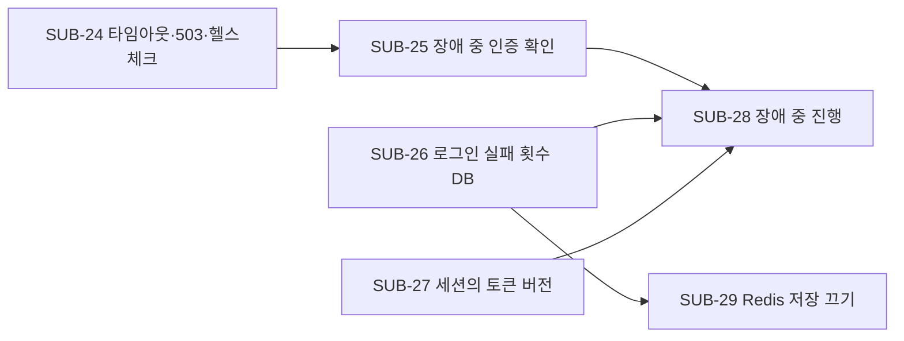

# 서브: Redis 장애 대응

> 버전 0.1 · 2026-11-20 · Redis를 쓸 수 없을 때 로그인한 요청·로그인·로그아웃·비밀번호 변경·제재·탈퇴는 진행하고, 가입·토큰 갱신·비밀번호 재설정은 503으로 막는다. 로그인 실패 횟수를 DB로 옮기고, 세션에 토큰 버전을 넣어 갱신 때 DB와 비교하며, 세션 삭제를 커밋 뒤로 옮기고, Redis 저장을 끈다(단계 ID SUB-24~SUB-29)

> **서브**: 로드맵에서 뺀 기능이다. Stage 1(Part 6) 뒤에 한다.
> **따르는 규칙**: 로드맵 Part 1~6의 공통 규칙. 인증 규격의 출발점은 [로드맵 4-4](../03-roadmap/part4-auth.md)와 [ADR-006](../adr/ADR-006-auth.md)이다.

---

## 공통

### 지금 Redis를 쓰는 곳

Redis는 member 모듈과 JWT 필터만 쓴다. 주문·결제·재고·정산·알림·검색·예약 작업·Kafka consumer는 쓰지 않는다.

| 키 | 값의 원본 | 쓰는 곳 |
|---|---|---|
| `auth:token-version:{memberId}` | DB `member.token_version`의 복사본(1일 만료) | `RedisTokenVersionProvider`(JWT 필터가 토큰이 있는 요청마다 읽음), `TokenVersionService.bump`(커밋 뒤 씀) |
| `auth:session:{sessionId}`, `auth:member-sessions:{memberId}` | Redis에만 있음 | `RedisSessionStore`: 로그인·가입의 세션 생성, 갱신의 해시 교체, 로그아웃·비밀번호 변경·재설정·제재·탈퇴의 세션 삭제 |
| `auth:login-fail:{email}` | Redis에만 있음 | `RedisLoginAttemptStore`: 15분 안에 5번 틀리면 15분 잠금 |
| `auth:email-code:*`, `auth:email-cooldown:{email}`, `auth:email-hourly:{email}` | Redis에만 있음 | `RedisEmailCodeStore`: 가입 인증·비밀번호 재설정 코드, 발송 간격(60초)·시간당 횟수(5번). 간격·횟수는 목적과 상관없이 이메일 하나에 같이 쌓인다 |
| `auth:signup-verified:*`, `auth:oauth-signup:*` | Redis에만 있음 | `RedisSignupVerificationStore`, `RedisSignupTokenStore`: 가입 인증 완료 표시, 소셜 가입 토큰 |

지금은 Redis가 응답하지 않으면 Redis를 부르는 요청이 Lettuce 기본 타임아웃(60초) 뒤 실패한다. 서비스 안의 실패는 `@Transactional`이 DB 변경을 롤백하고 500 `INTERNAL_ERROR`로 답한다. JWT 필터 안의 실패는 `GlobalExceptionHandler` 밖이라 에러 형식이 다르다. `/actuator/health`에는 Redis 지표가 들어가 있어 DOWN이 된다.

### 정책

| 기능 | Redis를 쓸 수 없을 때 | 단계 |
|---|---|---|
| 토큰 없는 공개 조회, 예약 작업, Kafka consumer | 지금도 진행한다 | - |
| 유효한 토큰을 붙인 모든 요청(JWT 필터) | 진행. 토큰 버전을 DB에서 읽어 비교한다 | SUB-25 |
| 이메일 로그인 | 진행. 실패 횟수는 DB에서 세고, 세션 없이 토큰을 발급한다 | SUB-26, SUB-28 |
| 이미 연결된 회원의 소셜 로그인 | 진행. 세션 없이 토큰을 발급한다 | SUB-28 |
| 전체 로그아웃, 비밀번호 변경, 제재, 탈퇴 | 진행. DB 커밋으로 끝나고, 세션 삭제는 커밋 뒤에 하며 실패해도 경고만 남긴다 | SUB-27, SUB-28 |
| 한 기기 로그아웃 | 진행. 그 회원의 토큰 버전을 올려 전체 로그아웃처럼 끊는다 | SUB-28 |
| 토큰 갱신 | 503. 세션이 Redis에만 있다 | SUB-24 |
| 가입 인증 코드 발송·확인, 이메일 가입, 처음 오는 회원의 소셜 로그인, 소셜 가입 | 503. 코드·인증 완료 표시·가입 토큰이 Redis에만 있다 | SUB-24 |
| 비밀번호 재설정 요청·확인 | 503. 코드·발송 간격·횟수가 Redis에만 있다 | SUB-24 |
| `/actuator/health` | UP. Redis 지표를 뺀다 | SUB-24 |

세션을 지우지 못해도 진행할 수 있는 것은 끊었는지를 DB가 정하기 때문이다. 전체 로그아웃·비밀번호 변경·재설정은 토큰 버전을 올리고, 갱신이 세션의 버전과 DB 버전을 비교해 남은 세션을 거부한다(SUB-27). 제재·탈퇴는 갱신의 회원 상태 확인(`verifyCanLogin`)이 거부한다. 로그인 실패 횟수는 막아 주는 값이라 건너뛸 수 없어 DB로 옮긴다(SUB-26).

모든 단계를 마치면 Redis에는 잃어도 거부로 끝나는 값만 남는다. 세션이 없으면 갱신이 401이 되어 다시 로그인하고, 토큰 버전 캐시는 DB에서 다시 채우고, 코드가 없으면 다시 받는다. 그래서 Redis 저장을 끈다(SUB-29).

### 단계 순서



SUB-26과 SUB-27은 Redis 장애와 상관없이 할 수 있다. SUB-29는 SUB-26 뒤에 한다. 먼저 하면 Redis가 재시작할 때마다 로그인 잠금이 풀린다. SUB-27과 SUB-29는 배포할 때 모든 사용자를 한 번 다시 로그인하게 하므로, 같은 릴리스에 넣으면 한 번으로 끝난다.

### "Redis를 쓸 수 없음"의 예외

Spring Data Redis는 Lettuce 예외를 Spring 예외로 바꿔 던진다(`spring-data-redis` 4.1.1 `LettuceExceptionConverter`).

| Lettuce 예외 | Spring 예외 |
|---|---|
| 연결 실패(`RedisConnectionException`, `ChannelException`) | `org.springframework.data.redis.RedisConnectionFailureException` |
| 명령 타임아웃(`RedisCommandTimeoutException`) | `org.springframework.dao.QueryTimeoutException` |
| 그 밖의 Redis 오류(스크립트 오류 등) | `org.springframework.data.redis.RedisSystemException` |

이 문서에서 "Redis를 쓸 수 없음"은 앞의 둘이다. `RedisSystemException`은 코드나 스크립트의 결함일 수 있어 500으로 둔다. `QueryTimeoutException`은 JDBC 쿼리 타임아웃도 같은 타입이지만, 이 앱은 DB 쿼리 타임아웃을 설정하지 않아 지금은 Redis에서만 나온다.

커밋 뒤의 Redis 호출(SUB-28)은 예외가 무엇이든 DB 결과가 바뀌지 않으므로 세 예외의 공통 부모인 `org.springframework.dao.DataAccessException`을 잡는다.

### 장애를 흉내 내는 방법

테스트는 공유 Redis 컨테이너(`IntegrationTestSupport.redis`)를 일시정지(`docker pause`)해 Redis가 응답하지 않는 장애를 만든다. 명령이 SUB-24의 타임아웃(1초) 뒤 `QueryTimeoutException`으로 실패하므로 타임아웃 설정까지 실제 경로로 지난다. `SearchUnavailableTest`가 ES를 멈추는 방법과 같다. 컨테이너를 멈추고(`stop`) 다시 띄우면 포트가 바뀌어 다른 테스트가 깨지므로 쓰지 않는다.

```java
redis.getDockerClient().pauseContainerCmd(redis.getContainerId()).exec();
try {
    // 동작
} finally {
    redis.getDockerClient().unpauseContainerCmd(redis.getContainerId()).exec();
}
```

`TestFixtures`의 Redis 헬퍼(`redisStringOf`, `sessionSnapshotOf` 등)와 `@AfterEach`의 `resetRedis`도 같은 Redis를 쓰므로, Redis 값 확인은 `unpause` 뒤에 한다. 일시정지 중에는 Redis를 부를 때마다 1초가 걸린다.

---

## SUB-24. Redis 타임아웃, 503 응답, 헬스체크 (S)

**목표**: Redis가 응답하지 않을 때 요청이 1초 안에 끝나게 하고, Redis 때문에 막는 기능은 503으로 답하고, 헬스체크가 Redis 때문에 DOWN이 되지 않게 한다. 막는 기능(공통 "정책"의 503 행)은 이 단계로 끝난다.

### 빈 곳

- `application.yaml`에 `spring.data.redis.timeout`이 없다. Spring Boot는 이 값이 있을 때만 Lettuce에 명령 타임아웃을 넘기므로(`spring-boot-data-redis` 4.1.1 `LettuceConnectionConfiguration` 173행) Lettuce 기본값 60초(`lettuce-core` 7.5.2 `RedisURI.DEFAULT_TIMEOUT`)가 적용된다. 요청마다 Tomcat 스레드를 60초씩 쥔다. 연결 타임아웃(`connect-timeout`)도 없어 Lettuce 기본값 10초다.
- Redis를 쓸 수 없어 실패한 요청이 500 `INTERNAL_ERROR`로 나간다. 검색은 ES 장애를 503 `SEARCH_UNAVAILABLE`로 답하는데 Redis에는 이런 구분이 없다.
- Redis 헬스 지표(`DataRedisHealthContributorAutoConfiguration`, `@ConditionalOnEnabledHealthIndicator("redis")`)가 켜져 있어 Redis가 멈추면 `/actuator/health`가 DOWN이 된다. 운영 compose의 app `healthcheck`, `deploy.sh`의 `up --wait`, `smoke.sh`가 이 경로를 본다. ES 지표는 같은 이유로 이미 꺼 두었다(`management.health.elasticsearch.enabled: false`).

### 할 일

**1) 설정** — `application.yaml`

```yaml
spring:
  data:
    redis:
      timeout: 1s
      connect-timeout: 1s

management:
  health:
    redis:
      enabled: false
```

이 앱의 Redis 명령은 키 하나를 읽고 쓰거나 짧은 Lua 스크립트라 1초 안에 끝나지 않으면 장애로 본다. 연결도 같은 VM의 docker 네트워크라 1초로 둔다. Redis 상태는 Redis 컨테이너의 자체 `healthcheck`(`redis-cli ping`)와 앱의 경고 로그로 본다.

**2) common.error**

| 클래스 | 규격 |
|---|---|
| `CommonErrorCode` | `SERVICE_UNAVAILABLE(HttpStatus.SERVICE_UNAVAILABLE, "일시적으로 처리할 수 없습니다. 잠시 후 다시 시도해 주세요.")` |
| `GlobalExceptionHandler` | `@ExceptionHandler({RedisConnectionFailureException.class, QueryTimeoutException.class})` 메서드를 더해 503 `SERVICE_UNAVAILABLE`로 답한다. 로그는 `handleException`과 같은 형식으로 예외와 함께 남긴다. `RedisSystemException`은 지금처럼 `Exception` 처리(500)로 둔다 |

막는 기능은 이 매핑만으로 503이 된다. 서비스 코드는 바꾸지 않는다.

### 완료 확인

케이스는 [로드맵 README 4.1](../03-roadmap/README.md)의 기준으로 골랐다.

#### `common/error/RedisUnavailableTest` (`@AutoConfigureMockMvc`)

| 케이스 | 준비 | 동작 | 확인할 것 |
|---|---|---|---|
| 1. Redis가 응답하지 않으면 가입 인증 코드 발송을 실패한다. (503) | 없음 | Redis 일시정지 → `POST /api/auth/signup/email-verifications` 본문 `{"email":"test@test.com"}` | 상태 503, `$.code` = `SERVICE_UNAVAILABLE` |
| 2. Redis가 응답하지 않으면 타임아웃 뒤 바로 실패한다. | 없음 | Redis 일시정지 → 1번과 같은 요청, 앞뒤 시각을 잰다 | 걸린 시간 5초 미만 |
| 3. Redis가 응답하지 않으면 토큰 갱신을 실패한다. (503) | `testFixtures.signup("test@test.com")` → `loginTokens("test@test.com")`의 `refreshToken` | Redis 일시정지 → `POST /api/auth/refresh` | 상태 503, `$.code` = `SERVICE_UNAVAILABLE` |
| 4. Redis가 응답하지 않아도 헬스체크는 UP이다. | 없음 | Redis 일시정지 → `healthEndpoint.health()` | `getStatus()` = `Status.UP` |

### 문서 반영

단계를 마칠 때 Claude가 고친다.

| 문서 | 고칠 곳 |
|---|---|
| [API 명세](../02-design/07-api-spec.md) | 1절 에러 표에 503 `SERVICE_UNAVAILABLE` |
| [ADR-006](../adr/ADR-006-auth.md) | 결과의 "Redis 장애 시 정책은 Stage 1에서 두지 않는다"를 이 문서의 정책 표로 |
| [로드맵 4-4](../03-roadmap/part4-auth.md) | "Redis 장애 시 특별한 처리를 하지 않는다" 줄을 이 문서 링크로 |
| [알려진 문제](../known-issues.md) | "Redis 명령 타임아웃 60초", "Redis 장애 응답이 500", "Redis 장애 시 헬스체크 DOWN" 행을 지운다 |

**리뷰 때 물어볼 것**

- 타임아웃을 1초로 둔 근거는? 너무 짧으면 무엇이 생기나?
- `RedisSystemException`은 왜 503에 넣지 않았나?
- 헬스체크에서 Redis를 빼면 Redis 장애는 어디서 알아차리나?

---

## SUB-25. Redis 장애 중 인증 확인 (S)

**목표**: Redis를 쓸 수 없어도 유효한 토큰을 붙인 요청을 DB의 토큰 버전으로 인증한다. Redis에 옛 토큰 버전이 남아 새 토큰을 거부하는 문제도 함께 고친다. SUB-24가 먼저다. 타임아웃이 없으면 DB로 넘어가기 전에 60초를 기다린다.

### 빈 곳

- `RedisTokenVersionProvider.currentVersion`은 Redis 값이 없을 때(`null`)만 DB를 읽는다. Redis 호출이 예외를 던지면 DB까지 가지 않고 `JwtAuthenticationFilter`에서 요청이 실패한다. DB를 읽은 뒤의 `setIfAbsent`도 Redis를 부른다.
- Redis에 옛 토큰 버전이 남는 경우가 있다. 커밋 뒤 쓰기(`TokenVersionService.bump`의 `afterCommit`)만 실패한 경우, Redis 장애 중에 버전을 올린 경우, Redis가 비정상 종료 뒤 옛 스냅샷으로 살아난 경우다. 그러면 새 버전으로 발급된 토큰이 키 만료(1일)까지 거부된다([알려진 문제](../known-issues.md) "토큰 버전 캐시 쓰기 실패").

### 정책

- 토큰 버전의 원본은 DB다. Redis를 쓸 수 없으면 DB에서 읽고, Redis에 다시 쓰지 않는다.
- 토큰의 버전이 Redis 값보다 크면 DB를 다시 읽어 Redis를 고친다. 토큰 버전은 DB가 올린 뒤에만 발급되므로, Redis보다 큰 버전은 Redis가 옛 값이라는 뜻이다.
- 토큰의 버전이 Redis 값보다 작으면 지금처럼 거부한다. Redis에 옛 값이 남은 동안 그 옛 값과 같은 버전의 토큰은 통한다. 그 토큰은 버전을 올리기 전에 발급된 것이라 액세스 토큰 만료(15분)로 끝난다.

### 할 일

**1) common.security**

| 클래스 | 규격 |
|---|---|
| `TokenVersionProvider` | `int currentVersion(UUID memberId)`를 `boolean isCurrent(UUID memberId, int tokenVersion)`으로 바꾼다. "크면 DB를 다시 읽기"는 캐시를 아는 구현이 해야 해서 비교를 구현으로 옮긴다 |
| `JwtAuthenticationFilter` | `claims.tokenVersion() == tokenVersionProvider.currentVersion(claims.memberId())`를 `tokenVersionProvider.isCurrent(claims.memberId(), claims.tokenVersion())`로 바꾼다 |

**2) member.infrastructure** — `RedisTokenVersionProvider.isCurrent(memberId, tokenVersion)`

1. Redis에서 `auth:token-version:{memberId}`를 읽는다. Redis를 쓸 수 없으면 `log.warn`을 남기고 DB 버전과 비교한 결과를 돌려준다.
2. 값이 없으면 지금처럼 DB에서 읽어 `setIfAbsent`(1일)로 채우고 DB 버전과 비교한다.
3. 값이 토큰 버전과 같으면 `true`, 토큰 버전보다 크면 `false`.
4. 값이 토큰 버전보다 작으면 DB에서 읽어 `set`(1일)으로 덮고 DB 버전과 비교한다.

회원이 없으면 `false`. 2·4의 Redis 쓰기가 실패하면 `log.warn`만 남기고 DB 버전과 비교한 결과를 돌려준다.

### 완료 확인

#### `member/web/TokenVersionFallbackTest` (`@AutoConfigureMockMvc`)

| 케이스 | 준비 | 동작 | 확인할 것 |
|---|---|---|---|
| 1. Redis가 응답하지 않아도 토큰 버전이 DB와 같은 토큰을 인증한다. | `signup("test@test.com")` → `token("test@test.com")` | Redis 일시정지 → `GET /api/members/me` | 상태 200 |
| 2. Redis가 응답하지 않으면 전체 로그아웃 전의 토큰으로 인증을 실패한다. (401) | `signup` → `token` → `POST /api/auth/logout?all=true`(204) | Redis 일시정지 → 로그아웃 전 토큰으로 `GET /api/members/me` | 상태 401 |
| 3. Redis의 토큰 버전이 토큰보다 낮아도 인증한다. | `signup` → `token` → `PATCH /api/members/me/password`(200, 응답의 새 액세스 토큰) → `redisTemplate.opsForValue().set("auth:token-version:{memberId}", "0")` | 새 토큰으로 `GET /api/members/me` | 상태 200 |
| 4. Redis의 토큰 버전이 토큰보다 낮으면 DB 값으로 고친다. | 3번과 같다 | 3번과 같다 | `tokenVersionSnapshotOf(memberId)`: `redis()` = `db()` |

### 문서 반영

| 문서 | 고칠 곳 |
|---|---|
| [로드맵 4-4](../03-roadmap/part4-auth.md) | `TokenVersionProvider`·`JwtAuthenticationFilter`·`RedisTokenVersionProvider` 행, `TokenVersionService`의 "`afterCommit`에서 Redis 쓰기가 실패하면" 설명 |
| [ADR-006](../adr/ADR-006-auth.md) | 결정 3에 "Redis를 쓸 수 없으면 DB의 버전과 비교한다", "토큰 버전이 캐시보다 크면 DB로 고친다" |
| [알려진 문제](../known-issues.md) | "Redis 장애 시 로그인한 요청 전부 실패", "토큰 버전 캐시 쓰기 실패" 행을 지운다 |

**리뷰 때 물어볼 것**

- 토큰 버전이 Redis 값보다 크면 DB를 다시 읽어도 안전한 이유는? 작은 버전에도 DB를 다시 읽으면 무엇이 달라지나?
- 장애 중에 DB에서 읽은 값을 Redis에 쓰지 않는 이유는?
- 장애 동안 로그인한 요청마다 DB 조회가 하나 늘어난다. 커넥션 풀(31)에는 어떤 영향이 있나?

---

## SUB-26. 로그인 실패 횟수를 DB로 (S)

**목표**: 로그인 실패 횟수와 잠금을 DB에 두어, Redis가 없어도 잠금이 유지되고 로그인이 비밀번호 확인 전에 실패하지 않게 한다. 잠금 규칙(15분 안에 5번 틀리면 15분 잠금)과 응답은 바꾸지 않는다.

### 빈 곳

- `LoginService.login`은 비밀번호를 확인하기 전에 `loginAttemptStore.recordAttempt`(`login-attempt.lua`)를 부른다. Redis를 쓸 수 없으면 여기서 실패한다.
- 실패 횟수는 막아 주는 값이라 장애 동안 건너뛰면 비밀번호를 제한 없이 시도할 수 있다. Redis가 재시작해 값을 잃어도 잠금이 풀린다(SUB-29에서 저장을 끄면 재시작마다 그렇다).

### 고른 방법

| 방법 | 고르지 않은 이유 |
|---|---|
| Redis 장애 때 이메일 로그인을 503으로 막는다 | 장애가 길면 액세스 토큰(15분)이 끝난 사용자가 다시 들어오지 못한다 |
| 장애 때 잠금을 건너뛴다 | 장애 동안 비밀번호를 무제한으로 시도할 수 있고 이미 잠긴 계정도 풀린다 |
| 장애 때만 앱 메모리에서 센다 | 장애 때만 도는 저장소라 평소에 검증되지 않고, 이메일마다 항목이 늘어나 크기 상한을 따로 짜야 한다. 앱이 여러 대가 되면(SUB-9~SUB-13) 한도가 대수만큼 늘어난다 |

DB로 옮기면 틀린 로그인마다 DB 쓰기가 하나, 성공한 로그인마다 DELETE가 하나 생긴다. 틀린 로그인은 이미 BCrypt 비교를 하므로 쓰기 하나가 주된 비용은 아니다.

### 할 일

**1) 마이그레이션** — `db/migration/member/V{시각}__member_create_login_attempt.sql`

```sql
CREATE TABLE member.login_attempt (
    email         varchar(255) NOT NULL,
    attempt_count int          NOT NULL,
    expires_at    timestamptz  NOT NULL,
    CONSTRAINT pk_login_attempt PRIMARY KEY (email)
);

CREATE INDEX idx_login_attempt_expires_at ON member.login_attempt (expires_at);
```

`expires_at`은 Redis 키의 만료 시각을 옮긴 것이다. 첫 실패에서 15분 뒤로 걸고, 5번째 실패에서 다시 15분 뒤로 건다. 지난 행은 없는 것과 같다. 존재하지 않는 이메일도 지금처럼 센다.

**2) member.infrastructure** — `JdbcLoginAttemptStore implements LoginAttemptStore`

`JdbcTemplate`과 `Clock`을 쓴다(`InboxGuard`와 같은 모양). 시각은 DB의 `now()`가 아니라 `Clock`에서 받아 넘긴다. `RedisLoginAttemptStore`와 `redis/login-attempt.lua`는 지운다.

| 메서드 | 규격 |
|---|---|
| `int recordAttempt(String email)` | `@Transactional(propagation = Propagation.REQUIRES_NEW)`. 아래 SQL 한 문장. 반환 행이 없으면(잠김) `-1`, 있으면 `attempt_count` |
| `Optional<Instant> lockedUntil(String email)` | `SELECT expires_at FROM member.login_attempt WHERE email = ? AND attempt_count >= 5 AND expires_at > ?` |
| `void reset(String email)` | `DELETE FROM member.login_attempt WHERE email = ?`. 호출한 쪽의 트랜잭션에 참여한다(`confirmReset`은 비밀번호 변경과 함께 커밋) |
| `int deleteExpired()` | `DELETE FROM member.login_attempt WHERE expires_at <= ?`. 지운 행 수를 돌려준다 |

```sql
INSERT INTO member.login_attempt (email, attempt_count, expires_at)
VALUES (:email, 1, :expiresAt)
ON CONFLICT (email) DO UPDATE SET
    attempt_count = CASE WHEN login_attempt.expires_at <= :now THEN 1
                         ELSE login_attempt.attempt_count + 1 END,
    expires_at    = CASE WHEN login_attempt.expires_at <= :now
                           OR login_attempt.attempt_count + 1 = 5 THEN :expiresAt
                         ELSE login_attempt.expires_at END
WHERE login_attempt.expires_at <= :now OR login_attempt.attempt_count < 5
RETURNING attempt_count
```

`:now`는 `clock.instant()`, `:expiresAt`은 그 15분 뒤다. `ON CONFLICT DO UPDATE`는 그 행을 잠그고 `WHERE`를 최신 행으로 다시 평가하므로, 동시에 온 시도도 차례로 세어져 비밀번호 확인은 5번까지만 한다. 이미 잠긴 행(`attempt_count >= 5`이고 만료 전)은 `WHERE`에 걸려 바뀌지 않고 반환 행이 없다. 이름 붙은 자리(`:email` 등)는 읽기 쉽게 쓴 것이고, `JdbcTemplate`이면 `?`로 쓴다.

`recordAttempt`가 `REQUIRES_NEW`인 이유: 틀린 비밀번호면 `LoginService`가 예외를 던진다. 같은 트랜잭션이면 이 예외로 실패 횟수까지 롤백되어 세지지 않는다. Redis는 트랜잭션 밖이라 이 문제가 없었다.

**3) member.application**

| 클래스 | 규격 |
|---|---|
| `LoginService.login` | `@Transactional(readOnly = true)`를 뗀다. 읽기 전용 트랜잭션 안에서는 `reset`의 DELETE가 실패한다(Postgres가 읽기 전용 트랜잭션의 쓰기를 거부). 나머지 흐름은 그대로다 |

**4) member.infrastructure** — `LoginAttemptCleanupJob`

`@Scheduled(cron = "0 0 * * * *", zone = "Asia/Seoul")`로 매시 정각에 `jobRunner.run("cleanup-login-attempts", loginAttemptStore::deleteExpired)`. 존재하지 않는 이메일로 틀리게 보내면 행이 계속 생기는데, Redis는 TTL로 지웠고 DB는 이 작업이 지운다. 지난 행은 정리 전에도 없는 것과 같아서, 정리가 늦어도 동작은 바뀌지 않는다.

### 완료 확인

테스트 보조: `TestFixtures.loginAttemptOf(String email)`이 `LoginAttemptRow(int attemptCount, Instant expiresAt)`를 돌려주고(행이 없으면 `null`), `TestFixtures.expireLoginAttempt(String email)`이 그 행의 `expires_at`을 지금보다 1초 전으로 바꾼다.

#### `member/web/LoginLockRedisDownTest` (`@AutoConfigureMockMvc`)

| 케이스 | 준비 | 동작 | 확인할 것 |
|---|---|---|---|
| 1. Redis가 응답하지 않아도 5번 틀리면 잠긴다. | `signup("lock@test.com")` | Redis 일시정지 → 틀린 비밀번호로 `POST /api/auth/login` 5번 → 맞는 비밀번호로 한 번 더 | 마지막 응답 423, `$.code` = `ACCOUNT_LOCKED` |

#### `member/infrastructure/LoginAttemptCleanupTest`

| 케이스 | 준비 | 동작 | 확인할 것 |
|---|---|---|---|
| 2. 만료된 실패 기록을 지운다. | `a@test.com`으로 틀린 로그인 1번 → `expireLoginAttempt("a@test.com")` | `loginAttemptStore.deleteExpired()` | `loginAttemptOf("a@test.com")` = `null` |
| 3. 만료되지 않은 실패 기록은 지우지 않는다. | `b@test.com`으로 틀린 로그인 1번 | `loginAttemptStore.deleteExpired()` | `loginAttemptOf("b@test.com").attemptCount()` = 1 |

### 기존 테스트

`LoginLockTest`·`LoginLockConcurrencyTest`는 케이스와 응답 확인을 그대로 두고, Redis 키(`redisStringOf("auth:login-fail:...")`)를 읽던 확인을 DB로 바꾼다.

| 지금 | 바꿀 것 |
|---|---|
| `redisStringOf(K).value()` = 횟수 | `loginAttemptOf(email).attemptCount()` = 횟수 |
| `redisStringOf(K).exists()` = false | `loginAttemptOf(email)` = `null` |
| `redisTemplate.expire(K, 1초)` 뒤 사라지기를 기다림 | `expireLoginAttempt(email)` |
| `redisStringOf(K).ttlSeconds()`가 범위 안 | `loginAttemptOf(email).expiresAt()`이 지금부터의 범위 안 |
| `redisTemplate.expire(K, 60초)`로 남은 시간을 줄임 | `expires_at`을 60초 뒤로 바꾸는 UPDATE |

### 문서 반영

| 문서 | 고칠 곳 |
|---|---|
| [ERD](../02-design/03-erd.md) | member 스키마에 `login_attempt` |
| [로드맵 4-4](../03-roadmap/part4-auth.md) | 로그인 잠금 규격(`LoginAttemptStore`, `RedisLoginAttemptStore`, `login-attempt.lua`)을 이 문서 링크로 |
| [ADR-006](../adr/ADR-006-auth.md) | 로그인 실패 횟수의 저장소 |
| [알려진 문제](../known-issues.md) | "로그인 실패 횟수가 Redis에만 있음" 행을 지운다. "이메일 발송 횟수 키의 만료 누락" 행의 `login-attempt.lua` 비교 문장을 고친다 |

**리뷰 때 물어볼 것**

- `recordAttempt`를 `REQUIRES_NEW`로 둔 이유는? `LoginService`의 트랜잭션에 참여하면 무엇이 깨지나?
- 동시에 온 틀린 로그인 10개가 비밀번호 확인을 5번까지만 하는 이유를 SQL로 설명하면?
- `expires_at`이 지난 행을 정리 작업 전에도 없는 것으로 다루는 곳은 어디인가?

---

## SUB-27. 세션의 토큰 버전 (S)

**목표**: 세션에 만들 때의 토큰 버전을 저장하고, 갱신할 때 DB의 회원 버전과 다르면 거부한다. 그러면 전체 로그아웃·비밀번호 변경·재설정이 Redis에서 세션을 지우지 못해도, DB 커밋만으로 끊긴 상태가 확정된다.

### 빈 곳

- `TokenRefreshService.refresh`는 세션의 해시와 회원 상태(`verifyCanLogin`)만 보고 토큰 버전은 보지 않는다. 토큰 버전을 올린 뒤에도 지워지지 않은 세션은 새 버전의 토큰을 받는다.
- 세션이 지워지지 않고 남는 경우: 세션 삭제가 실패한 경우(SUB-28이 커밋 뒤로 옮기면 Redis 장애 때 그렇다), 지운 직후 커밋 전에 같은 회원이 다른 기기로 로그인해 옛 버전으로 세션을 만든 경우, Redis가 옛 스냅샷으로 살아난 경우.

### 정책

- 세션 해시에 `tokenVersion`을 저장한다. 세션을 만들 때 회원의 `token_version`이다.
- 갱신할 때 세션의 `tokenVersion`이 DB `member.token_version`과 다르면 세션을 지우고 401 `UNAUTHORIZED`로 답한다. 회원은 갱신 때 이미 읽으므로(`findById`) DB 조회가 늘지 않는다.
- `tokenVersion`이 없는 세션(배포 전에 만든 세션)도 다른 것으로 보고 거부한다. 배포 뒤 처음 갱신할 때 모든 사용자가 한 번 다시 로그인한다.
- 비밀번호 변경은 지금 기기의 세션을 남기므로, 그 세션의 `tokenVersion`을 새 버전으로 바꾼다.

### 할 일

**1) member.domain**

| 타입 | 규격 |
|---|---|
| `SessionInfo` | record `(UUID memberId, Integer tokenVersion)`. `tokenVersion`은 배포 전 세션이면 `null` |
| `SessionStore` | `create(UUID sessionId, UUID memberId, String refreshHash, int tokenVersion, Duration ttl)`로 버전을 받는다. `Optional<UUID> findMemberId(UUID sessionId)`를 `Optional<SessionInfo> find(UUID sessionId)`로 바꾼다. `void updateTokenVersion(UUID sessionId, int tokenVersion)`을 더한다 |

**2) member.infrastructure** — `RedisSessionStore`

| 메서드 | 규격 |
|---|---|
| `create` | 해시에 `tokenVersion` 필드를 더한다 |
| `find` | 해시의 `memberId`와 `tokenVersion`(없으면 `null`)을 돌려준다 |
| `updateTokenVersion` | `redis/update-session-version.lua`로 세션이 있을 때만 `HSET`한다. 세션이 그 사이 지워졌으면 아무것도 하지 않는다. 없는 키에 `HSET`하면 만료 없는 반쪽 세션이 생기기 때문이다 |

```lua
-- KEYS[1] = auth:session:{id}, ARGV[1] = tokenVersion
if redis.call('EXISTS', KEYS[1]) == 1 then
  redis.call('HSET', KEYS[1], 'tokenVersion', ARGV[1])
  return 1
end
return 0
```

**3) member.application**

| 클래스 | 규격 |
|---|---|
| `TokenIssuer.issueNewSession` | `sessionStore.create`에 `member.getTokenVersion()`을 넘긴다 |
| `TokenRefreshService.refresh` | `findMemberId`를 `find`로 바꾼다. `verifyCanLogin` 뒤에 `session.tokenVersion()`이 `member.getTokenVersion()`과 다르면(`null` 포함) `sessionStore.delete(sessionId)` 후 `UNAUTHORIZED` |
| `PasswordService.change` | `deleteAllOfExcept` 다음에 `sessionStore.updateTokenVersion(sessionId, member.getTokenVersion())` |

### 완료 확인

테스트 보조: `SessionSnapshot`에 `tokenVersion()`(필드가 없으면 `null`)을 더한다.

#### `member/web/SessionVersionTest` (`@AutoConfigureMockMvc`)

| 케이스 | 준비 | 동작 | 확인할 것 |
|---|---|---|---|
| 1. 로그인하면 세션에 회원의 토큰 버전을 저장한다. | `signup("test@test.com")` | `loginTokens("test@test.com")` → `sessionIdsOf(memberId)`의 세션 | `sessionSnapshotOf(sessionId).tokenVersion()` = `tokenVersionSnapshotOf(memberId).db()` |
| 2. 세션의 토큰 버전이 회원과 다르면 갱신을 실패한다. (401) | `signup` → `loginTokens` → `jdbcTemplate.update("UPDATE member.member SET token_version = token_version + 1 WHERE id = ?", memberId)`(세션 삭제가 실패한 상태) | `POST /api/auth/refresh` | 상태 401, `$.code` = `UNAUTHORIZED`. `sessionSnapshotOf(sessionId).exists()` = false |
| 3. 토큰 버전이 없는 세션으로 갱신을 실패한다. (401) | `signup` → `loginTokens` → `redisTemplate.opsForHash().delete("auth:session:{sessionId}", "tokenVersion")` | `POST /api/auth/refresh` | 상태 401, `$.code` = `UNAUTHORIZED` |
| 4. 비밀번호를 바꾼 기기는 갱신한다. | `signup` → `loginTokens` → 그 액세스 토큰으로 `PATCH /api/members/me/password`(200) | 같은 기기의 `refreshToken`으로 `POST /api/auth/refresh` | 상태 200 |

### 기존 테스트

`sessionStore.create`·`findMemberId`를 직접 부르는 테스트가 있으면 새 시그니처로 바꾼다. API로 세션을 만드는 테스트(`loginTokens` 등)는 바꾸지 않는다.

### 문서 반영

| 문서 | 고칠 곳 |
|---|---|
| [로드맵 4-4](../03-roadmap/part4-auth.md) | `SessionStore`·`RedisSessionStore`·`TokenRefreshService`·`TokenIssuer` 행, 비밀번호 변경 순서 |
| [ADR-006](../adr/ADR-006-auth.md) | 결정 4에 "갱신은 세션의 토큰 버전을 DB와 비교한다" |
| [알려진 문제](../known-issues.md) | "갱신이 토큰 버전을 보지 않음" 행을 지운다 |

**리뷰 때 물어볼 것**

- 버전 비교를 해시 교체(`rotate`) 뒤에 두면 어떤 일이 생기나? 앞에 두면?
- `updateTokenVersion`을 Lua로 한 이유는? `opsForHash().put`이면 무엇이 깨지나?
- 전체 로그아웃이 세션을 지우는데도 버전 비교가 필요한 경우는?

---

## SUB-28. Redis 장애 중 로그인·로그아웃·비밀번호 변경·제재·탈퇴 (S)

**목표**: 세션 삭제와 토큰 버전 캐시 쓰기를 커밋 뒤로 옮겨, Redis를 쓸 수 없어도 전체 로그아웃·비밀번호 변경·제재·탈퇴가 DB 커밋으로 끝나게 한다. 로그인은 세션 없이, 한 기기 로그아웃은 토큰 버전을 올려 진행한다. SUB-25·SUB-26·SUB-27이 먼저다. 로그아웃·비밀번호 변경은 인증이 필요해 SUB-25가, 로그인은 SUB-26이, 커밋 뒤 세션 삭제가 실패해도 남은 세션을 거부하는 것은 SUB-27이 맡는다.

### 빈 곳

- 전체 로그아웃(`LogoutService`), 비밀번호 변경·재설정 확인(`PasswordService`), 제재(`AdminMemberService.ban`), 탈퇴(`WithdrawService.withdraw`)가 `@Transactional` 안에서 `sessionStore.deleteAllOf*`를 부른다. Redis는 DB 트랜잭션에 들어가지 않는다([개발 가이드 §6.2](../development-guide.md) "외부 호출은 트랜잭션 밖에서").
  - Redis 삭제가 실패하면 DB 변경까지 롤백되어 장애 동안 이 기능들을 할 수 없다.
  - Redis 삭제가 성공한 뒤 DB 커밋이 실패하면 세션은 지워졌는데 비밀번호·버전은 그대로다.
- `TokenVersionService.bump`의 `afterCommit`에서 Redis 쓰기가 실패하면 예외가 호출자로 올라간다. Spring은 `afterCommit`의 예외를 트랜잭션을 커밋된 것으로 둔 채 호출자에게 전한다(`spring-tx` 7.0.9 `AbstractPlatformTransactionManager` 832~835행). DB에는 반영됐는데 응답은 500이다. 비밀번호 변경을 실패로 알고 다시 보내면 현재 비밀번호가 이미 바뀌어 400 `PASSWORD_MISMATCH`가 된다.
- 한 기기 로그아웃은 Redis 세션 삭제뿐이라 Redis를 쓸 수 없으면 실패한다.
- `TokenIssuer.issueNewSession`이 Redis에 세션을 만들지 못하면 로그인(이메일, 연결된 소셜)이 실패한다.

### 정책

- 끊는 기능은 DB 커밋이 결정이다. Redis 세션 삭제, 지금 기기의 세션 버전 바꾸기, 토큰 버전 캐시 쓰기는 커밋 뒤에 하고, 실패하면 `log.warn`만 남긴다. 남은 세션은 SUB-27(버전)이나 회원 상태가 갱신 때 거부하고, Redis의 옛 버전 캐시는 SUB-25가 고친다.
- 커밋 뒤의 Redis 호출은 하나가 실패해도 나머지를 계속한다.
- 한 기기 로그아웃은 세션 삭제가 Redis를 쓸 수 없어 실패하면 그 회원의 토큰 버전을 올린다(전체 로그아웃과 같은 결과). 그 회원의 다른 기기도 로그아웃된다.
- 로그인에서 세션을 만들지 못하면 토큰을 그대로 발급한다. 응답 모양은 같다. 그 refresh 토큰은 장애 중에는 503, 복구 뒤에는 세션이 없어 401이 되어 다시 로그인한다.
- 장애 중에 비밀번호를 바꾼 기기는 세션 버전을 바꾸지 못해 복구 뒤 갱신이 401이 되어 한 번 다시 로그인한다.

### 할 일

**1) member.application** — `TokenVersionService`

`bump(Member)`를 아래 두 메서드로 바꾼다. 둘 다 `@Transactional(propagation = Propagation.MANDATORY)`이고, 토큰 버전을 올린 뒤 커밋 뒤 작업을 `TransactionSynchronization.afterCommit`에 등록한다.

| 메서드 | 커밋 뒤 작업(순서대로, 각각 `DataAccessException`을 잡아 `log.warn`) |
|---|---|
| `revokeAll(Member member)` | 토큰 버전 캐시 `set`(1일), `sessionStore.deleteAllOf(memberId)` |
| `revokeAllExcept(Member member, UUID keepSessionId)` | 토큰 버전 캐시 `set`(1일), `sessionStore.deleteAllOfExcept(memberId, keepSessionId)`, `sessionStore.updateTokenVersion(keepSessionId, 새 버전)` |

| 호출하는 곳 | 바꿀 것 |
|---|---|
| `LogoutService`(전체) | `bump` + `deleteAllOf`를 `revokeAll` |
| `PasswordService.change` | `bump` + `deleteAllOfExcept` + `updateTokenVersion`(SUB-27)을 `revokeAllExcept` |
| `PasswordService.confirmReset` | `bump` + `deleteAllOf`를 `revokeAll`. 코드 확인(Redis)은 그대로 첫 단계라 장애 때 503이다 |
| `AdminMemberService.ban` | `bump` + `deleteAllOf`를 `revokeAll` |
| `WithdrawService.withdraw` | `bump` + `deleteAllOf`를 `revokeAll` |

**2) member.application** — `LogoutService`

한 기기 로그아웃은 트랜잭션 없이 `sessionStore.delete(sessionId)`를 부른다. `RedisConnectionFailureException`·`QueryTimeoutException`이면 `log.warn`을 남기고 새 트랜잭션에서 회원을 읽어 `revokeAll`을 부른다. 전체 로그아웃은 지금처럼 트랜잭션 안에서 `revokeAll`이다.

**3) member.application** — `TokenIssuer`

`issueNewSession`의 `sessionStore.create`가 `RedisConnectionFailureException`·`QueryTimeoutException`이면 `log.warn`을 남기고 토큰을 발급한다. 이메일 로그인, 연결된 소셜 로그인이 이 처리로 진행된다. 가입·소셜 가입도 이 메서드를 부르지만 그 전에 Redis에서 인증 완료 표시·가입 토큰을 읽다가 503으로 끝나므로 장애 때는 여기까지 오지 않는다.

### 완료 확인

Redis는 공통 "장애를 흉내 내는 방법"으로 멈춘다. DB 토큰 버전은 `tokenVersionSnapshotOf(memberId).db()`로 읽는다.

#### `member/web/LoginRedisDownTest` (`@AutoConfigureMockMvc`)

| 케이스 | 준비 | 동작 | 확인할 것 |
|---|---|---|---|
| 1. Redis가 응답하지 않아도 맞는 비밀번호로 로그인한다. | `signup("test@test.com")` | Redis 일시정지 → `POST /api/auth/login` 본문 `{"email":"test@test.com","password":"pass1234"}` | 상태 200, `$.accessToken`·`$.refreshToken`이 비어 있지 않음 |
| 2. Redis 장애 중에 받은 refresh 토큰으로 복구 뒤 갱신을 실패한다. (401) | `signup` → Redis 일시정지 → 1번의 로그인 응답의 `refreshToken` → `unpause` | `POST /api/auth/refresh` | 상태 401, `$.code` = `UNAUTHORIZED` |

#### `member/web/RevokeRedisDownTest` (`@AutoConfigureMockMvc`)

| 케이스 | 준비 | 동작 | 확인할 것 |
|---|---|---|---|
| 3. Redis가 응답하지 않아도 전체 로그아웃한다. | `signup("test@test.com")` → `token("test@test.com")` | Redis 일시정지 → `POST /api/auth/logout?all=true` | 상태 204. DB 토큰 버전 1 |
| 4. Redis 장애 중에 전체 로그아웃하면 복구 뒤 다른 기기의 갱신을 실패한다. (401) | `signup` → `loginTokens`로 기기 A·B → Redis 일시정지 → A의 액세스 토큰으로 `POST /api/auth/logout?all=true`(204) → `unpause` | B의 `refreshToken`으로 `POST /api/auth/refresh` | 상태 401, `$.code` = `UNAUTHORIZED` |
| 5. Redis가 응답하지 않아도 비밀번호를 바꾼다. | `signup` → `token` | Redis 일시정지 → `PATCH /api/members/me/password` 본문 `{"currentPassword":"pass1234","newPassword":"newpass99"}` → `unpause` → 새 비밀번호로 `POST /api/auth/login` | 비밀번호 변경 200, 로그인 200 |
| 6. Redis 장애 중에 비밀번호를 바꾼 기기는 복구 뒤 갱신을 실패한다. (401) | `signup` → `loginTokens` → Redis 일시정지 → 그 액세스 토큰으로 5번의 비밀번호 변경(200) → `unpause` | 같은 기기의 `refreshToken`으로 `POST /api/auth/refresh` | 상태 401 |
| 7. Redis가 응답하지 않으면 한 기기 로그아웃이 토큰 버전을 올린다. | `signup` → `token` | Redis 일시정지 → `POST /api/auth/logout` | 상태 204. DB 토큰 버전 1 |
| 8. Redis가 응답하지 않아도 회원을 제재한다. | `signup("test@test.com")`, `adminToken("admin@test.com")` | Redis 일시정지 → `POST /admin/api/members/{id}/ban` 본문 `{"reason":"테스트"}` | 상태 204. `memberSnapshotOf(memberId).status()` = `BANNED` |
| 9. Redis가 응답하지 않아도 탈퇴한다. | `signup` → `token` | Redis 일시정지 → `DELETE /api/members/me` | 상태 204. `memberSnapshotOf(memberId).status()` = `WITHDRAWN` |

5번은 커밋 뒤 Redis 쓰기가 실패해도 성공으로 답하는 것까지 확인한다. 세션 삭제가 커밋 뒤로 옮겨져, Redis를 멈추면 이 요청의 Redis 호출은 모두 커밋 뒤에 실패한다.

### 기존 테스트

전체 로그아웃·비밀번호 변경·재설정·제재·탈퇴 뒤 세션이 지워졌는지 보는 테스트는 그대로 통과해야 한다. `afterCommit`은 응답 전에 실행된다. `bump`를 직접 부르는 테스트가 있으면 `revokeAll`로 바꾼다.

### 문서 반영

| 문서 | 고칠 곳 |
|---|---|
| [로드맵 4-4](../03-roadmap/part4-auth.md) | `TokenVersionService` 행, 로그아웃·비밀번호 변경·재설정·제재·탈퇴의 순서, `TokenIssuer` 행 |
| [ADR-006](../adr/ADR-006-auth.md) | 결과에 "세션 삭제는 커밋 뒤, 실패해도 DB 버전이 끊는다" |
| [API 명세](../02-design/07-api-spec.md) | 로그인 행에 "Redis 장애 중에는 세션 없이 발급(갱신은 복구 뒤 401)", 로그아웃 행에 "Redis 장애 중 한 기기 로그아웃은 모든 기기를 로그아웃" |
| [알려진 문제](../known-issues.md) | "세션 삭제가 트랜잭션 안에 있음", "토큰 버전 캐시 쓰기 실패가 500", "Redis 장애 시 로그인 불가", "Redis 장애 시 한 기기 로그아웃 불가" 행을 지운다 |

**리뷰 때 물어볼 것**

- 세션 삭제를 커밋 뒤로 옮기면 SUB-27 없이는 무엇이 깨지나?
- `afterCommit`에서 예외를 잡지 않으면 트랜잭션과 응답은 어떻게 되나?
- 한 기기 로그아웃이 장애 때 버전을 올리는 대가는? 다른 방법은?
- 커밋 뒤 작업에서는 `DataAccessException`을 잡고, `TokenIssuer`에서는 두 예외만 잡는 이유는?

---

## SUB-29. Redis 저장 끄기 (S)

**목표**: Redis가 재시작하면 빈 상태로 뜨게 해, 지운 세션이나 쓴 코드가 옛 스냅샷에서 되살아나지 않게 한다. SUB-26이 먼저다. 실패 횟수가 Redis에 있으면 재시작마다 잠금이 풀린다.

### 빈 곳

운영 Redis(`docker-compose.ops.yml`의 `redis:7.4.11`)는 설정 파일 없이 떠서 기본값을 쓴다. 같은 이미지의 로컬 컨테이너에서 읽은 값은 `save 3600 1 300 100 60 10000`, `appendonly no`, `dir /data`이고, 운영은 `/data`가 `redis_data` 볼륨이다.

| 장애 | Redis가 다시 떴을 때 |
|---|---|
| 정상 종료 후 재시작(`docker restart`, VM 정상 재부팅) | 종료할 때 스냅샷을 저장하므로 그대로다 |
| 비정상 종료(OOM kill, 강제 종료, 전원 차단) | 마지막 스냅샷으로 돌아간다. 바뀐 건수가 적으면 최대 1시간 전 상태다 |

비정상 종료면 스냅샷 뒤에 지운 세션이 되살아난다. SUB-27 뒤에도 남는 것은 한 기기 로그아웃으로 지운 세션과, 갱신으로 바뀌기 전의 옛 refresh 해시다. 그 refresh 토큰이 새어 나갔다면 세션 만료(7일)까지 통한다. 쓴 인증 코드도 만료 전이면 다시 쓸 수 있다.

### 고른 방법

| 방법 | 고르지 않은 이유 |
|---|---|
| 그대로 둔다(RDB) | 위 문제가 남는다 |
| AOF를 켜고 1초마다 반영 | 되살아나는 범위가 1초로 준다. 다만 Redis에 남은 값이 모두 잃어도 거부로 끝나는 값이라 남길 이유가 없고, 쓰기마다 디스크에 기록한다 |

저장을 끄면 Redis가 재시작할 때마다(VM 재부팅, 이미지 교체, 비정상 종료) 모든 사용자가 다시 로그인하고, 진행 중인 인증 코드를 다시 받는다. 앱 배포 때는 Redis 컨테이너가 다시 만들어지지 않는다.

### 할 일

`docker/docker-compose.ops.yml`의 `redis`:

- `command: ["redis-server", "--save", ""]`를 둔다. 자동 스냅샷을 끄고, 종료할 때도 저장하지 않는다.
- `volumes`의 `redis_data:/data`와 최상위 `volumes`의 `redis_data`를 지운다. 볼륨을 남기면 옛 `dump.rdb`를 재시작마다 다시 읽어, 그 뒤에 지운 키가 계속 되살아난다(`redis:7.4.11` 로컬 컨테이너로 확인).

`docker/docker-compose.yml`(로컬)의 `redis`에도 같은 `command`를 둔다. 로컬은 볼륨이 없지만 `docker restart`면 컨테이너 안의 `/data`에 남은 스냅샷을 읽는다.

배포하면 Redis 컨테이너가 다시 만들어져 빈 상태로 뜬다. 이때 모든 사용자가 한 번 다시 로그인한다. 배포 뒤 VM에서 옛 볼륨을 지운다. 이름은 compose 프로젝트 이름(`myroutine-ops`)이 붙은 `myroutine-ops_redis_data`다.

```bash
docker volume ls | grep redis_data
docker volume rm myroutine-ops_redis_data
```

### 완료 확인

자바 테스트가 아니라 로컬에서 운영 compose 설정으로 띄워 확인한다.

1. 회원으로 로그인해 refresh 토큰을 받는다 → `docker restart`로 Redis를 재시작한다 → 그 refresh 토큰으로 `POST /api/auth/refresh`가 401이다. 바꾸기 전에는 같은 순서에서 200인 것을 먼저 확인한다.
2. 운영 VM에 배포한 뒤 `docker exec myroutine-ops-redis-1 redis-cli CONFIG GET save`의 값이 빈 문자열이다.

### 문서 반영

| 문서 | 고칠 곳 |
|---|---|
| [ADR-011](../adr/ADR-011-ops-practice-environment.md) | Redis 영속성 설정(저장 안 함) |
| [알려진 문제](../known-issues.md) | "Redis 비정상 종료 뒤 되살아나는 세션" 행을 지운다 |

**리뷰 때 물어볼 것**

- 저장을 꺼도 되는 근거는? Redis에 무엇이 남아 있었다면 끄면 안 되나?
- 볼륨을 남긴 채 `--save ""`만 주면 어떻게 되나?
