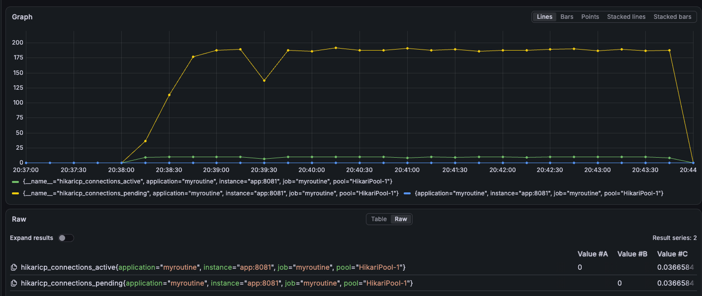
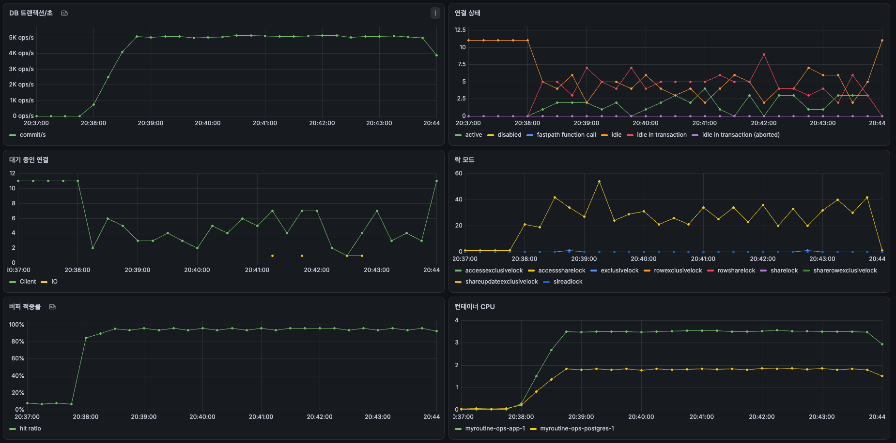
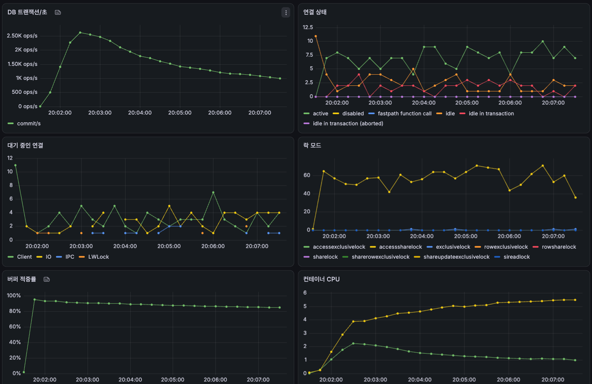
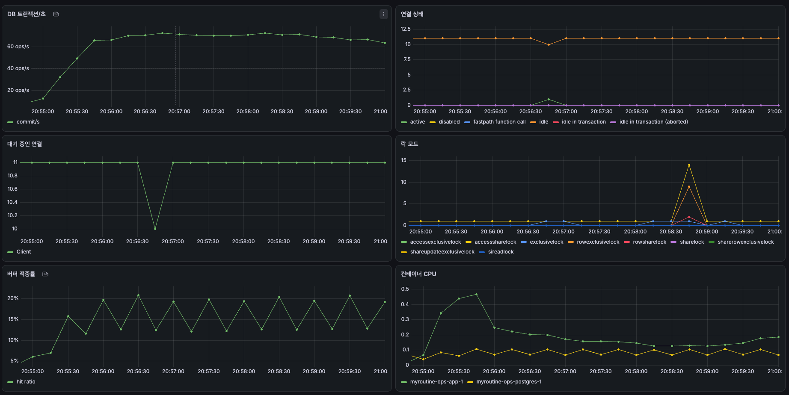
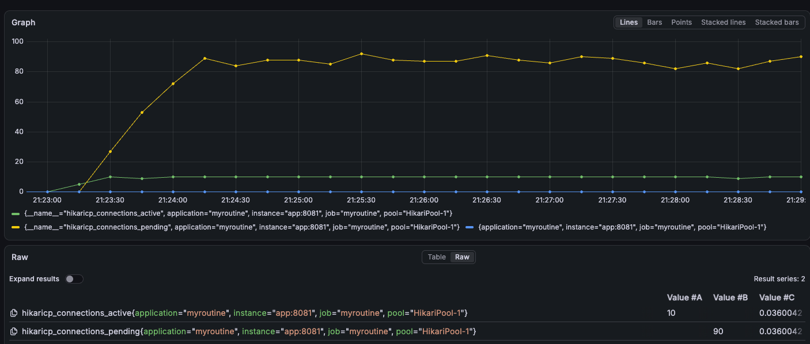
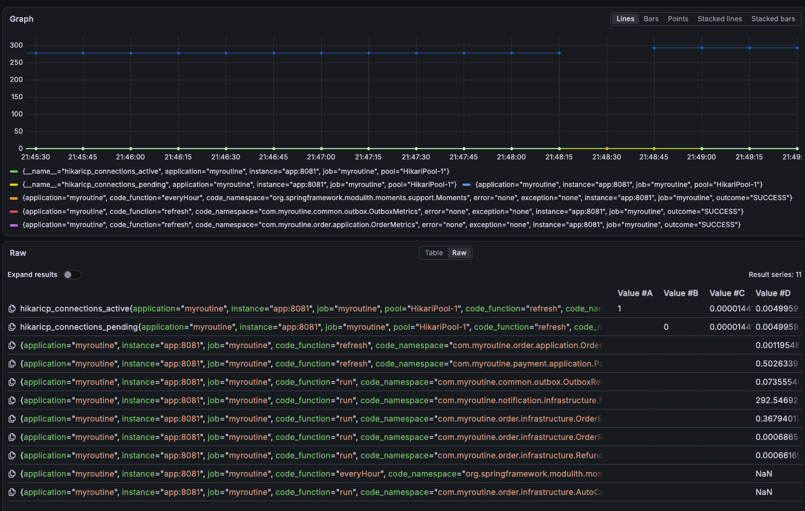

# S2-1a Baseline 리포트

## 무엇을 했나

Stage 1로 만든 서비스가 지금 얼마나 버티는지, 느리다면 어디서 느린지 쟀다. 성능을 고치기 전에 출발점(Baseline)을 남겨 두어야 고친 뒤 얼마나 나아졌는지 비교할 수 있다.

방법은 세 단계다.

1. 운영 VM의 DB를 실제 서비스처럼 크게 채웠다. 주문 1,000만 건(2년 동안 하루 약 1만 4천 건씩 쌓인 규모), 상품 100만 개 등 총 37GB다. 이 크기는 Postgres의 메모리 캐시(128MB)는 물론 VM 메모리(16GB)에도 다 들어가지 않는다. 데이터가 메모리에 다 들어가면 쿼리가 쓸데없이 많이 읽어도 빨라서 문제가 안 보이고, 메모리보다 커야 그만큼 디스크를 읽느라 느려져 문제가 드러난다.
2. 개발 PC에서 부하 도구 k6로 가짜 사용자를 만들어 API를 계속 호출했다. 부하 크기는 측정마다 다르다(아래 결과 표). 가짜 사용자는 응답을 받자마자 다음 요청을 보내므로, 예를 들어 상품 조회의 "동시 요청 300개"는 요청 300개가 쉬지 않고 계속 처리 중인 상태다. 이 부하는 초당 약 5,000건이었는데, 사람이 10초에 한 번 클릭한다고 가정하면 약 5만 명이 동시에 둘러보는 양이다(가정에 따른 어림값).
3. 그동안 세 곳을 봤다.
   - k6 응답 시간: 요청을 보낸 순간부터 응답을 받을 때까지 전부(네트워크, 앱이 커넥션을 기다린 시간, 앱 처리, DB 실행)
   - Postgres 쿼리 실행 시간(`pg_stat_statements`): 그중 DB가 쿼리를 실행한 시간만. Postgres가 쿼리마다 실행 횟수와 평균 시간을 기록해 둔다. 측정 전에 비우고 측정 직후 시간이 큰 순서로 뽑았다
   - Grafana: 시간이 아니라 자원 상태 그래프. DB 커넥션이 몇 개 사용 중이고 몇 개가 기다리는지, CPU를 얼마나 쓰는지 등

   k6 시간과 DB 시간의 차이가 크면 DB가 아닌 곳에서 시간이 쓰였다는 뜻이고, 그곳이 어디인지는 Grafana로 찾았다.

## 측정 조건

운영 VM 1대(vCPU 8, RAM 16GB)에 앱·Postgres·Redis·Kafka·Elasticsearch·프론트·Cloudflare Tunnel과 모니터링(Prometheus·Grafana·ELK)이 모두 함께 떠 있다. 앱은 1개이고, DB 커넥션 풀 10개와 요청 처리 스레드 200개는 Spring Boot 기본값 그대로다(`application.yaml`에 설정 없음). Postgres의 메모리 캐시(`shared_buffers`)도 기본값 128MB라(VM에서 `show shared_buffers`로 확인), 37GB 중 대부분은 디스크에 있다. k6는 개발 PC에서 같은 공유기 안의 VM으로 바로 요청을 보냈고, Cloudflare Tunnel은 거치지 않았다. k6는 CPU를 절반 코어만 써서(측정 중 활동 모니터) 부하를 만드는 쪽이 병목이 되지는 않았다. 측정한 코드는 커밋 `f2a6a8c`다(VM의 배포 기록 `deployed-sha`로 확인).

## 결과

| 측정 | 무엇을 보려고 | 부하 | 기준 | 결과 |
|---|---|---|---|---|
| 상품 조회 | 가장 많이 불리는 조회 API가 큰 데이터에서도 빠른가 | 상품 목록·상세를 동시에 300개씩, 6분 | 응답 p95 200ms 이내 | 통과. p95 124ms, 초당 5,019건 |
| Kafka 이벤트 지연 | 상품이 바뀐 뒤 다른 모듈(검색 등)에 알림 이벤트가 얼마나 빨리 가는가 | 판매자가 상품 가격을 초당 20번 수정, 5분 | 이벤트 p95 1초 이내 | **실패**. p95 1.5초 |
| 체크아웃 | 주문 생성(재고 예약 포함)이 큰 데이터에서도 빠른가 | 서로 다른 상품을 동시에 100개씩 주문, 6분 | 응답 p95 500ms 이내 | 통과. p95 299ms, 초당 658건 |
| 인기 상품 동시 구매 | 재고보다 많은 사람이 한꺼번에 사도 초과 판매가 없는가 | 1,000명이 재고 100개짜리 상품을 동시에 주문 | 초과 판매 0 | 통과. 정확히 100명 성공, p95 2.7초 |

p50은 잰 값을 줄 세웠을 때 가운데 값(절반이 그 이하), p95는 100개 중 95개가 그 값 이하라는 뜻이다. 예를 들어 p95 124ms는 요청 100개 중 95개가 124ms 안에 끝났다는 것이다.

숫자의 크기는 이렇게 보면 된다.

| 측정 | 비교하면 |
|---|---|
| 상품 조회 초당 5,019건 | 사람이 10초에 한 번 클릭한다고 치면 약 5만 명이 동시에 둘러보는 양이다. 다만 DB의 한계가 아니라 커넥션 10개가 만든 한계다(발견 참고) |
| 체크아웃 초당 658건 | 시드 데이터의 평소 주문량은 하루 약 1만 4천 건, 초당 0.16건이다. 그 약 4,000배다 |
| 이벤트 지연 p95 1.5초 | 판매자가 가격을 바꾸면 검색 결과에 1.5초 뒤 반영된다. 정한 기준 1초를 넘었다 |
| 인기 상품 1,000명을 2.9초에 처리 | 여기서는 속도보다 정확성(초과 판매 0)이 핵심이다 |

이 숫자는 VM 한 대에서 다른 서비스와 함께 돌린 결과라 다른 서비스와 견줄 값이 아니고, 고친 뒤 같은 조건에서 다시 재서 비교하는 출발점이다.

측정마다 자세한 값은 아래와 같다.

### 상품 조회

목록 30%, 상세 70%. 목록은 가상 사용자마다 10페이지까지만 넘긴다. 처리량은 초당 5,019건, 실패는 0건이다.

| 응답 시간 | 요청 수 | 평균 | p50 | p95 | p99 |
|---|---|---|---|---|---|
| 전체 | 1,807,237 | 54.6ms | 50.0ms | 124.4ms | 165.5ms |
| 상세 | 1,265,522 | 54.4ms | 49.9ms | 124.1ms | 165.3ms |
| 목록 | 541,715 | 55.0ms | 50.3ms | 124.9ms | 165.9ms |

| DB 쿼리 | 실행 횟수 | 한 번 평균 | DB 시간 중 비중 |
|---|---|---|---|
| 목록 다음 페이지 | 487,402 | 0.31ms | 48.7% |
| 상세: 상품 + 이미지 | 1,265,522 | 0.07ms | 27.6% |
| 상세: 재고 | 1,265,522 | 0.03ms | 13.5% |
| 트랜잭션 시작(`BEGIN READ ONLY`) | 1,807,237 | 0.00ms | 2.8% |
| 목록 첫 페이지 | 54,313 | 0.14ms | 2.5% |
| 기타(k6 요청과 무관한 모니터링용 결제 조회 2개) | 36 | 약 400ms | 4.7% |

| Grafana | 값 |
|---|---|
| 사용 중인 DB 커넥션 | 10개(최대) |
| 커넥션을 기다리는 요청 | 약 185개 |
| 커넥션 하나를 받기까지 대기 | 평균 약 37ms |
| DB에서 쿼리를 실행 중인 연결 | 0~3개 |
| 트랜잭션을 연 채 앱을 기다리는 연결 | 4~9개 |
| CPU | 앱 약 3.5코어, postgres 약 1.8코어 |

DB 커넥션 사용(초록)과 커넥션을 기다리는 요청(노랑):

### 상품 조회: 페이지 상한 없이 잰 처음 측정

처음에는 가상 사용자가 목록을 끝없이 넘기게 했다. 6분 동안 가상 사용자마다 약 590페이지까지 들어갔다.

| 응답 시간 | 요청 수 | 평균 | p50 | p95 | p99 | 처리량 |
|---|---|---|---|---|---|---|
| 전체 | 589,711 | 167.6ms | 135.3ms | 426.6ms | 574.1ms | 초당 1,637건 |

| DB 쿼리 | 실행 횟수 | 한 번 평균 | DB 시간 중 비중 |
|---|---|---|---|
| 목록 다음 페이지 | 176,877 | 14.14ms | 97.5% |

6,000번째 상품 근처의 다음 페이지를 `EXPLAIN (ANALYZE)`로 실행한 결과:

| 실행 계획 항목 | 값 | 뜻 |
|---|---|---|
| 사용한 인덱스 | `idx_product_status_category_created_at` | 상태·카테고리·등록일 순 인덱스 |
| 인덱스로 바로 찾아간 조건(`Index Cond`) | `status = 'ON_SALE'`, `category = 'FOOD'` | 커서 조건은 여기에 없다 |
| 읽은 뒤 하나씩 검사한 조건(`Filter`) | `created_at < 커서 OR (created_at = 커서 AND id < 커서 id)` | 커서 조건이 여기로 갔다 |
| 검사에서 버린 행(`Rows Removed by Filter`) | 6,001 | 20개를 돌려주려고 6,001개를 읽고 버렸다 |
| 실행 시간 | 18.9ms | |

| Grafana | 값 |
|---|---|
| DB 트랜잭션/초 | 초당 약 2,600건에서 1,000건까지 계속 감소 |
| postgres CPU | 3.9코어에서 5.5코어로 계속 증가 |

### Kafka 이벤트 지연

| 상품 수정 요청 | 값 |
|---|---|
| 요청 수 | 6,000건(초당 20건, 못 보낸 요청 0) |
| 응답 시간 | 평균 24.2ms, p50 10.2ms, p95 88.4ms, p99 239.1ms |
| 실패 | 14건(같은 상품 동시 수정으로 인한 409) |

이벤트가 outbox에 저장된 뒤 Kafka로 발송되기까지 걸린 시간:

| 이벤트 | 건수 | 미발송 | p50 | p95 | 최대 |
|---|---|---|---|---|---|
| 가격 변경(`product-price-changed`) | 5,910 | 0 | 1,024ms | 1,479ms | 1,965ms |
| 상품 변경(`product-upserted`) | 5,986 | 0 | 1,015ms | 1,471ms | 1,958ms |
| 합계 | 11,896 | 0 | 1,019ms | 1,475ms | 1,965ms |

발송 시각 사이의 간격으로 릴레이 동작을 나눠 본 결과:

| 릴레이 동작 | 값 |
|---|---|
| 5분 동안 묶음을 보낸 횟수 | 199번 |
| 묶음 안에서 이벤트 한 건 발송 | 보통 8.0ms(p50), 느려도 11.1ms(p95) |
| 한 묶음이 끝나고 다음 묶음이 시작하기까지 | 보통 1,015ms(p50) |

| DB 쿼리 | 실행 횟수 | 한 번 평균 |
|---|---|---|
| 상품 수정 | 5,924 | 0.09ms |
| outbox 이벤트 저장 | 11,896 | 0.04ms |
| outbox 발송 완료 표시 | 11,896 | 0.07ms |

대시보드. 연결은 거의 모두 쉬고 있고 CPU는 앱 0.5코어 이하, postgres 약 0.1코어다:

### 체크아웃

| 응답 시간 | 요청 수 | 평균 | p50 | p95 | p99 | 처리량 |
|---|---|---|---|---|---|---|
| 체크아웃 | 241,474 | 136.3ms | 115.2ms | 298.6ms | 409.4ms | 초당 658건 |

실패는 0건이다. 체크아웃 한 건이 DB 쿼리 16개를 실행하고, 모두 합쳐 약 0.8ms다(쿼리 총 시간 약 191초 ÷ 241,474건). 시간이 큰 쿼리:

| DB 쿼리 | 한 번 평균 | DB 시간 중 비중 |
|---|---|---|
| 주문 저장 | 0.16ms | 20.0% |
| 멱등 키에 응답 저장 | 0.11ms | 14.3% |
| 가게주문 저장 | 0.08ms | 10.7% |
| 재고 예약 조회 | 0.07ms | 8.5% |
| 재고 이력 저장 | 0.06ms | 7.8% |
| 주문 품목 저장 | 0.06ms | 7.8% |
| 재고 차감 | 0.03ms | 3.4% |

| Grafana | 값 |
|---|---|
| 사용 중인 DB 커넥션 | 10개(최대) |
| 커넥션을 기다리는 요청 | 약 87개 |
| 커넥션 하나를 받기까지 대기 | 평균 약 36ms |
| CPU | 앱 약 1.7코어, postgres 약 1.2코어 |

### 인기 상품 동시 구매

| 주문 결과 | 건수 |
|---|---|
| 성공 | 100 |
| 재고 부족 | 900 |
| 그 밖의 응답(실패) | 0 |

| 응답 시간 | 평균 | p50 | p95 | p99 | 최대 |
|---|---|---|---|---|---|
| 주문 | 1.80초 | 1.77초 | 2.70초 | 2.73초 | 2.91초 |

측정 직후 인기 상품의 재고는 판매 가능 0, 예약 100, 입고 100이고, 주문 품목은 100건이다.

| DB 쿼리 | 실행 횟수 | 바뀐 행 | 한 번 평균 | 체크아웃 측정에서 |
|---|---|---|---|---|
| 재고 차감 | 1,000 | 100 | 3.87ms | 0.03ms |
| 주문 저장 | 1,000 | 1,000 | 1.07ms | 0.16ms |

주문은 약 3초 만에 끝나 Grafana 수집 간격보다 짧아서, 이 측정의 Grafana 화면은 쓸 수 없었다.

### 체크아웃 뒤 결제 대기 주문의 만료

체크아웃 측정이 만든 결제 대기 주문 수를 시간 간격을 두고 셌다.

| 시각 | 결제 대기 주문 |
|---|---|
| 21:38:02 | 241,474 |
| 21:40:45 | 241,374 |
| 21:43:45 | 241,274 |
| 21:45:27 | 241,274 |
| 21:49:28 | 241,174 |

같은 구간에서 예약 작업마다 한 번 실행에 걸린 평균 시간:

| 예약 작업 | 한 번 실행 |
|---|---|
| 알림 메일 발송(`NotificationDispatchJob`) | 292.5초 |
| 결제 지표 갱신(`PaymentMetrics`) | 0.50초 |
| 결제 대기 주문 만료(`OrderExpirationJob`) | 0.37초 |
| outbox 릴레이(`OutboxRelayJob`) | 0.07초 |

## 발견

### DB 커넥션 10개가 모자라 요청이 줄을 선다

상품 조회에서 DB가 쿼리를 실행한 시간은 요청당 0.1~0.3ms(상세는 0.07 + 0.03ms, 목록 다음 페이지는 0.31ms)인데, 사용자가 받은 응답은 p95 124ms였다. 수백 배 차이 나는 이 시간은 DB 커넥션을 기다린 시간이었다. 커넥션 10개가 측정 내내 모두 사용 중이었고, 185개 요청이 커넥션이 비기를 기다렸다(평균 약 37ms).

그런데 DB 쪽에서 보면 그 10개 중 실제로 쿼리를 실행하고 있는 것은 0~3개뿐이었다. 앱이 커넥션을 빌려 간 뒤 DB 밖의 일(DB와 주고받기, 결과를 객체로 바꾸기, CPU 차례 기다리기)을 하느라 오래 쥐고 있다는 뜻이다. 계산하면 요청 하나가 커넥션을 약 2ms 쥐고(커넥션 10개 ÷ 초당 5,019건), 그중 DB가 일한 시간은 약 0.16ms다(상품 조회 요청의 쿼리 총 시간 약 295초 ÷ 1,807,237건). 커넥션 10개를 각각 2ms씩 쓰면 초당 약 5,000건이 한계이고, 실제로 잰 초당 5,019건이 바로 그 한계다. DB의 CPU는 1.8코어로 여유가 있었다.

체크아웃과 인기 상품 동시 구매도 같았다. 체크아웃 한 건의 DB 실행은 약 0.8ms인데 응답은 평균 136ms였고, 커넥션 10개가 모두 사용 중이었다.

다음 단계: 커넥션 수를 늘리거나 커넥션을 쥐는 시간을 줄여 본다. 다만 커넥션만 늘리면 아래의 느린 목록 쿼리가 DB에 더 몰리므로, 쿼리를 먼저 고친다.

### 상품 목록의 다음 페이지가 뒤로 갈수록 느려진다

상품 목록은 "마지막으로 본 상품 다음부터 20개"를 가져오는 커서 방식이다. 이 방식은 몇 페이지째든 같은 속도여야 한다. 그런데 페이지 상한 없이 잰 처음 측정에서 시간이 갈수록 처리량이 초당 약 2,600건에서 1,000건까지 떨어졌고, 다음 페이지 쿼리 하나가 DB 시간의 97.5%를 쓰고 있었다(평균 14ms).

실행 계획을 보면, 6,000번째 상품 근처의 다음 페이지 20개를 가져오려고 앞의 6,001개를 읽고 버렸다(`Rows Removed by Filter: 6001`). 커서 조건을 `created_at < :c or (created_at = :c and id < :id)`처럼 OR로 써서(`JpaProductRepository.java` 37줄), Postgres가 인덱스에서 커서 위치로 바로 건너뛰지 못하고(`Index Cond`에 커서 조건이 없다) 맨 앞부터 읽으며 하나씩 버린 것이다(`Filter`). 커서 방식을 썼지만 실제로는 "앞에서 N개 건너뛰기(OFFSET)"와 같이 동작한다. `(created_at, id) < (:c, :id)`처럼 쓰면 커서 위치로 바로 건너뛸 수 있다. 주문 목록과 정산 목록도 같은 OR 조건이라 같은 문제가 있다.

이 결과는 오래 잴수록 나빠져서 기준값으로 쓰지 않았다. 사람이 목록을 수백 페이지씩 넘기지는 않으므로, 가짜 사용자마다 10페이지까지만 넘기게 바꿔 다시 잰 것이 결과 표의 상품 조회다.

다음 단계: 조건을 고친 뒤 같은 위치에서 읽고 버리는 행이 0에 가까워지는지 본다.

### Kafka 이벤트가 1초 넘게 늦게 나간다

상품이 바뀌면 앱은 같은 트랜잭션에서 이벤트를 DB 표(outbox)에 저장하고, 릴레이라는 작업이 이 표에서 이벤트를 꺼내 Kafka로 보낸다. 이벤트가 저장된 뒤 Kafka로 나가기까지 p50 1,019ms, p95 1,475ms가 걸렸다. 미발송은 0건이라 잃어버린 이벤트는 없다.

DB는 원인이 아니었다(쓰기 쿼리 모두 0.1ms 미만). 원인은 릴레이의 동작 방식이다. 릴레이는 이벤트를 모아 보낸 뒤 1초를 쉬고(`OutboxRelayJob.java` 14줄 `@Scheduled(fixedDelay = 1000)`), 보낼 때는 한 건씩 Kafka의 응답을 기다린 뒤 다음 건을 보낸다(`OutboxRelay.java` 65줄 `kafkaTemplate.send(...).get(5, TimeUnit.SECONDS)`). 측정해 보니 한 번에 약 60건(11,896건 ÷ 199번)을 건당 8ms씩 약 0.5초 동안 보내고, 그다음 약 1초를 쉬었다. 그래서 이벤트 하나는 릴레이가 다시 깨어날 때까지 최대 1.5초, 자기 차례가 올 때까지 최대 0.5초를 기다린다. 한 번에 최대 100건(`OutboxRelay.java` 37줄 `LIMIT 100`)이므로, 이 방식이라면 이벤트가 초당 약 55건(100건 ÷ (1,015ms + 100 × 8ms))보다 많이 생기면 계속 밀린다(계산값).

다음 단계: 쉬는 시간을 줄이거나, 여러 건을 한꺼번에 보내고 응답을 모아 기다리는 방식, DB 변경 로그를 바로 읽는 방식(CDC)을 비교한다.

### 인기 상품 동시 구매는 정확하다

1,000명이 재고 100개를 동시에 샀고 정확히 100명만 성공했다. 재고는 0개 남고 100개가 예약됐으며, 주문 품목도 100건이라 초과 판매가 없다. 나머지 900명은 "재고 부족"을 받았다.

모두가 같은 재고 행을 고치므로 차례로 기다린다. 재고를 줄이는 UPDATE가 서로 다른 상품을 사는 체크아웃에서는 0.03ms였는데 여기서는 3.87ms로 늘었다. 그래도 응답 시간(p95 2.7초)의 대부분은 앞의 커넥션 대기다.

다음 단계: 이 값을 기준으로 재고 차감 방식(지금의 조건부 UPDATE, `SELECT FOR UPDATE`, Redis)을 비교한다. 이 측정은 3초 만에 끝나 Grafana로는 락 대기를 볼 수 없었으므로, 비교할 때는 다른 수집 방법이 필요하다.

### 메일 보내는 작업 하나가 다른 예약 작업을 막는다

체크아웃 측정으로 결제하지 않은 주문이 24만 건 생겼다. 이 주문들은 15분 뒤 만료되어야 하고, 만료 작업은 1분마다 100건씩 처리하도록 되어 있다(`OrderExpirationJob.java` 15줄 `fixedDelay = 60_000`, `OrderExpirationService.java` 33줄 `Limit.of(100)`). 그런데 실제로는 4~5분에 100건만 줄었다.

예약 작업별 실행 시간을 보니 알림 메일 작업이 한 번에 약 5분(292.5초) 걸렸다. 주문이 만료될 때마다 알림이 생기고, 메일 작업이 알림 100건을 한 건씩 Gmail로 보내는데(`NotificationDispatcher.java` 28줄 `Limit.of(100)`, 33줄 `mailSender.send(...)`) 건당 약 3초가 걸린다. Spring의 예약 작업(`@Scheduled`)은 따로 설정하지 않으면 스레드 하나로 모든 작업을 차례로 돌리고 `application.yaml`에 이 설정이 없으므로, 메일 작업이 5분 동안 스레드를 잡고 있으면 만료 작업도 기다린다(설정으로 판단한 추정이고, 실행 중 스레드로는 확인하지 않았다). 앞의 Kafka 릴레이도 같은 스레드를 쓰므로, 메일이 쌓이면 이벤트 지연이 몇 분으로 늘 수 있다.

이때 메일은 테스트 데이터 회원의 가짜 주소(`@seed.test`)로 실제로 나갔다. VM을 측정 전 스냅샷으로 되돌려 멈췄고, 앞으로는 결제 대기 주문을 만드는 측정 뒤 15분 안에 앱을 멈춘다.

다음 단계: 예약 작업 스레드 수를 늘리는 것부터 본다. 메일을 한 건씩 보내는 방식과 만료 처리량도 고칠 대상이다.

### 모니터링이 30초마다 결제 900만 건을 읽는다

모든 측정에서 k6 요청과 상관없는 쿼리가 상위에 나왔다. 상품 조회 결과 표의 "기타"가 그것이다. 앱이 모니터링 지표를 만들려고 30초마다 결제 상태별 건수를 세는데, 결제 상태 컬럼에 인덱스가 없어 900만 건을 다 읽는다(한 번에 약 0.24~0.46초). 측정 결과를 볼 때 이 부하는 따로 봐야 한다.

다음 단계: 인덱스를 두거나 세는 방식을 바꾼다.

## 측정하면서 바로잡은 것

- 상품 조회: 목록을 끝없이 넘기면 결과가 측정 시간에 따라 달라져서, 가상 사용자마다 10페이지까지만 넘기게 했다.
- Kafka 이벤트 지연: 같은 상품을 두 사람이 동시에 고치면 한쪽이 409(충돌, 다시 시도)를 받는다. 설계대로의 응답이라 실패로 세지 않게 했다. 상품 UPDATE 호출 5,924건 중 바뀐 행이 5,910건이라, 0행을 바꾼 14건이 k6의 실패 14건과 같다.
- 인기 상품 동시 구매: 로그인 같은 준비 요청까지 실패로 세던 k6 설정을 고쳤다. 실제 주문 실패는 0건이었다.
- 인기 상품 동시 구매는 체크아웃 측정이 남긴 결제 대기 주문이 사라지기를 기다릴 수 없어(메일 작업 때문), VM을 측정 전 스냅샷으로 되돌린 뒤 쟀다.

## 다음에 할 일

이번 Stage 2에서 고칠 것은 다음과 같다. 커넥션 풀과 예약 작업은 같은 단계에서 한다.

| 할 일 | 이유 |
|---|---|
| 목록의 커서 조건 고치기 | 뒤 페이지로 갈수록 느려진다. 고친 뒤 같은 조건으로 다시 재서 비교한다 |
| 커넥션 풀 크기 정하기 | 커넥션 10개가 모자라 요청이 줄을 선다. 커서 조건을 고친 뒤 풀 크기를 바꿔 가며 재서 DB CPU가 한계에 닿는 지점을 찾는다 |
| 예약 작업 동시 실행 | 예약 작업이 한 번에 하나만 돌아 메일 작업이 만료·릴레이를 막는다. 먼저 실제로 보내지 않고 걸리는 시간(한 통 약 3초)만 흉내 내는 가짜 메일 발송기를 두어 측정 중 메일이 나가지 않게 한다. 그다음 동시에 도는 작업 수를 늘리고, 메일이 쌓여도 만료가 1분마다 도는지 확인한다 |
| 재고 차감 방식 비교 | 인기 상품 동시 구매 결과를 기준으로 조건부 UPDATE, `SELECT FOR UPDATE`, Redis를 비교한다 |

나머지는 발견만 기록하고 이번에는 고치지 않는다.

| 발견 | 내용 |
|---|---|
| Kafka 이벤트 지연 | 릴레이가 1초 쉬고 한 건씩 보내 1초 넘게 늦다. 위 세 가지를 끝내고 여유가 있으면, 쉬는 시간을 줄이고 묶음을 먼저 다 보낸 뒤 응답을 한꺼번에 기다리게 바꾼다 |
| 메일 한 건씩 발송 | 한 통에 약 3초, 100통에 약 5분 걸린다 |
| 모니터링 쿼리 | 30초마다 결제 900만 건을 읽는다 |

다시 잴 때는 VM을 측정 전 스냅샷(`seed_vacuumed`)으로 되돌려 같은 데이터에서 시작한다.
