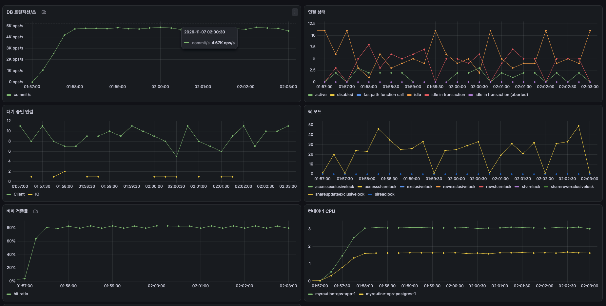
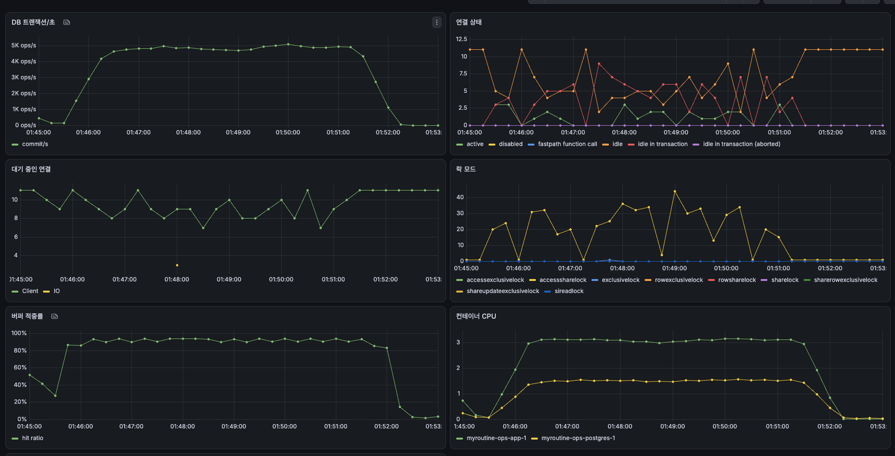

# S2-2 커서 조건 리포트

## 무엇을 했나

[Baseline](s2-1a-baseline.md)에서 상품 목록의 다음 페이지가 뒤로 갈수록 느려졌다. 커서 조건을 `created_at < :c or (created_at = :c and id < :id)`처럼 OR로 써서, Postgres가 인덱스에서 커서 위치로 바로 가지 못하고 앞의 행을 모두 읽고 버렸기 때문이다.

이 조건을 `(created_at, id) < (:c, :id)`로 바꿨다. 두 값을 앞 값부터 차례로 비교하는 것이라 결과는 같다. 상품 목록 두 개와 같은 OR 형태였던 나머지 목록 14개까지 모두 16개 쿼리를 바꿨다(PR #83). 그리고 Baseline과 같은 VM, 같은 데이터에서 같은 위치의 실행 계획과 상품 조회 부하를 다시 쟀다.

## 측정 조건

Baseline과 같다. VM 1대(vCPU 8, RAM 16GB)에 앱 1개와 모든 서비스가 함께 떠 있고, DB 커넥션 풀은 10개다. 데이터는 시드 스냅샷 `seed_vacuumed`이다. 지난 측정 뒤 이 스냅샷으로 되돌린 다음 데이터를 바꾸는 측정을 하지 않아 되돌리지 않고 쟀다. 같은 데이터인지는 OR 형태의 실행 계획이 Baseline과 똑같이 `Rows Removed by Filter: 6001`인 것으로 확인했다.

측정한 코드는 `dd3be5d`다(develop 머지 뒤 자동 배포). 부하는 Baseline과 같은 S-01이다. 목록 30%, 상세 70%, 대기 없는 가상 사용자 300명이 6분 동안 요청한다. 가상 사용자마다 목록을 최대 10페이지까지 넘기는 측정과, 상한 없이 계속 넘기는 측정을 했다.

## 결과

| 측정 | Baseline | 이번 |
|---|---|---|
| 같은 위치(FOOD 6,001번째)의 다음 페이지 쿼리 | 6,001행을 읽고 버림, 블록 6,123개, 6.3ms | 버린 행 없음, 블록 108개, 0.067ms |
| 상한 없음: 처리량 | 초당 1,637건, 측정 중 2,600 → 1,000으로 감소 | 초당 4,678건, 측정 내내 일정 |
| 상한 없음: 응답 p50 / p95 / p99 | 135ms / 427ms / 574ms | 37ms / 167ms / 229ms |
| 상한 없음: 다음 페이지 쿼리 평균 | 14.14ms (DB 시간의 97.5%) | 0.28ms (59.8%) |
| 상한 10: 처리량 | 초당 5,019건 | 초당 4,753건 |
| 상한 10: 응답 p50 / p95 / p99 | 50ms / 124ms / 166ms | 33ms / 172ms / 237ms |
| 상한 10: 다음 페이지 쿼리 평균 | 0.31ms | 0.11ms |

모든 측정에서 실패는 0건이다. 위 표의 Baseline 실행 계획 값은 캐시가 데워진 상태에서 다시 뜬 OR 형태다(Baseline 리포트의 18.9ms는 디스크 읽기 1,959블록이 섞인 값).

### 실행 계획

같은 커서 위치에서 두 형태를 나란히 떴다.

| 항목 | OR | 행 값 비교 |
|---|---|---|
| 인덱스로 바로 찾아간 조건(`Index Cond`) | `status`, `category` | `status`, `category`, `ROW(created_at, id) < ROW(...)` |
| 읽은 뒤 버린 행(`Rows Removed by Filter`) | 6,001 | 없음 |
| 상품 인덱스 스캔이 읽은 블록 | 6,039 | 24 |
| 실행 시간 | 6.3ms | 0.067ms |

캐시가 빈 첫 실행에서는 OR 형태가 디스크에서 5,335블록을 읽어 765ms가 걸렸다.

### 상한 없음

| Grafana | Baseline | 이번 |
|---|---|---|
| DB 트랜잭션/초 | 약 2,600에서 1,000까지 계속 감소 | 약 4,700으로 일정 |
| postgres CPU | 3.9코어에서 5.5코어로 계속 증가 | 약 1.6코어로 일정 |
| 앱 CPU | | 약 3.0코어 |

| DB 쿼리 | 실행 횟수 | 한 번 평균 | DB 시간 중 비중 |
|---|---|---|---|
| 목록 다음 페이지 | 504,775 | 0.28ms | 59.8% |
| 상세: 상품 + 이미지 | 1,179,161 | 0.04ms | 20.6% |
| 상세: 재고 | 1,179,161 | 0.02ms | 12.0% |

### 상한 10

| DB 쿼리 | 실행 횟수 | 한 번 평균 | DB 시간 중 비중 |
|---|---|---|---|
| 목록 다음 페이지 | 461,832 | 0.11ms | 35.4% |
| 상세: 상품 + 이미지 | 1,198,106 | 0.04ms | 31.3% |
| 상세: 재고 | 1,198,106 | 0.02ms | 17.6% |
| 목록 첫 페이지 | 51,460 | 0.11ms | 3.8% |

| Grafana | 값 |
|---|---|
| DB 트랜잭션/초 | 약 4,800~5,000 |
| CPU | 앱 약 3.1코어, postgres 약 1.5코어 |

## 발견

### 다음 페이지가 몇 번째든 같은 속도가 됐다

같은 위치의 다음 페이지 쿼리가 6,001행을 읽고 버리던 것에서 21행만 읽게 됐다. 커서 조건이 인덱스 조건(`Index Cond`)에 들어가, Postgres가 인덱스에서 커서 위치를 바로 찾아 거기서부터 읽는다. 읽은 블록은 6,123개에서 108개로, 실행 시간은 6.3ms에서 0.067ms로 줄었다.

부하에서도 같은 결과가 나왔다. 상한 없이 목록을 넘긴 측정에서 Baseline은 시간이 갈수록 처리량이 떨어졌다(초당 2,600건 → 1,000건). 이번에는 6분 동안 초당 약 4,700건으로 일정했고, 전체 처리량은 초당 1,637건에서 4,678건으로 2.9배가 됐다. 다음 페이지 쿼리 한 번은 14.14ms에서 0.28ms가 됐고, postgres CPU는 5.5코어까지 오르던 것이 1.6코어로 일정했다.

상한 없음 측정(초당 4,678건, p95 167ms)과 상한 10 측정(초당 4,753건, p95 172ms)이 이제 거의 같다. 목록을 얼마나 깊이 넘기는지가 성능에 영향을 주지 않는다는 뜻이고, 커서 방식에 기대한 동작이다. 상한 없음에서 다음 페이지 쿼리가 0.28ms로 상한 10(0.11ms)보다 조금 느린 것은, 깊은 페이지들이 인덱스 곳곳에 흩어져 캐시에 덜 있기 때문이다(버퍼 적중률 약 80% 대 약 90%).

다음 단계: 없음. 이 문제는 끝났다.

### 상한 10 측정은 DB 시간이 줄었지만 처리량은 그대로다

상한 10 측정에서 다음 페이지 쿼리는 0.31ms에서 0.11ms로 줄었다. 요청 하나가 DB에서 쓴 시간도 약 0.16ms에서 0.08ms로 절반이 됐다(쿼리 총 시간 ÷ 요청 수). 그런데 처리량은 초당 5,019건에서 4,753건으로 오히려 조금 줄었고, p95는 124ms에서 172ms로 늘었다. p50은 50ms에서 33ms로 줄었다.

처리량이 늘지 않은 것은 예상한 결과다. Baseline에서 이 측정의 한계는 DB가 아니라 커넥션 10개였다. 요청 하나가 커넥션을 약 2ms 쥐는데 그중 DB가 일한 시간은 0.16ms뿐이었다. 이번에도 커넥션 10개를 요청 하나가 약 2.1ms씩 쥐었고(10개 ÷ 초당 4,753건), DB는 그중 0.08ms만 일했다. DB 시간을 줄여도 커넥션을 쥐는 나머지 시간이 그대로라 처리량은 같다.

p95가 늘어난 원인은 이 측정만으로는 가릴 수 없다. 측정을 한 번씩만 했고, 상세 조회처럼 이번 변경과 무관한 쿼리도 평균 시간이 바뀌어서(0.07ms → 0.04ms) 두 측정 사이에 VM 상태가 달랐다. 커서 변경이 DB 쪽에서 한 일은 모든 쿼리의 시간을 줄인 것뿐이다.

다음 단계: S2-3에서 커넥션 풀 크기를 바꿔 가며 잰다. 같은 조건에서 여러 번 재어 실행마다의 차이부터 본다.

### 모니터링 쿼리는 그대로다

Baseline과 같이 앱의 지표 수집이 30초마다 결제 900만 건을 읽어 한 번에 약 0.35초가 걸렸다(`count`·`min` 각각). 이번 변경과 무관하다.

## 측정하면서 바로잡은 것

- 측정 절차의 VM 명령을 `runner` 사용자로 실행하고 결과를 `/tmp/s2-2/`에 남기도록 고쳤다. 처음 절차대로 `runner`의 홈에 남긴 파일은, scp로 접속하는 `vmadmin`이 읽지 못했다.
- k6를 돌리는 터미널에서 `ulimit -n 10000`을 먼저 실행한다고 절차에 적었다. Baseline에서도 했지만 문서에 빠져 있었다.
- 스냅샷으로 되돌리지 않았다. 지난 되돌림 뒤 데이터를 쓰는 측정이 없었고, OR 형태의 실행 계획으로 같은 데이터임을 확인했다.

## 다음에 할 일

S2-2는 끝났다. 다음은 S2-3 커넥션 풀과 예약 작업 스레드다. 이번 상한 10 측정에서도 커넥션 10개가 처리량의 한계였다.
