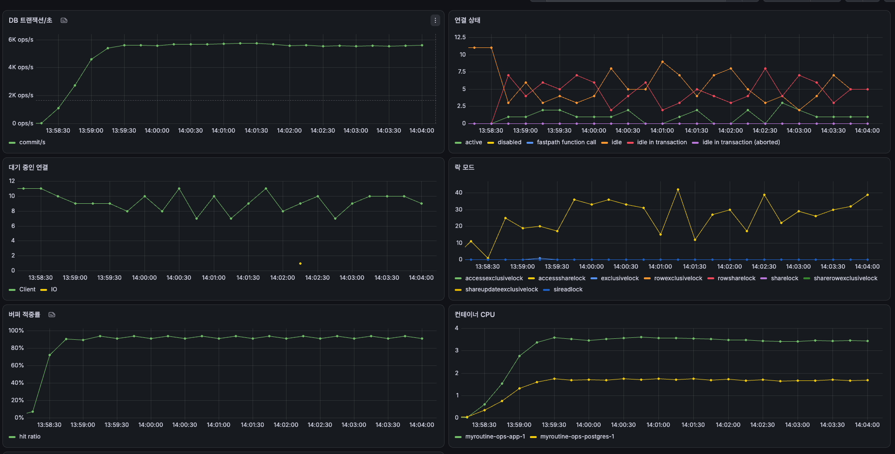
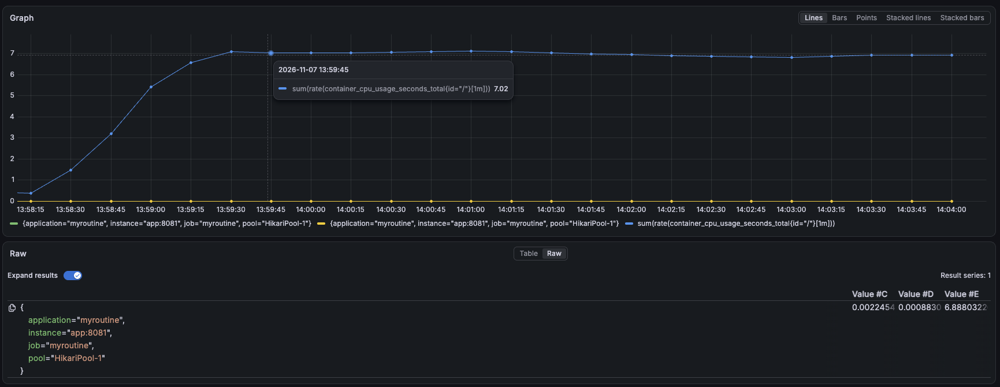
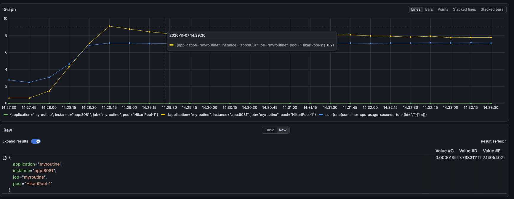
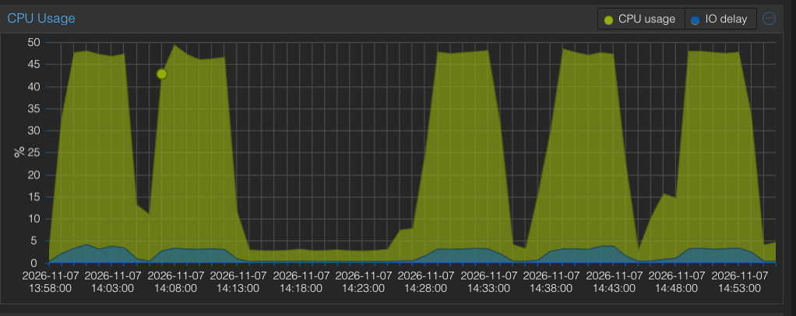
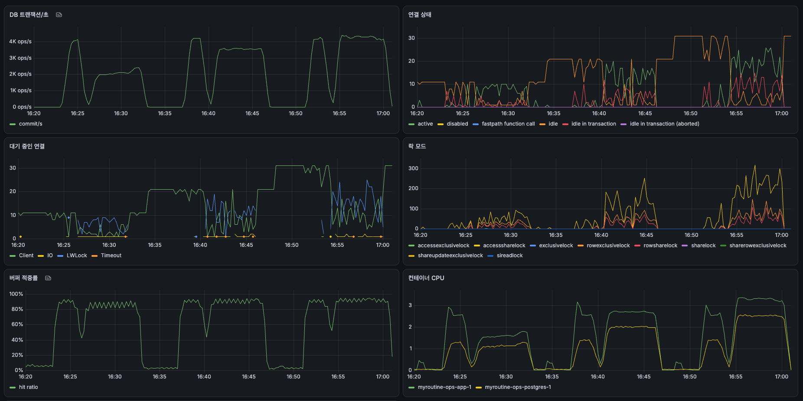
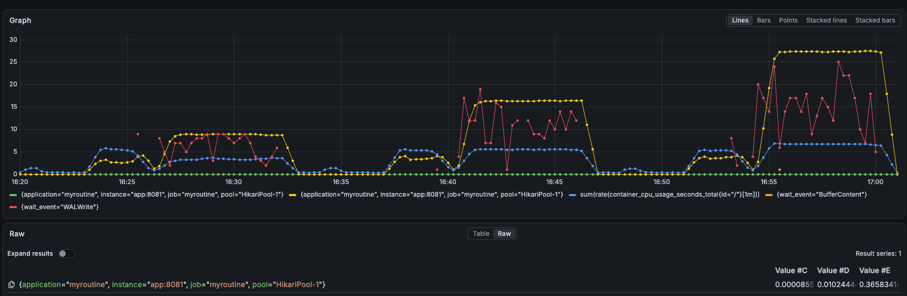

# S2-3 커넥션 풀과 예약 작업 스레드 리포트

## 무엇을 했나

[Baseline](s2-1a-baseline.md)에서 두 가지가 문제로 보였다. 상품 조회와 체크아웃 모두 DB 커넥션 10개가 가득 차 있었고, 예약 작업이 스레드 하나로 차례로 돌아 메일 작업(한 번 약 5분)이 도는 동안 결제 대기 주문 만료가 4~5분에 한 번만 돌았다.

예약 작업 스레드를 작업 수인 11개로 늘렸다(PR #85). 그리고 같은 VM, 같은 데이터에서 커넥션 풀 크기를 10·20·30·50으로 바꿔 가며 상품 조회와 체크아웃을 쟀고, 메일이 쌓인 상태에서 만료가 몇 분마다 도는지를 스레드 1과 11로 비교했다.

측정 중에는 메일을 보내지 않고 로그만 남기되, 한 통에 3초를 기다리는 가짜 발송기를 썼다. Baseline에서 Gmail 발송이 한 통에 약 3초였다. 그냥 끄면 메일 작업이 0초에 끝나 스레드 하나일 때의 막힘이 재현되지 않는다.

## 측정 조건

VM 1대(vCPU 8, RAM 16GB)에 앱 1개와 모든 서비스가 함께 떠 있다. 호스트 CPU는 Ryzen 7 PRO 6850H(물리 코어 8개, 스레드 16개)이고, VM에 물리 코어 수만큼 vCPU를 주었다. 데이터는 시드 스냅샷 `seed_vacuumed`다. 측정한 코드는 `4f4dc9c`다.

풀 크기와 예약 작업 스레드 수는 VM의 `.env`에 환경변수로 덮어써서 바꾸고 앱만 다시 띄웠다. 상품 조회(S-01)는 Baseline과 같은 부하다(대기 없는 가상 사용자 300명, 목록 30%·상세 70%, 목록은 10페이지까지, 6분). 체크아웃(S-02)은 가상 사용자 100명이 서로 다른 상품을 6분 동안 주문한다.

커넥션 지표는 1분 평균으로 봤다. Hikari의 `pending`·`active`는 15초마다 찍는 순간값이라 0과 100 넘는 값 사이를 오가서 크기를 비교할 수 없었다.

| 지표 | 쿼리 |
|---|---|
| 커넥션을 받기까지 기다린 평균 | `rate(hikaricp_connections_acquire_seconds_sum[1m]) / rate(hikaricp_connections_acquire_seconds_count[1m])` |
| 사용 중이던 커넥션의 평균 개수 | `rate(hikaricp_connections_usage_seconds_sum[1m])` |
| VM 전체 CPU | `sum(rate(container_cpu_usage_seconds_total{id="/"}[1m]))` |

## 결과

| 측정 | 풀 10 | 풀 30 |
|---|---|---|
| 상품 조회 처리량 | 초당 4,899~5,563건(세 번) | 초당 5,654건 |
| 상품 조회 p95 | 168.7~172.0ms | 201.9ms |
| 체크아웃 처리량 | 초당 666건 | 초당 1,366건 |
| 체크아웃 p95 | 287ms | 135ms |

| 예약 작업 스레드 | 결제 대기 주문이 18분 동안 준 건수 | 만료 작업 간격 |
|---|---|---|
| 1 | 400건 | 약 5분 10초 |
| 11 | 1,700건 | 약 60초 |

모든 측정에서 실패는 0건이다. 최종 풀 크기는 31로 정했다(발견 3).

### 상품 조회

| 풀 | 처리량(초당) | p50 | p95 | p99 | 커넥션 대기 평균 | 사용 중 커넥션 | VM CPU |
|---|---|---|---|---|---|---|---|
| 10 (1회) | 4,899 | 31.6ms | 168.7ms | 235.4ms | | | |
| 10 (2회) | 5,469 | 21.7ms | 172.0ms | 216.0ms | 2.2ms | 4.9개 | 약 7.0코어 |
| 10 (3회) | 5,563 | 22.1ms | 169.2ms | 214.6ms | | | |
| 20 | 5,665 | 20.4ms | 199.3ms | 251.1ms | 0.019ms | 7.7개 | 약 7.1코어 |
| 30 | 5,654 | 20.3ms | 201.9ms | 254.9ms | 0.001ms | 8.5개 | 약 6.9코어 |
| 50 | 5,671 | 20.0ms | 202.6ms | 252.4ms | 약 0 | 약 8.4개 | 약 7.1코어 |

커넥션 지표는 측정 끝 무렵 1분 평균이고, VM CPU는 그래프의 평평한 구간에서 읽었다. 풀 10의 Grafana 값은 세 번 중 처리량이 가운데인 2회 측정이다.

풀 10에서 VM 전체 CPU(파랑)는 측정 내내 약 7코어였다.

풀 20에서 사용 중 커넥션(노랑)은 약 8개로 늘었고 VM CPU(파랑)는 그대로였다.

측정 중 Proxmox 호스트 CPU는 약 48%였다. 호스트의 100%는 스레드 16개 기준이라, 48%는 스레드 약 7.7개, 곧 물리 코어 8개를 모두 쓴 상태다.

### 체크아웃

스냅샷을 되돌린 뒤 결제 TTL을 60분으로 늘려, 세 측정이 끝날 때까지 주문이 만료되지 않게 하고 연달아 쟀다. 값은 램프업 뒤 4분 동안의 평균이다.

| 풀 | 처리량(초당) | p50 | p95 | p99 | 커넥션 대기 평균 | 사용 중 커넥션 | VM CPU | 초당 커밋 | `WALWrite` 대기 |
|---|---|---|---|---|---|---|---|---|---|
| 10 | 666 | 118ms | 287ms | 391ms | 35ms | 8.9개 | 3.5코어 | 2,155 | 7.3개 |
| 20 | 1,126 | 68ms | 169ms | 225ms | 16.5ms | 16.4개 | 5.5코어 | 3,485 | 11.6개 |
| 30 | 1,366 | 58ms | 135ms | 187ms | 13.8ms | 27.3개 | 6.7코어 | 4,148 | 17.6개 |

되돌리기 전에 같은 풀 10으로 잰 체크아웃은 초당 648건, p95 304ms였다(Baseline은 658건, 299ms).

세 칸(16:26, 16:40, 16:54 시작)마다 DB 트랜잭션/초가 계단처럼 오르고, 대기 중인 연결에 `LWLock`(파랑)이 늘었다. 각 칸 앞의 짧은 봉우리는 데우기다.

같은 구간의 `WALWrite` 대기(빨강), 사용 중 커넥션(노랑), VM CPU(파랑):

### 예약 작업 스레드

체크아웃이 남긴 결제 대기 주문 약 24만 건이 15분 뒤부터 만료되기 시작한 때부터, 스레드 1과 11에서 각각 18분 동안 3분마다 결제 대기 주문 수를 셌다.

| 스레드 | 시각 | 결제 대기 주문 | 줄어든 건수 |
|---|---|---|---|
| 1 | 15:17 → 15:35 | 238,173 → 237,773 | 400 |
| 11 | 15:35 → 15:53 | 237,673 → 235,973 | 1,700 |

| 작업 실행 로그 | 스레드 1 | 스레드 11 |
|---|---|---|
| 만료(100건) 한 번 | 0.6~1.0초 | 0.4~1.5초 |
| 메일(100통) 한 번 | 300.7~300.8초 | 300.7~300.8초 |
| 만료 실행 간격 | 약 5분 10초 | 약 60초 |
| 만료를 돌린 스레드 | 모두 `scheduling-1`(메일과 같음) | `scheduling-1`~`10`에 흩어짐 |

메일은 모두 가짜 발송기로 갔다. 3분마다 센 `notification sent`와 `send mail to` 로그 수가 매번 같았다(예: 57건과 57건).

스레드 11에서 메일 작업이 도는 동안 advisory lock을 쥔 커넥션 하나가 `idle` 상태로 최대 4분 37초 동안 남아 있었다.

## 발견

### 상품 조회의 한계는 커넥션이 아니라 VM의 CPU였다

Baseline은 "커넥션 10개가 한계"라고 봤다. 커넥션 10개를 초당 5,019건으로 나눠 요청 하나가 커넥션을 약 2ms 쥔다고 계산했는데, 이 계산은 10개가 항상 다 쓰인다고 가정한 것이었다. 이번에 직접 재 보니 풀 10에서 사용 중인 커넥션은 평균 4.9개였고, 커넥션을 받으려고 기다린 시간은 평균 2.2ms로 응답 평균(약 50ms)의 일부였다. 그동안 VM 전체 CPU는 vCPU 8개 중 약 7개를 쓰고 있었다.

풀을 20·30·50으로 늘리자 커넥션 대기는 거의 0이 됐지만 처리량은 초당 약 5,660건으로 풀 10의 세 번(4,899~5,563건) 범위를 거의 넘지 않았고, VM CPU도 약 7코어 그대로였다. 대신 p95가 약 170ms에서 약 200ms로 늘었다. 풀 10이 동시에 일하는 요청 수를 묶어 두던 것이 풀리면서, 기다림이 커넥션 앞에서 CPU 차례로 옮겨 갔다. 사용 중 커넥션이 4.9개에서 8.5개로 늘었는데 처리량이 같은 것도, 요청이 커넥션을 쥔 채 CPU를 기다리는 시간이 길어졌다는 뜻이다.

VM에는 호스트의 물리 코어 8개를 이미 모두 주었다(측정 중 호스트 CPU 약 48% = 스레드 16개 중 약 7.7개). vCPU를 더 주면 같은 코어의 하이퍼스레드를 나눠 쓰게 되어 늘어나는 폭이 작고, 풀 효과와 가리기 어려워 재지 않았다.

다음 단계: 없음. 상품 조회 처리량을 늘리려면 CPU가 더 필요하다.

### 체크아웃의 한계는 커밋 기록을 디스크에 쓰는 차례였고, 풀을 늘리면 두 배가 됐다

체크아웃은 상품 조회와 반대였다. 풀 10에서 커넥션 10개 중 평균 8.9개가 쓰였고 대기는 평균 35ms였는데, VM CPU는 3.5코어로 절반도 쓰지 않았다. 커넥션은 DB 안에서 `active` 상태로 `LWLock`의 `WALWrite`를 기다리고 있었다. Postgres는 커밋할 때 변경 기록(WAL)을 디스크에 써야 커밋 완료를 돌려주는데, 그 쓰기를 한 번에 한 커넥션만 하고 나머지는 차례를 기다린다.

풀을 20, 30으로 늘리자 처리량이 초당 666건에서 1,126건, 1,366건으로 늘었고(2.05배) p95는 287ms에서 135ms로 줄었다. 초당 커밋도 2,155에서 4,148로 늘었다(체크아웃 한 건에 커밋 약 3번). 디스크 쓰기를 기다리는 커넥션(`WALWrite`)은 7개에서 18개로 늘었다.

디스크가 빨라지지 않았는데 커밋이 두 배가 된 것은, Postgres가 디스크에 한 번 쓸 때 그때까지 기다리던 커밋을 함께 써 주기(group commit) 때문으로 보인다. 풀 10에서는 동시에 커밋을 기다릴 수 있는 커넥션이 10개뿐이라 한 번에 함께 쓰이는 커밋이 적었고, 풀을 늘리자 함께 쓰이는 커밋이 늘었다. 디스크 쓰기 횟수(`pg_stat_wal`의 `wal_sync`)는 재지 않아 직접 확인하지는 못했다.

풀 30에서도 30개 중 27개를 쓰고 대기가 14ms 남아 있어 끝에 닿지는 않았다. 다만 VM CPU가 6.7코어로 상품 조회의 한계(약 7코어)에 가까워 더 늘리지 않았다.

커밋할 때 디스크를 기다리지 않게 하는 설정(`synchronous_commit = off`)도 있지만, 서버가 갑자기 꺼지면 이미 성공을 돌려준 주문이 사라질 수 있어 쓰지 않았다.

다음 단계: 풀 크기를 31로 정한다(아래).

### 풀 크기는 31로 정했다

풀 30에 메일 작업이 쥐는 커넥션 1개를 더했다.

| 풀 | 상품 조회 p95 | 체크아웃 처리량 / p95 |
|---|---|---|
| 10 | 168.7~172.0ms | 초당 666건 / 287ms |
| 20 | 199.3ms | 초당 1,126건 / 169ms |
| 30 | 201.9ms | 초당 1,366건 / 135ms |

상품 조회는 풀 크기와 상관없이 CPU가 한계라 처리량이 같고, 풀을 30으로 줘도 커넥션을 평균 8.5개만 쓴다. 체크아웃은 풀이 처리량을 정한다. 서비스에서 조회가 주문보다 훨씬 많더라도 조회는 커넥션을 더 쓰지 않으므로, 체크아웃 처리량이 두 배가 되는 30을 골랐다. 대가는 포화 부하에서 상품 조회 p95가 약 170ms에서 약 200ms로 느는 것이다. 요구사항 기준(200ms)에 걸치는 값이고 한 번씩만 쟀다.

메일 몫 1은 예약 작업의 락 방식 때문이다. 예약 작업은 Postgres advisory lock으로 앱이 여러 개여도 한 곳에서만 돌게 하는데, 이 잠금은 잡은 커넥션에 묶여 작업이 끝날 때까지 커넥션 하나를 쥔다. 메일 작업은 한 번에 5분을 돌므로 그동안 풀에서 커넥션 하나가 빠진다. 체크아웃이 풀을 거의 다 쓰므로 이 몫을 따로 둔다. 다른 작업은 1초 안에 끝나 잠깐만 쥔다.

### 예약 작업 스레드를 늘리자 메일이 쌓여도 만료가 1분마다 돌았다

스레드 1에서는 만료와 메일이 같은 스레드에서 번갈아 돌았다. 만료 한 번(0.6초) 뒤 메일 한 번(300초)이 이어져, 만료가 1분이 아니라 약 5분 10초에 한 번 돌았고 18분 동안 결제 대기 주문이 400건만 줄었다. Baseline의 "4~5분에 100건"이 그대로 재현됐다.

스레드 11에서는 메일 작업이 다른 스레드에서 5분씩 도는 동안 만료가 약 60초마다 돌았고, 같은 18분 동안 1,700건이 줄었다(4.25배). 만료 작업도 매번 다른 `scheduling-N` 스레드에서 돌았다.

다음 단계: 없음.

### 메일은 만들어지는 속도를 따라가지 못한다

만료가 1분에 100건씩 알림을 만드는데, 메일은 한 통에 3초라 5분에 100통만 보낸다. 스레드를 늘려 만료는 제때 돌지만 보낼 메일은 계속 쌓인다.

다음 단계: 이번에는 고치지 않는다. 메일을 묶어 보내거나 동시에 보내는 것은 Stage 2 범위 밖이다.

### 실행마다의 흔들림과 S2-2의 p95

풀 10에서 상품 조회를 세 번 재자 처리량은 초당 4,899~5,563건(약 13%)으로 흔들렸고 p95는 168.7~172.0ms로 거의 같았다. 1회 측정은 처리량이 측정 내내 다른 두 번보다 낮게 평평했다(DB 트랜잭션/초 약 5,000 대 5,600). 데우기가 덜 된 것이었다면 측정 초반에 처리량이 오르는 모양이었어야 해서 그 탓은 아니고, 원인은 찾지 못했다.

S2-2에서 상한 10 측정의 p95가 Baseline 124ms에서 172ms로 늘었는데, 이번 세 번의 p95가 모두 약 170ms라 실행마다의 흔들림으로는 설명되지 않는다. 지금 코드의 풀 10 상태에서는 약 170ms가 보통이다. Baseline과 무엇이 달라 124ms가 나왔는지는 이번 측정으로 가리지 못했다.

## 측정하면서 바로잡은 것

- 커넥션 비교에 Hikari의 `pending`·`active` 대신 1분 평균(기다린 시간, 사용 중 개수)을 썼다. 순간값은 15초마다 0과 160 사이를 오갔다. Baseline의 "커넥션을 기다리는 요청 약 185개"도 이런 순간값 하나였을 가능성이 크다.
- 체크아웃은 처음 계획에서 풀 10과 고른 크기로 두 번만 재기로 했다. 풀 10 측정에서 체크아웃만 커넥션이 한계로 나와, 스냅샷을 한 번 되돌린 뒤 결제 TTL을 60분으로 늘리고 풀 10·20·30을 연달아 재도록 바꿨다.
- 스냅샷을 되돌리면 VM 디스크의 Prometheus 데이터도 되돌아간다. 상품 조회와 예약 작업 측정 구간의 Grafana 데이터는 되돌린 뒤 남지 않아, 이 리포트의 해당 화면은 측정 중에 남긴 것만 썼다.

## 다음에 할 일

S2-3은 풀 크기 31을 `application.yaml`에 넣으면 끝난다. 다음은 S2-5 재고 차감 방식 비교다. 시작할 때 VM을 `seed_vacuumed`로 되돌린다.
